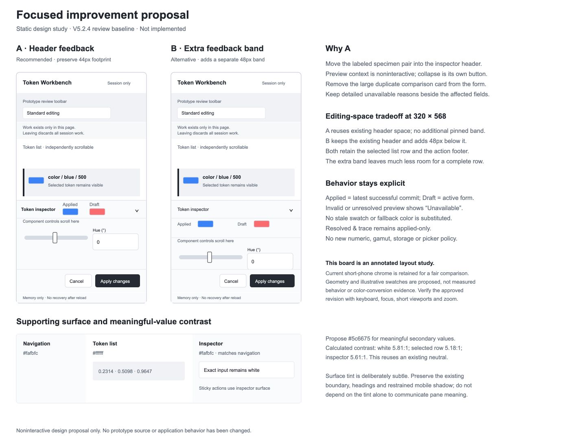

# Increment 003 — Focused design improvement proposal

**Approved for isolated prototyping · 7 November 2026 · Option A selected.**

This follows the [V5.2.4 designer review](003-prototype-design-review.md) and the user's additional request to distinguish the inspector surface from the token list. Existing review captures are the evidence baseline; this is not a new audit. The current visual direction, authored-value model, numeric policies, independent drafts and session-only boundary remain constraints. The proposal itself changed no prototype code, build, dependency or canonical document. The user subsequently approved the complete F1–F7 bundle with option A and authorized the designer to prepare V6 in the isolated prototype. The resulting artifact must return to the user before analyst review; this is not final design/contract agreement or application implementation authorization.

## Recommendation and reviewable visual

Keep the workbench's structure and make one cohesive correction pass: strengthen meaningful text, retain compact color feedback during editing, clarify exceptional states and current navigation, normalize modal dimming, and give the inspector the existing navigation-surface neutral.

For the main layout choice, I recommend **A: compact feedback in the existing inspector-header footprint**. It solves the feedback problem without adding another pinned strip to the short-phone editor.

[Open the static board](../../output/design-proposals/003-improvement-pass/index.html) · [SVG file](../../output/design-proposals/003-improvement-pass/layout-and-surface-board.svg).

The board is a noninteractive layout study, not a working prototype or screenshot of implemented changes. It retains current short-phone chrome to compare space fairly. Illustrative swatches are not conversion evidence. Final geometry and browser behavior must be checked in the approved artifact.

## F2 — Persistent color feedback: two bounded options

### A. Compact inspector-header feedback — recommended

Replace the large comparison card in the scrolling form with one compact, labeled **Applied / Draft** specimen pair in the existing **44px inspector header**, beside its title. This removes duplicate large preview space and keeps feedback visible while component controls scroll. Retain detailed applied values and explanations in their existing inspection areas.

The header becomes a **noninteractive context group plus a separate 44px collapse/reopen button**. Chips are not controls. The entire header would no longer be the collapse button: this is a deliberate interaction refinement for approval, not permission to nest controls in the old button. Its accessible name, expanded state and controlled-region relationship remain explicit.

At 320×568, reusing the existing header is materially more useful than pinning another card above the controls. Keep the selected token's list context, component/input proportions and bottom actions. The header, scroll content and sticky action region use the proposed inspector surface. Modal layers remain above all three. Ordinary state changes must not move focus, reset scroll or obscure focused fields.

| Situation | Feedback behavior |
| --- | --- |
| Active literal form | Applied shows the latest successful commit; Draft shows the current literal candidate. Viewing another space alone preserves the exact draft and its authorship. |
| Active Reference form | Draft follows the selected reference target's eligible preview; the independent literal draft remains retained, not flattened or displayed as the active reference candidate. |
| Incomplete/invalid entry, unsupported preview or unresolved reference | Show a labeled **Unavailable** state in place of that specimen; never reuse a stale swatch or invent a fallback. Detailed reason stays beside the relevant field/error. |
| Apply / rejection / Cancel | Existing operation semantics govern both specimens: only success changes Applied; rejection retains Applied and both drafts; Cancel restores the baseline. |
| Resolved & trace tab | Header shows applied-only context, not a competing Draft specimen. The tab's current Applied value meaning remains intact. |
| Inspector collapsed | Compact context and reopen control remain in the same 44px footprint; drafts and reading position survive. |

Use the existing 11px meaningfully labeled-control scale as the starting point for compact Applied/Draft labels, rather than introducing smaller labels; verify actual fit and unavailable text at 320px. Keep labels independent of color. Do not announce every slider tick as a separate live-region message; retain meaningful success/error feedback and verify accessible reading order. Test unavailable labels at the narrowest width, with the full reason available in the form. The static board illustrates the ordinary successful-preview state, not every label combination.

### B. Separate compact feedback band — alternative

Keep the present header/collapse interaction, then place one compact Applied/Draft pair in an additional sticky band above the controls. This requires less change to the header and offers roomier labels/statuses. Replace the large scrolling comparison card rather than add another duplicate.

The cost is about **48px of additional pinned height**. In the reviewed 320×568 layout, that leaves substantially less room between the inspector header and bottom actions. It means more scrolling and less complete control context while retaining the visible selected list row. I would choose B only if the user values roomier preview context over compact editing; I do not recommend pinning the existing large comparison card in either option.

Neither option establishes that every virtual-keyboard viewport or zoom state fits. Those remain checks on the approved revision; do not silently shrink fields or hide selected context to make a screenshot fit.

## F1 and F7 — Readable values and a distinct inspector surface

**Meaningful secondary values:** reuse the existing neutral **`#5c6675`** for authored-coordinate summaries, rather than the faint `#8a919c`. Keep primary names/headings at their present stronger role. Do not globally darken decorative/disabled elements or introduce a new palette.

Calculated contrast of that proposed solid text color:

| Surface | Background | Contrast |
| --- | --- | --- |
| Token list / exact fields | `#ffffff` | 5.81:1 |
| Selected token row | `#f0f2f5` | 5.18:1 |
| Proposed inspector | `#fafbfc` | 5.61:1 |

These are calculations using the relative-luminance formula, not measurements of an implemented revision or a full contrast audit. The existing `#657080` muted text would give about **4.477:1** on the selected row, so merely reusing it would not resolve the reviewed sample against the **4.5:1 normal-text target** in [W3C's guidance](https://www.w3.org/WAI/WCAG22/Understanding/contrast-minimum.html).

**Inspector surface:** use **`#fafbfc`**, the current desktop left-navigation background, for the inspector on the right and at the bottom. Keep the token list and exact-entry fields white. Match the inspector heading, feedback header, content and sticky action region so they read as one supporting panel. Existing controls, cards and error treatments retain their own roles; preview colors and transparency checkerboards do not change.

My preference is this shared neutral over adding a different gray: it creates visual kinship between supporting panes and leaves chromatic emphasis to token content. The tint is intentionally subtle. Keep the existing boundary and restrained upward mobile shadow; the background difference alone must not carry pane identity or selection meaning. No global theme or color-management change is proposed.

## F3–F6 — State meaning and recovery

| Finding | Proposed treatment | Reason / boundary |
| --- | --- | --- |
| **F3 · Missing alias target** | In the Authored value column, show **Missing target** and its retained stable ID, such as `missing-primary`. Do not substitute the source token's own path or create a target link that cannot resolve. | The list must distinguish a missing dependency from a self-cycle. Preserve the authored reference; no new resolver or automatic repair. Long identifiers retain full accessible text. |
| **F4 · Active navigation** | Mark exactly one current All tokens/group button with **`aria-current="true"`**, consistently in desktop/sidebar and compact/drawer copies of the same state; omit it on others. | This marks current view context without claiming another page exists or that pressing the current item deselects it. Keep the existing native buttons and focus behavior; do not add simultaneous pressed/selected/current attributes or a new radio/tab keyboard pattern. Verify actual assistive-technology behavior later. |
| **F5 · Project read failure** | Keep Retry available and visibly make project mutation actions unavailable until a successful read: New token, New group, Rename and any applicable commit action. Explain **Project unavailable — retry reading to make changes** near the failure. | Do not invite a creation dialog while its project is unavailable. Preserve retained data/drafts and avoid an empty replacement. If a form was already open when failure occurred, retain its input with submission unavailable; do not silently discard it. The prototype can illustrate this eligibility without pretending to implement real storage failure recovery. |
| **F6 · Modal backdrop** | Give departure/create confirmations the same restrained dimming role already demonstrated by the drawer: existing neutral overlay `#20263055`, with the dialog above and background editing surfaces below. | Restore clear modal/background separation while preserving proven focus containment, Escape/Close behavior and focus return. The review did not establish a root cause; actual backdrop rendering and layering need verification, not only a CSS change. No generic modal framework is proposed. |

## Scope and proposed checks

This bundle includes **F1–F6 plus F7's inspector surface**. Fixed illustrative component gradients remain a separately known limitation. Do not add predictive ramps, a picker, gamut mapping or numerical algorithms during this pass; those require a distinct bounded proposal. Preserve the 4px selection indicators, adjacent Applied value badge, 28px trace gap, native range hit areas, compact action sizes, view-only exact restoration and accepted-different-token scroll behavior.

After user approval of the proposal, the isolated artifact should demonstrate:

- **F1/F7:** measured meaningful-value contrast on selected/unselected rows and new panel surfaces; white fields and readable states; distinct right/bottom inspector without heavier chrome.
- **F2:** visible, correctly labeled feedback while scrolling/dragging at desktop, tablet, 649px, 390px and 320×568; active-form and unavailable cases; applied-only trace; no extra hidden draft mutation, focus movement or blocked action/field.
- **F3/F4:** missing target/ID labels distinct from cycles; exactly one current navigation item in the accessibility representation, including drawer close/reopen; ordinary keyboard flow retained.
- **F5/F6:** read failure blocks mutation affordances until Retry succeeds; drafts survive; confirmation backdrop visibly dims the workspace; forward/reverse Tab boundaries, dismissal and focus return still work.
- **Regression:** selected token remains visible, list/document scrolling stays separated, collapsed state survives, other accepted interactions remain. Actual zoom and screen-reader checks are additional evidence, not replaced by viewport screenshots.

**Decision recorded — 7 November 2026:** the user approved the cohesive bundle with **option A** and explicitly requested an isolated prototype update. The designer is preparing V6. Show that actual artifact to the user before analyst review; final contract/design agreement and application implementation authorization remain separate.

## Preparation evidence

Only this proposal and static assets outside the prototype were written. Colors were read from the owning stylesheet; candidate contrast values were independently calculated with Python standard-library arithmetic. The board’s SVG/XML and links are checked. The coordinator rendered the separate static document at 1440×1100, saved and reopened its screenshot; the designer independently inspected that saved frame. Labels, surface examples and both layouts are visible. The alternative’s constrained control area illustrates its scrolling tradeoff, not proof of an implemented clipping defect. The existing interactive prototype remained unchanged. No live interaction, new audit, runtime accessibility result or production policy acceptance is claimed.

Suggested commit: `design: propose focused increment 003 usability improvements`.
