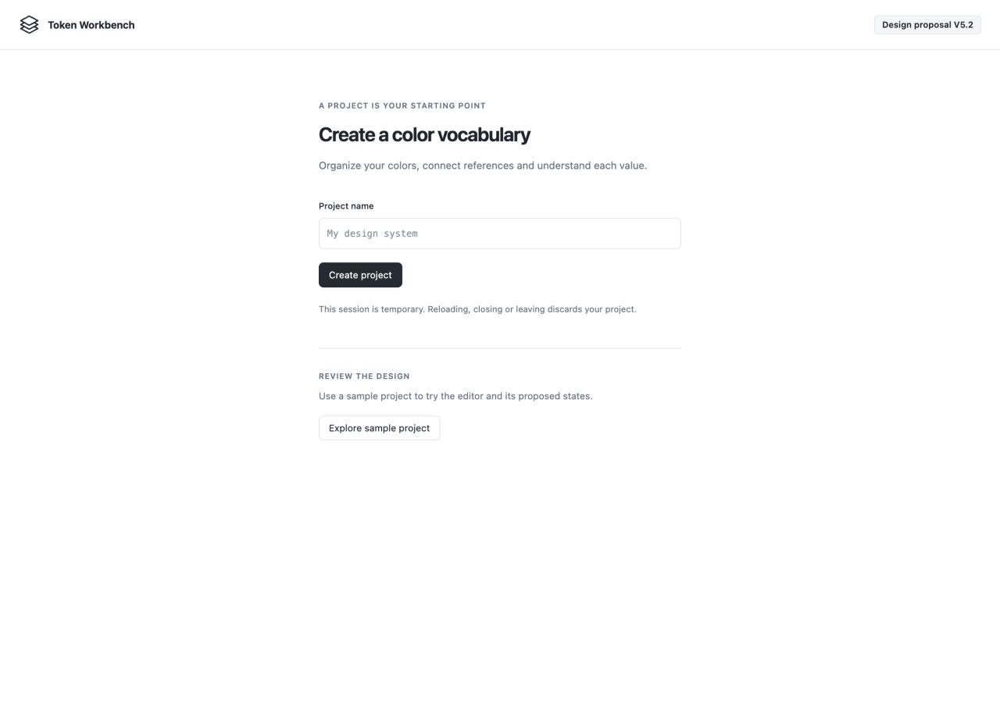
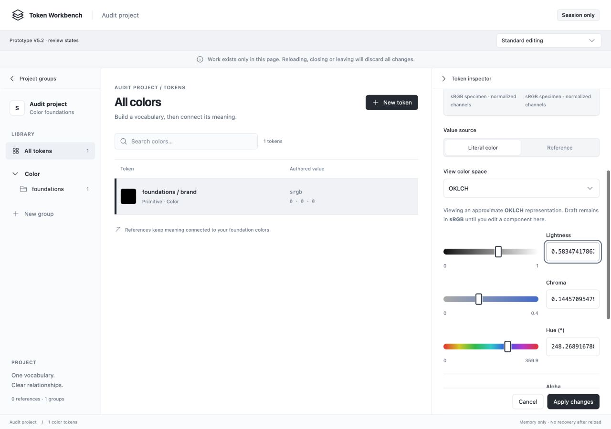
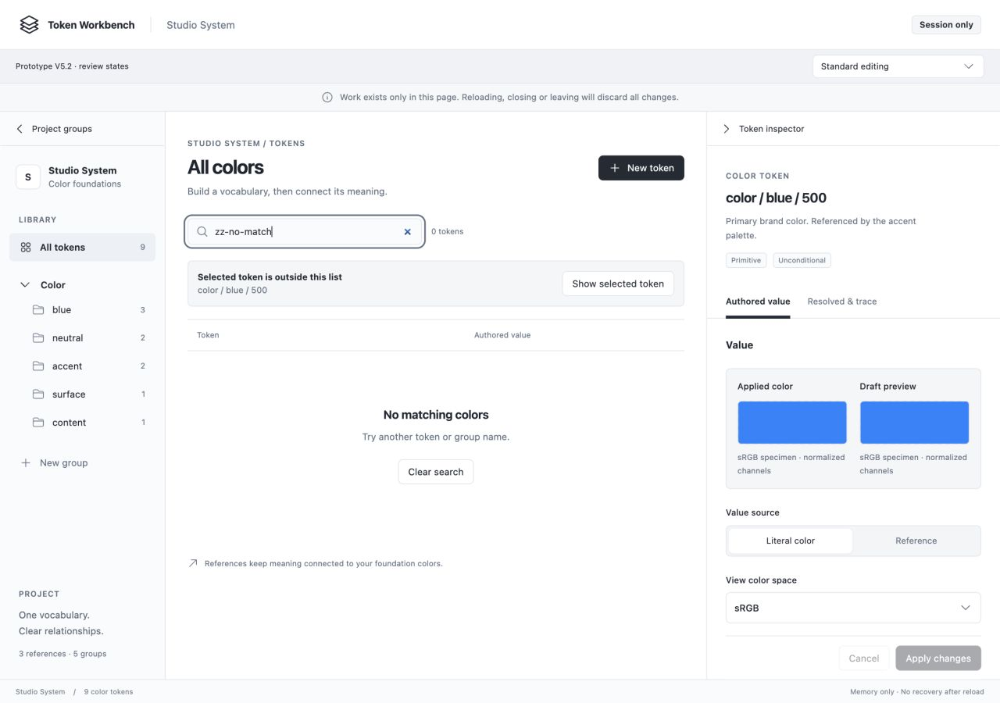
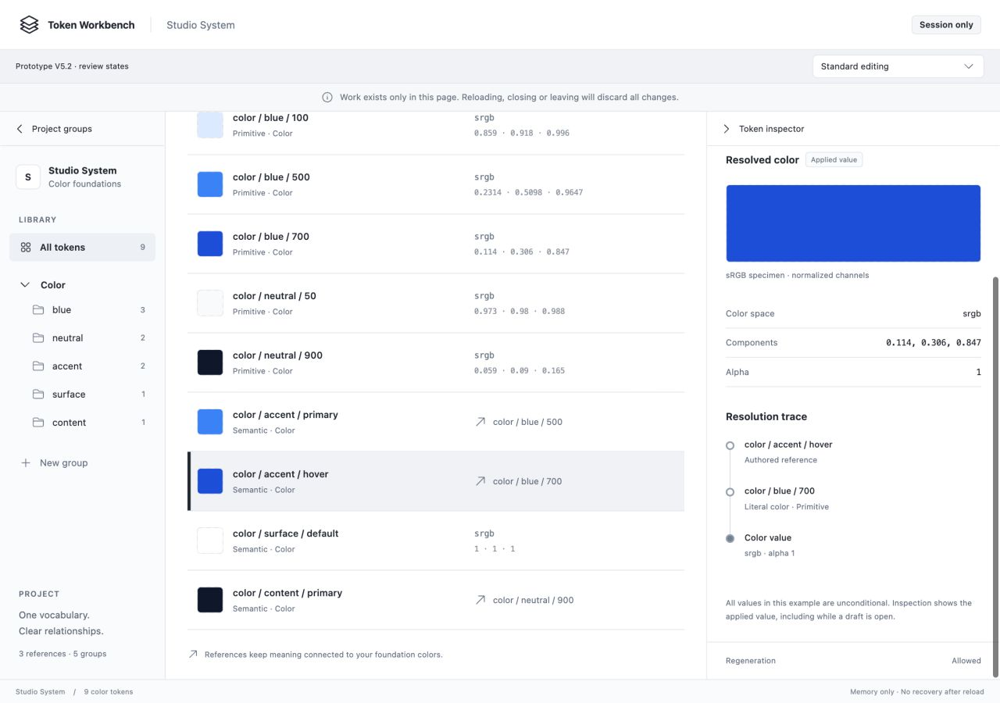
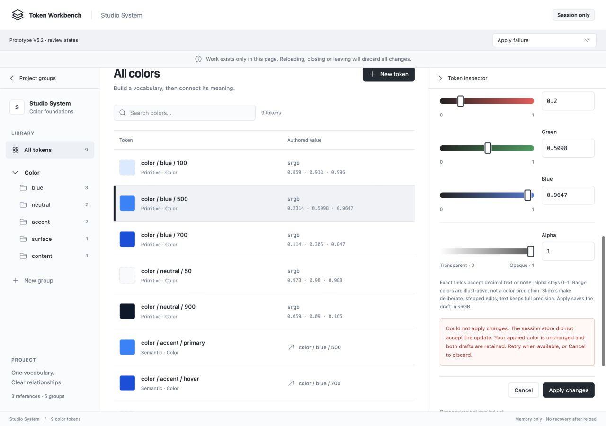
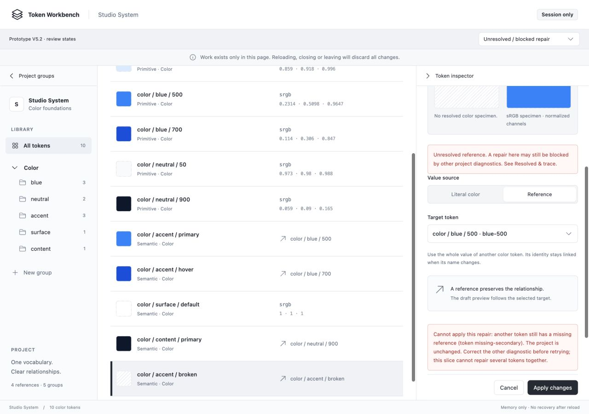
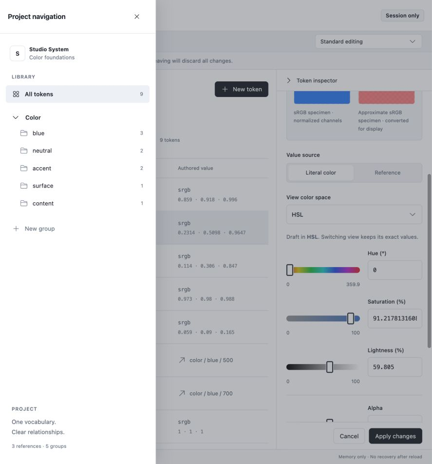
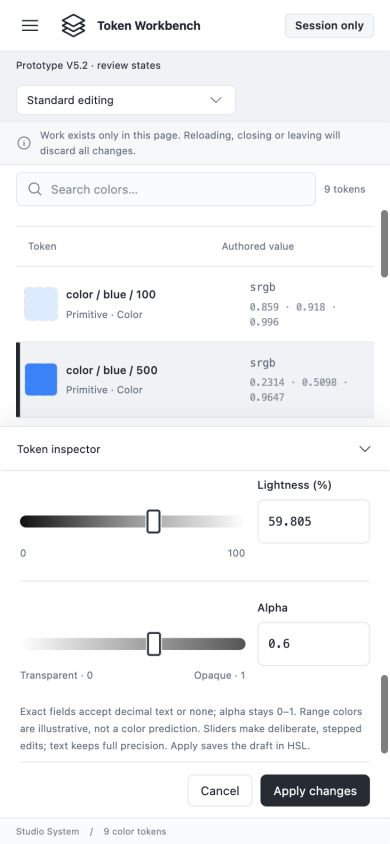

# Increment 003 — Prototype design review

**Designer self-assessment · 7 November 2026 · Review only; no fixes made.**

Baseline: **V5.2.4**, commit `b19a6736d8acd52fed3bc753d9a26f868cde0e1b`. The reviewed prototype is a coherent basis for the next design decisions. Its restrained visual system, explicit applied/draft distinction and protected editing workflow are strong. The main improvements concern accessible reading/current-state semantics, visual feedback during editing and truthful exceptional-state presentation. I do **not** recommend a broad visual redesign.

This is the designer's assessment of their own artifact, using coordinator-captured runtime evidence. It is neither an independent implementation review nor the contract analyst's assessment. It does not agree the final design, claim production acceptance or authorize implementation.

## Scope and method

The goal is to create and organize a small color vocabulary, edit literals, explore representations without accidental changes, author/inspect aliases and recover safely from draft or operation failures. Evaluation covers task usability; clarity and information architecture; aesthetics and density; consistency; accessibility; responsive context; error recovery/trust; and efficiency. The [current increment](003-visible-color-authoring.md), [UX requests](003-ux-ui-change-capture.md), [V5/V5.1/V5.2 artifacts](../../prototypes/increment-003-v1/DESIGN-V5-2.md) and accepted visual direction provide the constraints.

The Product Design audit framework was used. The coordinator ran its context preflight; no saved context existed, so repository documents are authoritative. The designer tried the in-app browser: `getTab` reported `iab` unavailable and inventory returned no browsers. The coordinator therefore operated the in-app browser and captured this run; the designer separately opened and assessed the saved images and source. Runtime observations below are attributed to the coordinator. No earlier screenshot is used as current proof.

The [coordinator observation log](../../output/playwright/design-review-2026-11-07/observations.md) records the live actions, measurements, accepted/rejected captures and end state.

Fresh screenshots are in [`output/playwright/design-review-2026-11-07/`](../../output/playwright/design-review-2026-11-07/). Viewports sampled were desktop **1280×900**, tablet **887×952**, mobile **649×952** and **390×844**, short mobile **320×568**, and short landscape **887×420**. These are viewport/reflow samples, not actual browser zoom or real-device tests.

## Assessment by criterion

| Criterion | Assessment | Reason |
| --- | --- | --- |
| Task entry and orientation | Strong within the slice | Clear project start, empty-state actions and explicit sample-project entry. |
| Authored / derived / applied clarity | Strong | Space-view explanation, explicit Apply, separate specimens and applied-only resolution view. |
| Editing usability and efficiency | Mixed | Exact entry and sliders work together; color feedback disappears above the editing viewport. |
| Aesthetics and hierarchy | Strong | Neutral chrome, controlled color, fine separators, consistent emphasis and clear modal typography. No broad styling change needed. |
| Consistency | Strong with a modal exception | Shared selection indicators and action sizing are coherent; departure confirmation lacks the drawer's clear backdrop treatment. |
| Accessibility and inclusive interaction | Mixed; incomplete coverage | Labels, native controls and sampled keyboard containment are positive. Active value text contrast and navigation current-state semantics need correction. |
| Responsive context | Strong in sampled layouts | Selected row and reachable actions survive the split; short/phone editing remains usable through independent scrolling. |
| Error recovery and trust | Mixed | Draft preservation and session-loss warnings are clear; missing-target labels and read-failure creation affordances conflict with state meaning. |

## Five priorities for the next design pass

Severity describes the observed experience: **medium** affects understanding/access/task efficiency; **low** is polish or a bounded opportunity. No critical data-loss defect was established by this design audit.

### F1 · Medium — Make active authored values readable at sufficient contrast

In the active selected row, authored coordinates are meaningful data, not disabled/decorative content. The coordinator read the current computed styles: **10px** text `#8a919c` on selected background `#f0f2f5`, giving **2.832366621:1** by the relative-luminance formula. The faint coordinates are visible in steps 3 and 8, especially [the short-landscape sample](../../output/playwright/design-review-2026-11-07/25-short-landscape-editor.jpg).

That sample is below the **4.5:1** normal-text target described by [W3C's contrast-minimum guidance](https://www.w3.org/WAI/WCAG22/Understanding/contrast-minimum.html), checked 7 November 2026. W3C recommends using the browser/CSS colors rather than antialiased screenshot pixels. This is a focused confirmed contrast finding, not a claim that every color or state was audited.

**Recommendation:** strengthen meaningful secondary values enough to meet the normal-text target against selected and unselected surfaces, retaining their typographic hierarchy. Increasing selection-bar thickness does not solve text contrast. Source: [value-summary styling](../../prototypes/increment-003-v1/src/styles.css), `.value-summary small`.

### F2 · Medium — Keep useful color feedback near component editing

At desktop/tablet and mobile widths, scrolling to the component rows moves the applied/draft specimens above the viewport. [Derived editing](../../output/playwright/design-review-2026-11-07/05-derived-space-editor.jpg), [mobile controls](../../output/playwright/design-review-2026-11-07/19-mobile-split-controls.jpg) and [phone editing](../../output/playwright/design-review-2026-11-07/21-phone-editor.jpg) show the separation; [the comparison state](../../output/playwright/design-review-2026-11-07/20-mobile-comparison-context.jpg) requires another scroll position.

The control remains operable, but a user adjusting hue/chroma cannot continuously see its resulting color. This is an efficiency/feedback opportunity, not a failed numerical conversion or an assertion that the specimens never update.

**Recommendation:** explore a compact applied/draft specimen context that remains visible while editing, or a shorter inspector hierarchy that achieves the same outcome. Keep labels and unavailable states; avoid simply pinning the entire large comparison card, which would consume scarce phone height. This deserves a small user-reviewed design proposal rather than an automatic sticky-layout fix.

### F3 · Medium — Identify a missing alias target truthfully in the list

In the unresolved fixture, `color / accent / broken` displays its **own path** in the Authored value column, making the row resemble a self-reference. Its actual authored target is the missing ID `missing-primary`. The mismatch is visible in [step 6](../../output/playwright/design-review-2026-11-07/13-unresolved-blocked-repair.jpg). Source: [App.tsx](../../prototypes/increment-003-v1/src/App.tsx), line 65, where the missing-target lookup falls back to the current token before formatting its path.

**Recommendation:** show an explicit missing-target label and preserved target identity rather than substituting the source token's path. This is misleading fixture presentation, not evidence that the domain resolver invents a self-cycle. The underlying one-hop specimen shortcut remains a separate known limitation.

### F4 · Medium — Expose the active navigation context programmatically

Desktop/sidebar and compact/drawer navigation distinguish the current group through a filled active surface, but the coordinator confirmed that the active **All tokens** button has no `aria-current`, `aria-pressed` or `aria-selected` state. The [drawer capture](../../output/playwright/design-review-2026-11-07/18-compact-navigation.jpg) shows the visual state; [App.tsx](../../prototypes/increment-003-v1/src/App.tsx), line 56, confirms class-only activation. Token rows and Literal/Reference mode controls already expose their pressed state.

**Recommendation:** select an appropriate programmatic current/filter-state pattern for this navigation and keep it consistent between desktop and drawer. This is a confirmed semantic gap; a screen reader was not run, so no specific announcement or complete accessibility failure is claimed.

### F5 · Medium — Make read-failure actions consistent with unavailable project data

The read-failure state correctly explains that no empty replacement has been created and makes inspection unavailable, but still offers **New token**. The coordinator confirmed it is enabled and opens the create dialog while the read failure remains; no token was submitted during this check. See [read-failure state](../../output/playwright/design-review-2026-11-07/16-read-failure.jpg) and [creation affordance](../../output/playwright/design-review-2026-11-07/24c-read-failure-create-dialog.jpg). Source: [App.tsx](../../prototypes/increment-003-v1/src/App.tsx), lines 43–45 and 65.

**Recommendation:** decide and show mutation eligibility explicitly during an unreadable-project state. The bounded default is to make creation unavailable until Retry succeeds, rather than inviting another operation against unexplained data. This does not prove real data corruption: failures are simulated and the actual application/storage integration remains unimplemented. It is a design-state coherence gap to resolve before production wiring.

## Additional observations

- **F6 · Low — Departure modal visual consistency.** [Repeated desktop confirmation](../../output/playwright/design-review-2026-11-07/11b-departure-backdrop-recheck.jpg) and [short-mobile confirmation](../../output/playwright/design-review-2026-11-07/22-short-mobile-departure.jpg) leave the workspace bright, unlike the clearly dimmed drawer. The coordinator found no `.dialog-backdrop` element while the departure dialog was visible. Recommend restoring a consistent modal/background distinction. Keyboard containment was separately checked at both Tab boundaries and passed; an earlier immediate outside-focus reading was transient and is **not** reported as a focus-trap defect. No root cause is asserted.
- **Known illustrative limitation — Component gradients.** In [HSL hue 0](../../output/playwright/design-review-2026-11-07/17-tablet-hue-zero-controls.jpg), the draft specimen is red while the saturation ramp remains blue. The helper text explicitly calls tracks illustrative; source confirms fixed range graphics. This is not a color-calculation defect. If richer predictive range context is wanted, it needs a bounded proposal and numerical/gamut policy, not cosmetic guesswork. The offscreen qualification/preview compounds the present interpretation risk.

## Eight-stage walkthrough and observation log

### 1. Project start, empty project and dialogs — strong, with a known shortcut

Created `Audit project`, group `foundations` and token `brand`. The start screen separates creation from sample exploration; the empty project explains the next action. Dialogs show clear labels and a visible focused name field.

[Empty project](../../output/playwright/design-review-2026-11-07/02-empty-project.jpg) · [group dialog](../../output/playwright/design-review-2026-11-07/03-create-group.jpg) · [token dialog](../../output/playwright/design-review-2026-11-07/04-create-token.jpg).

The token dialog chooses name/group/layer then creates the existing black sample literal. This is a documented prototype shortcut, not a user-agreed production default or completed create-color workflow.

### 2. Literal editing, bytes, representations and unsupported inputs — coherent, feedback placement mixed

Entered sRGB Red `0.123456789123456789`, Green `0.5`, Blue `0.8`, alpha `0.6`; viewed OKLCH and returned to the exact Red string. A byte edit `127.5` produced normalized `0.5`. Incomplete byte `-` was retained, blocked Apply and refused a P3 switch with an explanatory alert. Extended Red `2` and Green `none` retained exact entry with text-only slider explanations.

[Incomplete byte](../../output/playwright/design-review-2026-11-07/06-incomplete-byte-entry.jpg) · [extended/missing values](../../output/playwright/design-review-2026-11-07/07-extended-and-missing-components.jpg). These are sampled prototype behaviors, not validation of the agreed production numerical bundle.

### 3. Browse, search and selected context — strong, with contrast/semantic gaps

List rows, alias summaries and selection bars support scanning. Searching for a nonexistent name shows both a useful empty state and the selected-token context, with an explicit reveal action rather than silently altering the query.

[Desktop browse](../../output/playwright/design-review-2026-11-07/08-desktop-browse.jpg). Active-value contrast and navigation semantics remain findings above.

### 4. Alias inspection and applied resolution trace — strong in the demonstrated case

Inspected `color / accent / hover` as an alias of `color / blue / 700`. The adjacent Applied value badge and spaced trace heading establish hierarchy. Components, alpha and the trace consistently describe applied data while editing remains separate.

This verifies presentation of the fixture case, not general graph resolution or domain integration.

### 5. Draft preservation, departure and failed Apply — strong protection, modal visual issue

Literal Red `0.2` survived a switch to Reference with target `neutral / 900` and back. Keep editing preserved the draft; Cancel restored its baseline. The Apply-failure fixture retained Red `0.2` and focused its role-alert message. Departure confirmation clearly states both drafts will be discarded; sampled forward/reverse Tab boundaries remained inside it.

[Departure](../../output/playwright/design-review-2026-11-07/11-draft-departure.jpg) · [backdrop recheck](../../output/playwright/design-review-2026-11-07/11b-departure-backdrop-recheck.jpg). No actual storage failure was induced.

### 6. Duplicate identities, unresolved repair, inspect-only and read failure — useful coverage, clarity gaps

Duplicate/unnamed identity examples pair names with stable presentation IDs. The Number fixture explains inspection-only status without exposing color editing. Unresolved/blocked repair explains missing data and the one-edit boundary; read failure offers Retry instead of claiming an empty project. The misleading missing-target row and read-failure creation affordance remain findings.

[Identity rows](../../output/playwright/design-review-2026-11-07/14-identity-disambiguation.jpg) · [identity choices](../../output/playwright/design-review-2026-11-07/14b-identity-choice-context.jpg) · [inspect-only Number](../../output/playwright/design-review-2026-11-07/15-inspect-only.jpg) · [read failure](../../output/playwright/design-review-2026-11-07/16-read-failure.jpg). Identity controls and failure transitions are explicitly staged design specimens.

### 7. Tablet and compact navigation — strong visual organization; current-state semantics incomplete

At 887×952, the list retains space beside the right inspector. The drawer covers the workspace clearly, with a visible close control and readable group choices. The HSL hue-0 sample also exposes the fixed-illustrative-gradient limitation noted above.

[Tablet component controls](../../output/playwright/design-review-2026-11-07/17-tablet-hue-zero-controls.jpg). This is not exhaustive drawer keyboard or reduced-motion validation.

### 8. Mobile, short layouts and keyboard samples — usable sampled reflow, remaining coverage limits

At 649×952 and 390×844, the selected row stays above the bottom inspector and actions remain reachable; component fields and rounded tracks fit. At 320×568, departure/create dialogs show their decisions and controls. At 887×420, independent scrolling makes the short editor usable without pretending all content fits at once. Separate controls/comparison views illustrate the feedback-placement tradeoff.

[649px controls](../../output/playwright/design-review-2026-11-07/19-mobile-split-controls.jpg) · [649px comparison](../../output/playwright/design-review-2026-11-07/20-mobile-comparison-context.jpg) · [short departure](../../output/playwright/design-review-2026-11-07/22-short-mobile-departure.jpg) · [short create](../../output/playwright/design-review-2026-11-07/23-short-mobile-create-dialog.jpg) · [short landscape](../../output/playwright/design-review-2026-11-07/25-short-landscape-editor.jpg).

## Evidence index

The eight embedded images are representative walkthrough frames. Additional accepted evidence is linked in each stage above; these capture groups make the full run easier to inspect.

| Captures | Coverage |
| --- | --- |
| 01–04 | Project entry, empty project, group/token dialogs. |
| 05–07 | Derived view, exact-return/byte observations, invalid/missing/extended input. |
| 08–10 | Desktop browse, search empty/context, applied alias trace. |
| 11, 11b, 12 | Departure and backdrop recheck, preserved failed-Apply draft. |
| 13–16, 14b | Unresolved repair, identity choices, inspect-only, read failure. |
| 17–18 | Tablet hue-zero controls and compact navigation. |
| 19–23 | Mobile controls/comparison, phone editor, short departure/create. |
| 24c, 25 | Creation opened over confirmed read failure; short landscape. |

The rejected wrong-frame 24b is not evidence. Capture 24 is superseded for this report by the clearer context in 24c. The saved image directory and observation log preserve the run's details; screenshots alone do not establish focus, atomic writes or numerical accuracy.

## Limits and next step

This was a broad walkthrough of the current prototype, not exhaustive test coverage. Not established: screen-reader announcements, a complete keyboard path through every state, actual 200% browser zoom, real-device touch/virtual keyboard, every long identity/decimal/error, all contrast/focus combinations, motion preferences, calibrated color display or numerical correctness. A viewport resize does not prove zoom resilience. Passing isolated helper tests from development are not evidence for this audit's untested behaviors.

Known fixture limitations remain separate from defects: black creation default, string-only groups, one-hop alias specimens, static identity choices, fixed cycle/repair/store examples and the older approximate numerical helper. Durable storage, backup/restore, interchange and complete PWA acceptance are future contracted work, not omissions to fix in this session-only design review.

Discuss the five priorities and modal/gradient observations with the user. Use the designer assessment → user feedback → approved artifact revision sequence for any changes; do not apply fixes under this review authorization. After the user approves an identified resulting proposal for analyst review, the analyst can reconcile contract/design scope and the view-only interaction amendment. Final agreement and explicit application implementation authorization remain separate.

Review-report verification: current saved images inspected by the designer; coordinator runtime observations attributed; source references checked; Markdown/local links and scoped diff reviewed. No warnings/errors were observed in the coordinator’s sampled browser log; the clean sample was restored and viewport overrides reset. No prototype code, dependency or canonical model was changed.

Suggested commit: `docs: review increment 003 prototype design`.
