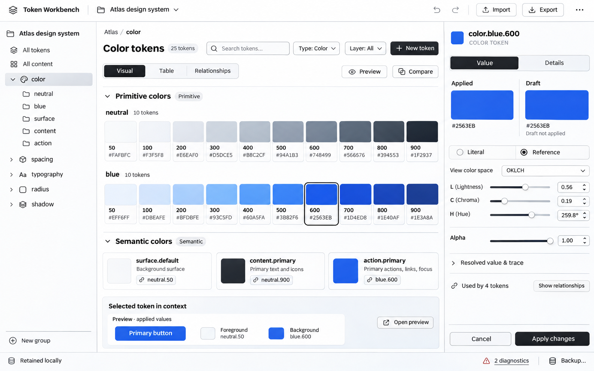
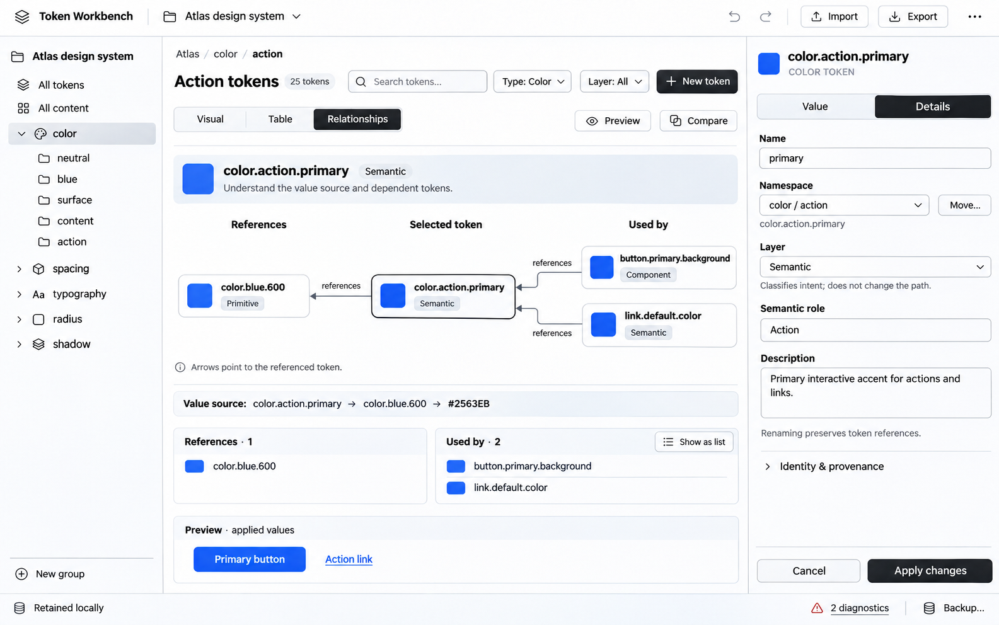
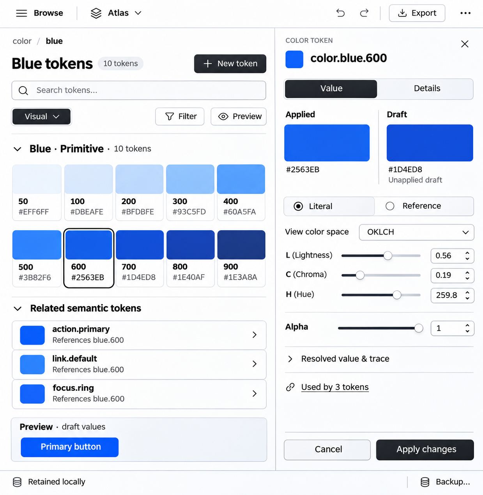
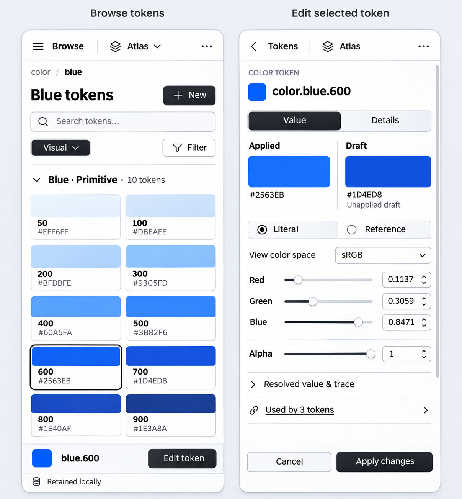

# Workbench layout and responsive visual reference

## Status and purpose

**Established visual direction — 14 November 2026.** The user endorsed the
proposed layout, desktop and responsive mockups, and requested that they be saved
as project visual direction and reference. This V1 extends the neutral Precision
[visual direction](../visual-direction.md); it does not replace its visual character.

The direction is a visual token library, a contextual inspector and focused
relational views within the existing project-centered shell. The app is a design
authoring companion used beside design tools and code editors, and a local source
of truth for projects and their canonical tokens.

**Proposed interaction details and future capabilities:** the arrangements below
record the proposal that informed the images. Exact controls, breakpoints,
workflows and feature coverage require a scoped contract and concrete validation.
The images are AI-generated concepts, not screenshots of implemented behavior or
acceptance evidence. They do not establish adapter support or pixel specifications.

This documentation request authorizes no application implementation, new increment,
analyst review, or qualification restart. Increment 009's delivered work, existing
agreements and outstanding acceptance remain governed by its own records.

## Increment 011 coordinated V2 proposals

**Proposed for user review — 15 November 2026.** The
[Projects V2](projects-shell-v2.md), [workbench V2](workbench-shell-v2.md),
[representative states](v2-state-sheet.svg) and [React component map V2](component-map-v2.md)
incorporate subsequent user scope decisions: project selection/inspection with an
explicit Open action, project operations on Projects, coherent current workbench
UI refinement and responsive states down to 320 CSS px. Undo/Redo is deferred to
012. These source-informed proposals are distinct from the accepted visual
references below and require user feedback before analyst review or final agreement.
The current delivered ownership map remains authoritative for actual code.

The user subsequently approved V2 at `ae75f29` for analyst review. The
[completed review](../../increments/011-v2-analyst-review.md) and
[concrete resulting presentation tree](presentation-organisation-v2.md) refine
the Draft contract and component/hook/state/lifetime ownership. The organising
principle applies to all file kinds. Final agreement and implementation remain pending.

## Increment 012 Undo/Redo V1 proposal

**For user feedback — 15 November 2026.** [Session Undo/Redo V1](undo-redo-v1.md)
provides [responsive controls](undo-redo-v1.svg), [behavior states](undo-redo-states-v1.svg)
and a [component ownership delta](undo-redo-component-map-v1.md) for the
[draft 012 contract](../../increments/012-session-undo-redo.md). It extends the
011 shell with proposed session history, preserving native typing undo and one
editor. The user approved V1 for analyst review with responsive icon/text controls;
the [review](../../increments/012-v1-analyst-review.md) is complete. The user subsequently agreed the refined contract/design and authorized
implementation, now delivered with [acceptance gaps](../../increments/012-session-undo-redo.md#implementation-completion-report--15-november-2026).
The user amendment supersedes original text-only button drawings. Static sheets are not runtime
acceptance evidence. Increment 011's actual closure and acceptance gaps are owned
by its [increment record](../../increments/011-responsive-shell.md#user-directed-closure--15-november-2026).

## Mockup gallery

All four original generated PNGs are preserved locally, without alteration. Each
image is an illustrative V1 reference; later revisions should use new filenames.

### Wide desktop: visual library

The central workspace shows primitive palettes, semantic references and a small
contextual specimen. The right pane edits the selected token. See the
[interpretation notes](#interpretation-notes) before deriving controls from the image.

### Wide desktop: relationships and token details

The selected token's sources and dependents share the central workspace. The
Details inspector exposes name, namespace, layer, role and description.

### Half-screen desktop

Navigation moves behind Browse. The workspace and inspector remain side by side
where both have usable width; palettes wrap and editor channels stack.

### Mobile: browse and edit

These are successive screens, not two panes displayed together on a phone.
Browsing and editing each receive the full content width.

## Shell and information hierarchy

The [annotated decomposition and proposed React component/file map
V1](./component-map-v1.md) provide a companion implementation-planning guide for
all four mockups, saved on 15 November 2026. They identify shared and responsive
composition, existing owners and candidate additions. The decomposition remains
a proposal, not an implemented folder migration or finalized architecture.

The user-endorsed [presentation organisation proposal V1](./presentation-organisation-proposal-v1.md)
is the preferred future folder/file direction: named component subtrees, colocated
hooks/helpers and a generic `ui/` folder, without the single-feature wrapper. It
supersedes the earlier map's target paths, not current delivered ownership. No
implementation is authorized by persisting that proposal.

| Region | Direction |
| --- | --- |
| Project header | Compact project context and switching; proposed Undo/Redo, Import, Export and project menu. |
| Namespace navigation | Existing path-forming groups, All tokens and All content; creation and group actions remain reachable. |
| Central workspace | Largest region; current scope, search, filters, creation and alternate views of the same tokens. |
| Contextual inspector | Precise editing and explanation of the current selection; resizable and collapsible on desktop. |
| Status strip | Quiet local-retention status and access to diagnostics and backup information. |

Use one concise retention status rather than repeating permanent explanations.
Show detailed guidance or warnings when relevant. Backup and restore remain
distinct from token interchange, even if their entry points share a project menu.

Namespace, explicit value type, optional layer and semantic role remain separate.
Layer and type filters do not create new path-forming trees. All tokens and All
content retain their existing distinctions; refine their explanation without
silently changing membership semantics.

## Central workspace

### Visual and Table

**Proposed views:** use Visual for homogeneous groups and Table for mixed
inventories or detailed scanning. Preserve scope, selection, search, filters and
the editor session when changing views.

- Colors use swatch grids and family strips with readable names and reference
  indicators.
- Spacing and sizing use measured bars; typography uses text specimens; radius,
  borders and shadows use contextual samples as their authoring slices are defined.
- Mixed content uses explicit type sections or Table rather than forcing every
  type into an identical decorative card.
- Table supports scanning name/path, layer, type, authored value, resolved value
  and diagnostics. Proposed maintenance actions include rename, move, duplicate,
  delete and appropriate multi-selection operations.

A displayed ramp or grouping does not establish a persisted scale, generated
recipe, canonical order or mathematical relationship. Authored references remain
visible independently of their resolved previews; incomplete and unresolved
definitions must remain discoverable and editable.

### Relationships

Show a focused neighborhood with References, the selected token and Used by.
Readable dependency lists accompany an optional small graph. Arrows point from
the referring token to its referenced token; labels must make direction clear.
Allow following a chain while retaining a route back to the original selection.

Used by means known token dependents, not verified consumption in an external
application. Do not imply restrictions between primitive, semantic and component
layers through graph lanes: the allowed reference-direction policy remains open.
Missing references, cycles and other unresolved outcomes need explicit states.
Diagnostics explain model validity as well as recovery and target compatibility;
their visual placement does not assign all validation ownership to recovery.

### Preview and Compare

Offer focused actions rather than adding every capability as a permanent panel.
Preview uses explicit token bindings and context, such as content on a surface or
a primary-action specimen. It supports authoring without becoming a page builder.
Clearly distinguish applied previews from draft previews, including which values
are affected. A preview never silently commits related tokens or changes authored
data.

Compare is a proposed later view of the same tokens under explicit variation
selections. Show the compared axes and fixed context. Do not create separate
light/dark token trees or imply that presets own values. Preview inputs, bindings,
variation authoring and comparison coverage still need contracts.

## Inspector and authoring behavior

**Proposed arrangement:** Value and Details tabs, with one coherent editor session
and Apply/Cancel workflow across all sections and responsive presentations.

| Value | Details |
| --- | --- |
| Larger applied/draft comparison | Editable local name and derived full path |
| Literal/reference editing and type-specific controls | Parent namespace and explicit Move operation |
| Authored/resolved distinction and resolution explanation | Optional layer, semantic role and description |
| Connections summary linking to Relationships | Component ownership when applicable; identity/provenance access |

Renaming preserves stable token identity and authored aliases. Show preparation
and collision feedback under the agreed naming policy, and make resulting derived
path/output-name changes understandable. Supported legacy conflicts must retain
identity-safe access. Moving a token changes containment, not its identity.

Layer is editable as Unspecified, Primitive, Semantic or Component. Changing it
must not automatically rename or move a token, change its type or role, or turn a
literal into a reference. Under the current model, Component requires an owning
ComponentDefinition; entering or leaving that classification must explicitly
handle the association. See the [canonical model](../../design-tokens/conceptual-model.md#token-layers)
and [taxonomy](../../design-tokens/taxonomy.md).

**15 November 2026 user follow-up:** Undo/Redo is now explicitly requested for
the token-workbench header, replacing its backup/restore controls; project actions
belong on Projects. [Increment 011](../../increments/011-responsive-shell.md#requested-undoredo-controls--15-november-2026)
records the requested direction and the user’s subsequent deferral to
**Increment 012**. Undo/Redo is outside Increment 011, including control delivery;
no placeholder buttons are needed for the responsive-shell increment.
Undo/Redo is not delivered by these images. Its scope and relationship
to draft cancellation, applied operations and retained history remain unresolved.

## Responsive behavior

**Established visual direction:** preserve usable browsing and editing by
changing composition rather than shrinking the desktop screen.

| Available space | Proposed adaptation |
| --- | --- |
| Wide desktop | Show navigation, workspace and inspector; keep the center dominant and side panes adjustable. |
| Half-screen desktop with sufficient width | Hide navigation behind Browse; retain workspace/inspector split, reflow toolbars and reduce palette columns. |
| Narrow desktop or tablet-sized window | Use a full-width editor reached from the workspace when a comfortable split no longer fits. |
| Mobile | Separate full-width browse and editor screens; keep navigation and secondary actions reachable through drawers or menus. |

The half-screen illustration targets roughly an 880-pixel-wide composition, but
does not establish a breakpoint or certify usability at that width. Half of a
smaller desktop may already need the full-width editor. Choose breakpoints using
actual control, content and viewport constraints, including long names and zoom.

Palette columns reduce without making labels or targets unusably small. The
compact editor may stack channel controls with exact fields; Alpha remains a
separate control. The desktop illustration does not override Increment 009's
approved horizontal controls in the existing implementation.

On mobile, the proposed flow is browse → select → Edit token → full-width editor.
Back returns to the same namespace, filters, selection and browsing position.
Layout changes and view navigation preserve the same unfinished draft, including
invalid raw input, within the session. Explicitly distinguish returning to browse
from cancelling or discarding an edit; resolve departure protection before
implementation. This is not a promise to persist drafts across reloads or restarts.

Keep Apply/Cancel reachable with suitable safe-area spacing. The editor scrolls
without sticky elements hiding fields or validation feedback. Keyboard opening,
reflow, focus restoration, drawer dismissal, target sizes and error announcements
require concrete interaction/accessibility validation. Exact mobile ordering and
keyboard behavior are not established by the images.

Relationships become readable linear lists at narrow widths. Tables use a useful
summary or alternate presentation rather than squeezing all desktop columns.
Import/export review becomes a full-width staged flow.

## Local ownership and interchange

The canonical project and its tokens remain the source of truth. Applied browser
data is currently retained within one profile/origin; unfinished forms and drafts
remain session-only. The direction preserves local ownership without choosing a
new persistence format, host capability or synchronization mechanism.

Proposed Import reviews source profiles, normalization, conflicts and unsupported
data before canonical changes. Proposed Export selects a target profile and scope,
then reviews mappings and loss before generating output. Intended destinations
include Penpot, Figma, CSS, Tailwind CSS and documentation such as `design.md`;
their import/export directions and exact coverage must be specified separately.
No universal round trip or synchronization is implied. Generated artifacts and
display notations are not independently editable copies of canonical truth.
Follow the [interoperability requirements](../../design-tokens/interoperability.md).

## Interpretation notes

These synthetic examples communicate layout and hierarchy. Preserve the images
as reviewed rather than silently correcting them, and apply these limits:

- The wide visual-library image incorrectly selects Reference while showing
  literal color controls. That example should select Literal.
- Some applied/draft swatches, source values, preview colors, token counts and
  dependency examples are inconsistent. They do not define valid test fixtures.
  Different colors for tokens shown as references to one source must not imply
  automatic transformations.
- HEX labels and rounded channel values are illustrative, not exact conversion,
  precision, gamut or authored-space policies. Preserve exact canonical values.
- Names and role text are examples, not a new taxonomy or naming policy.
- Generated icon shapes do not supersede Heroicons Outline or the shared Icon
  component. Styling and component implementation follow the existing
  [presentation conventions](../presentation-conventions.md).
- Image pixel dimensions, field spacing, control arrangements and scrollbars are
  not validated viewport measurements or accessibility evidence.

## Provenance and follow-up

The mockups were generated in this project's design discussion on 14 November
2026 using the built-in image generation tool. The wide visual-library concept
established the shell; the relationship image used it as reference, the compact
desktop image adapted it, and the mobile pair used the compact concept as reference.
A separate designer contributed layout and responsive recommendations. No analyst
review or independent implementation review of this future proposal has occurred.

This file owns the saved layout proposal; the parent visual-direction document
owns the broader aesthetic. Current component ownership remains described in the
[organisation map](../workbench-component-organisation.md), not inferred from
rectangles in these images. Existing host/application/domain boundaries remain.

Before implementation, scope a bounded increment, settle the relevant
[open questions](../../planning/open-questions.md), and follow the established
designer/user/analyst contract workflow. This reference does not choose delivery
order. Documentation checks for this save are limited to prose/link review and
verifying that the four saved PNGs match the generated originals; no application
tests, builds, browser qualification or new mockup generation are required.
