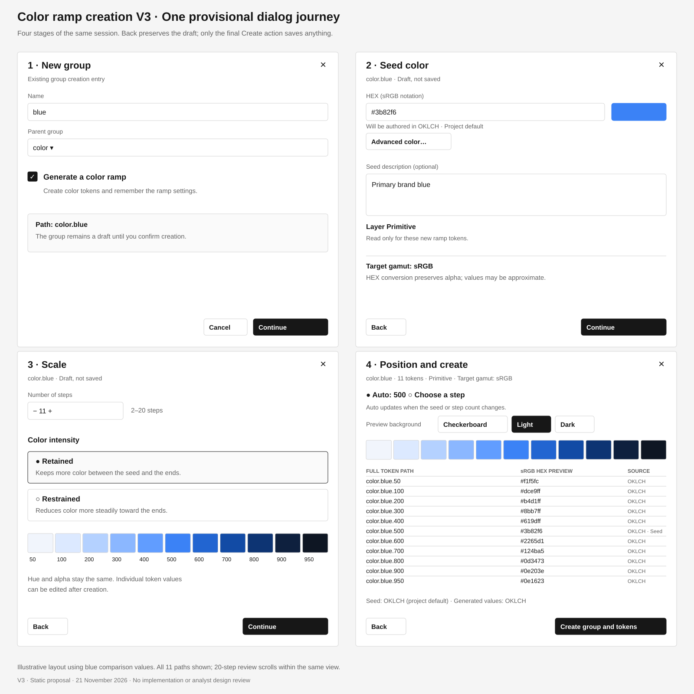
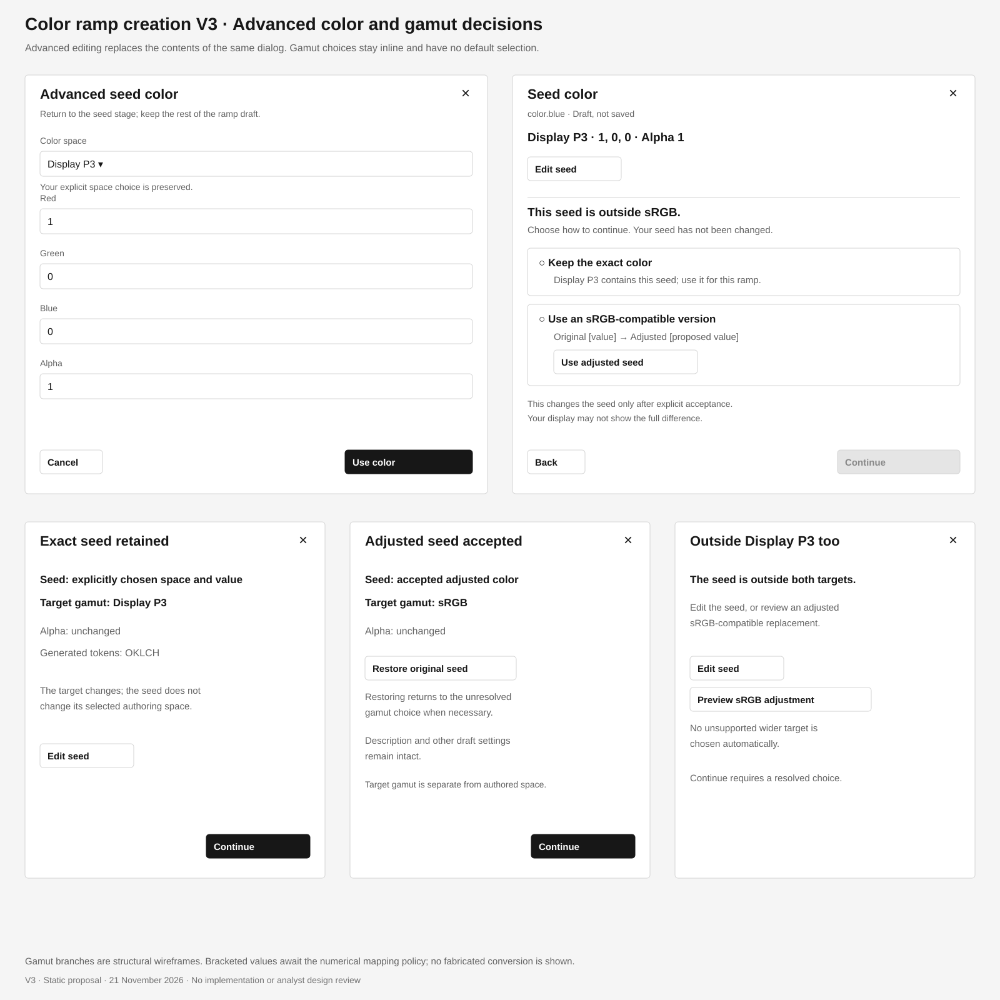
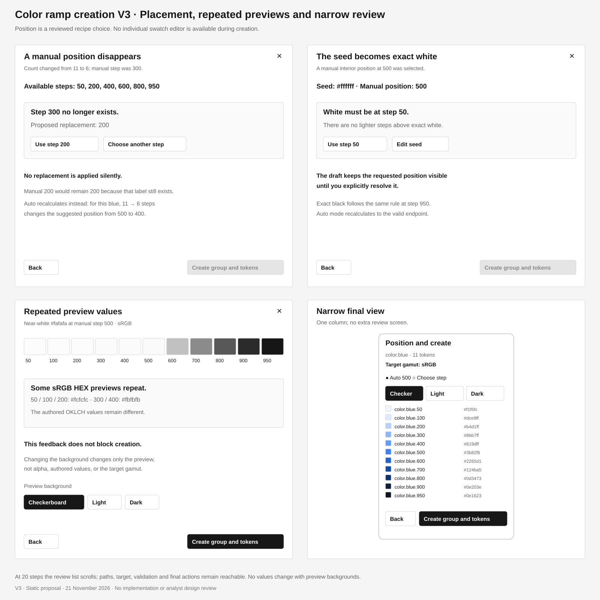

# Color ramp creation V3

**Static interaction refinement — 21 November 2026.**

The user accepted the creation flow and subsequently authorized the HEX-entry
amendment below. Amended wireframes remain for user inspection; no analyst review,
final complete contract agreement or implementation is authorized.

This proposal applies the latest [first-increment decisions](../guided-color-palette-generation.md#first-increment-decisions--21-november-2026).
It supersedes the creation interactions in V1/V2: creation uses a provisional
dialog, later editing uses the central workbench, and individual steps become
editable only after creation. The historical [Increment 024 draft](../../increments/024-color-ramp-authoring.md)
still needs reconciliation before final contract/design agreement.

## One creation session

The sheets show successive states of the same dialog, not four simultaneous
windows. Back retains every draft field. Cancel/close offers the existing
discard/keep-editing protection when needed. No group, token or history entry is
saved until **Create group and tokens** succeeds.

1. **Group:** keep ordinary New group with name, parent and path preview. Checking
   **Generate a color ramp** changes the next action to Continue. Unchecked group
   creation remains unchanged. A name collision blocks progression with feedback
   at the name/parent controls.
2. **Seed:** enter HEX, optionally describe the seed, or open Advanced color. Show
   Primitive as read-only for these new ramp tokens. The **Seed description** label
   denotes the seed token, not a group description or automatic description for
   every generated token. Assigning it only to the anchor token is the intended
   contract detail to confirm during reconciliation. Resolve seed/target-gamut
   choices here before continuing.
3. **Scale:** choose an integer count from 2–20, default 11, and **Color intensity**:
   **Retained** by default or **Restrained**. Show a preview, with no token-value
   editor or manual-override controls. Hue and alpha remain fixed to the seed.
4. **Position and create:** this is the final review, not a preliminary step before
   another confirmation screen. Show Auto/manual placement, resolved target gamut,
   the complete proposed paths and values, and any repeated-preview feedback.
   Confirm all tokens together with the group and settings.

The final sheet shows all 11 full paths legibly. At larger counts, keep the same
review with a scrollable list rather than hiding some members behind a summary.
Direct HEX entry uses the effective project default authored space; the illustrated
project defaults to OKLCH. A helper beneath the HEX field states **Will be authored
in OKLCH · Project default**, substituting the actual default where different.
HEX itself still denotes an sRGB input color. This initial conversion needs no
additional confirmation, preserves alpha, and follows the existing approximate
conversion policy; do not call it universally lossless. Keep the entered HEX in
the draft so Back/view changes do not repeatedly convert an already converted value.
An explicit advanced-editor space takes precedence for that seed. Generated values
remain OKLCH regardless of the seed/project space. The prepared authored seed is
preserved at its anchor; generation does not introduce another seed conversion.
HEX in the review is explicitly an sRGB preview, not a claim about authored space
or the complete representation of a Display P3 target.

## Advanced color and target gamut

Advanced color replaces the seed-stage contents inside the same dialog. It exposes
space, components and alpha. **Use color** returns the edited color to the ramp
draft; **Cancel** returns without adopting those advanced edits. Both preserve the
rest of the ramp session. Neither saves a token.

An advanced non-sRGB seed returns with a truthful source summary and **Edit seed**;
it must not silently become the displayed HEX approximation. The wireframe uses an
exact Display P3 red to illustrate that state. The normal HEX path remains the
simple sRGB input notation, authored in the effective project default space.
Accepting a space explicitly selected in Advanced preserves it on return, even
when it differs from the project default. Cancel preserves the seed and space
that existed before entering Advanced. Existing-token authorship and passive-view
rules are unchanged. The target gamut remains a separate decision.

When the seed is outside sRGB, show two unselected inline choices. **Keep the exact
color / Display P3** is available only when a numerical check confirms P3 contains
the seed. Otherwise offer editing or an explicitly reviewed sRGB adjustment; do
not invent a wider target. **Use adjusted seed** explicitly replaces the draft
seed after showing original and proposed values. Preserve alpha and expose
**Restore original seed** until final confirmation. Restoration reopens a gamut
decision when necessary; other draft fields remain intact.

The resolved target is visible after the choice and again at final review.
Advanced edits rerun the gamut check. A numerical gamut decision is distinct from
what the current monitor can display; the comparison carries that limitation.
Bracketed original/adjusted values in this sheet are deliberate placeholders while
mapping precision is unresolved, not fabricated conversion results.

## Placement and review states

**Auto** recalculates when seed or count changes. It is an active creation mode,
not a one-time suggestion requiring another button. Saving and later reopening a
ramp must still respect the agreed persisted-setting behavior; later editing is
outside this creation refinement.

**Manual** keeps the selected label when that label still exists and is valid. If
count changes remove it, preserve the requested position visibly and propose a
replacement requiring confirmation. The example changes 11 steps to 6: manual
300 disappears, so 200 is proposed with **Use step 200** / **Choose another step**.
This is an illustrative replacement, not a selected nearest-label algorithm.
Manual 200 would survive the same count change. Create remains unavailable while
the replacement is unresolved.

A seed change can invalidate a surviving label. Exact white at manual 500 keeps
that request visible but requires **Use step 50** or **Edit seed**; it is not moved
silently. Exact black has the corresponding 950 restriction. Auto mode recalculates
to the valid endpoint. Near-extreme manual interiors remain permitted under the
agreed endpoint-extension rule.

Repeated 8-bit sRGB previews produce non-blocking feedback identifying the affected
steps and explaining that their authored OKLCH values may differ. The near-white
example shows the actual repeated HEX values from the endpoint exploration. Do not
call these duplicate tokens or claim a perceptual distinguishability threshold.
Exact comparison behavior for Display P3 and alpha still needs a calculation/display
contract.

**Checkerboard / Light / Dark** changes only preview compositing. It never changes
the seed, generated values, alpha, placement or target gamut. These are opaque
wireframe samples; no alpha-compositing implementation is demonstrated.

## Access, errors and narrow layout

Use ordinary labeled fields and keyboard-operable buttons. Entering a stage focuses
its heading or first relevant control; returning from Advanced restores the seed
context. Choosing a manual position does not open a token editor. The dialog keeps
one focus boundary and one authoritative final action.

On narrow screens, stack controls and show full paths in a vertical list, as drawn.
At 20 steps that list scrolls; validation and final actions remain reachable.
Checkerboard/light/dark controls wrap without changing values. Exact dimensions,
focus timing and scroll behavior remain to validate in the chosen design.

Invalid seed/count input and unresolved gamut/placement choices block progression
or final creation with an explanation at the source. Ordinary failure retains the
draft; stale revisions, ownership loss and unknown write outcomes use existing
recovery rather than blindly retrying. A successful final action selects the new
group in the workbench; later token and ramp editing happens there.

## Remaining decisions and checks

The user accepted the four-stage flow, same-dialog Advanced return, inline gamut
decision and final positioning review. The latest authorized amendment is HEX input
using the project default, with explicit Advanced space preserved. This is not
approval to send the proposal to the analyst until the user explicitly agrees.
Manual replacement selection, seed-description persistence, mapped/alpha preview
feedback, calculation precision and the documented neutral-conversion observation
still need contract-level resolution. Later central-workbench editing requires a
separate refinement, especially count changes and manual overrides after creation.

The designer checked SVG XML, basic geometry and local links. Blue swatches come
from the [recipe comparison](./color-ramp-recipes-v1.md); repeated near-white values
come from the [endpoint comparison](./color-ramp-endpoints-v1.md). Reusing these
samples does not settle the remaining numerical policy. The coordinator rendered and visually inspected all three sheets; no clipping or
overlapping content was observed. A [PNG of the main journey](../../../output/color-ramp-creation-v3/journey.png)
is also available. Static wireframes do not establish keyboard,
screen-reader, responsive or calculation behavior. No production code or
interactive prototype was changed.

### HEX-entry amendment checks — 21 November 2026

The amended journey and advanced/gamut sheets were rendered and visually inspected;
new helper/source labels fit without clipping. The journey PNG was refreshed.
Markdown links, SVG XML and whitespace were checked. No conversion runtime tests,
production changes or additional analyst design review occurred.
