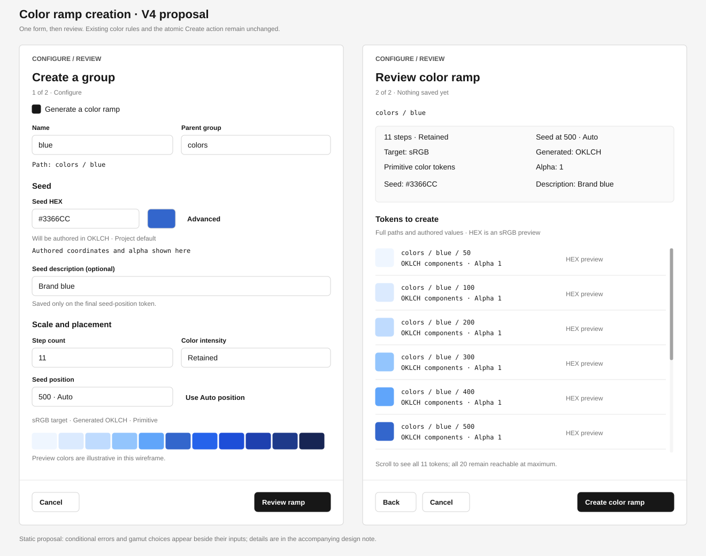

# Color ramp creation V4 — two-stage proposal

**Proposed — 24 November 2026. Not yet approved for analyst review or implementation.**

The user asked to proceed with the previously proposed one-form / one-review direction.
This static design consolidates the existing creation inputs; it changes no generation,
seed, placement, membership, persistence or history rules. It supersedes the four-stage
presentation in [creation V3](color-ramp-creation-v3.md) only if agreed.
The [Increment 024 contract](../../increments/024-color-ramp-authoring.md) remains authoritative.

The drawing illustrates hierarchy, not computed colors or a functioning interface.
Preview colors and value placeholders are schematic. Production shows actual paths,
authored spaces, component values, alpha and explicitly labelled HEX previews.

## Recommendation

Use the existing New group dialog with two stages when Generate a color ramp is checked:
**Configure** and **Review**. Keep the ordinary unchecked group route unchanged.
One form makes related seed/count/position changes visible together and removes repeated
Continue steps. Keep the full member list on review so the form remains manageable.
A compact, non-editable swatch strip on the form gives immediate context.

### 1. Configure

- Group identity first: Generate a color ramp checkbox, Name, Parent group and the
  existing truthful name/path preview, including collision details when relevant.
- Seed: HEX input, authored-space/alpha summary and specimen, quiet project-default
  helper, Advanced disclosure, and optional Seed description. Preserve the explanation
  that description belongs only to the token at the final seed position.
- Scale and placement: Step count, Color intensity, then Seed position and Use Auto
  position. Use the existing defaults and placement rules. Indicate Auto/manual status
  alongside the actual chosen label. Placement is a visible normal input, not Advanced.
- Show resolved target, generated OKLCH space and Primitive layer as facts, not extra
  editable controls. Add a compact preview when calculation is available; invalid
  inputs show their errors without presenting stale swatches as a valid proposal.
- Footer: Cancel and Review ramp. Review writes nothing and is unavailable while name,
  parent, seed, count or placement is invalid, a gamut choice is unresolved, Advanced
  has an unaccepted edit, or existing pending/read/recovery gates prevent progress.
  Explain the blocking condition beside the affected input or in the shared failure area.

Checking Generate reveals this form in place; there is no preliminary group-only step.
Unchecking uses the current behavior: drop ramp-specific local state, preserve group
identity and return to ordinary group creation. This proposal does not add a new
checkbox retention policy. Review/Back must preserve the entire current ramp draft,
including original HEX, Advanced acceptance and gamut-adjustment restore state.

### 2. Review

Use a read-only final review with group path, count, intensity, actual seed position
and Auto/manual status, target gamut, generated space, Primitive layer and seed
summary/description. The full proposed member list includes each full token path,
authored space/components/alpha and explicitly labelled HEX (sRGB preview).
Long paths wrap. All 2–20 members remain reachable by scrolling; no ellipsis replaces
members. Repeated-preview feedback stays visible and non-blocking under existing rules.
No per-step value editor is introduced.

Footer: Back, Cancel and Create color ramp. Back returns to the same form with all
inputs intact. Create is the existing atomic group + members + recipe save and one
history entry. No later Apply is needed to finish creation. Subsequent saved-ramp edits
retain the existing shared draft and ramp-level Apply boundary.

## Conditional states and interaction

| Condition | Presentation and behavior |
| --- | --- |
| Advanced color | Expand the existing color fields inline below Seed. Use color accepts; its Cancel abandons only that advanced edit. Return focus to Advanced. Keep the existing alpha and explicit-space rules. |
| Seed outside target / bounded lightness | Automatically show the existing original/candidate comparison and applicable explicit choices beside Seed, never behind optional disclosure. Do not preselect a gamut decision, silently clip or expand targets. Restore original remains available under the existing rule. |
| Invalid manual position after count/seed change | Retain the requested label visibly, explain why it needs review and block Review. Offer valid position choice or existing Auto action. Preserve exact white/black endpoint rules and the distinction between Auto and manual placement. |
| Name/parent problem | Retain the existing path/collision evidence beside identity. No empty group is created to get to review. |
| Read failure, unavailable/unknown result, or save failure | Show existing failure/recovery content in both stages, outside stage-hidden panels. Keep the draft, truthfully gate actions and use existing recovery; do not add blind retry or claim success. |
| Cancel/close | Use the existing creation departure/discard policy. No project write on cancellation. Do not add a third confirmation stage to successful creation. |
| Pending create | Keep pending feedback visible, gate duplicate submission and preserve the existing close/departure restrictions. |

Native labels and controls retain keyboard access. Enter from the configuration form
can request Review only, never Create; final creation requires its deliberate review
submission. Focus moves to the Review heading on entry and the Configure heading on
Back, with the fields immediately following. Advanced retains its existing heading/
return-focus behavior. Errors are programmatically associated with their inputs;
shared failures remain announced and reachable in either stage. Closing returns focus
through the existing dialog owner.

Use one scrollable content area and a persistent action footer, with enough scroll
padding that focused fields are not obscured. Pair Name/Parent and Count/Intensity only
when space permits; use one column at narrow widths. Advanced content grows in the
same scroll area. Review uses stacked member entries when columns would crowd values.
Do not add nested page-like wizard chrome or an independently scrollable short preview
inside the configuration form.

## Scope, assumptions and handoff

This design uses existing generation and application operations. Stage presentation
must not move command ownership or reset mounted draft state. No new dependency,
persistence format, numerical algorithm, recovery policy or save owner is proposed.
The current source resets ramp fields when Generate is unchecked; that behavior is
retained. A future request to preserve those fields is separate.

No additional product decision was identified beyond agreement to this identified
layout and progression. The user must see this proposal before analyst review per the
repository workflow. A focused analyst check should cover existing creation criteria,
state preservation and both-stage error/recovery visibility before implementation.

Source/design inspection only; no browser interaction, tests, numerical runs or old
qualification campaign. Approximately four aggregate designer minutes, zero harness
repairs; the six-minute source/design review ceiling is stopped. Static layout has not
been browser-tested and does not establish runtime accessibility or numerical accuracy.

Suggested commit: `docs: propose two-stage ramp creation`.
