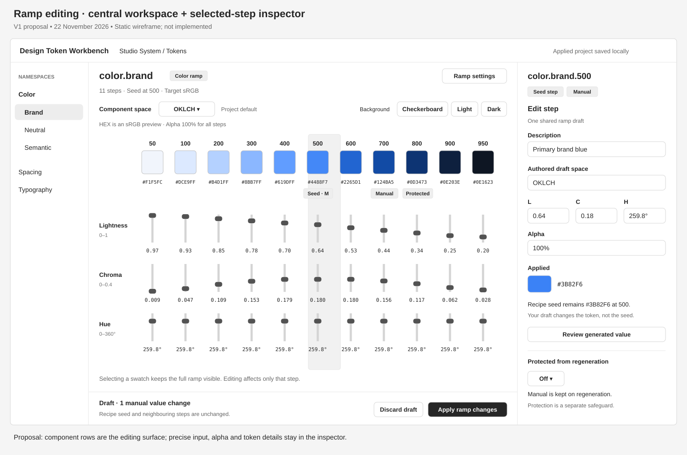
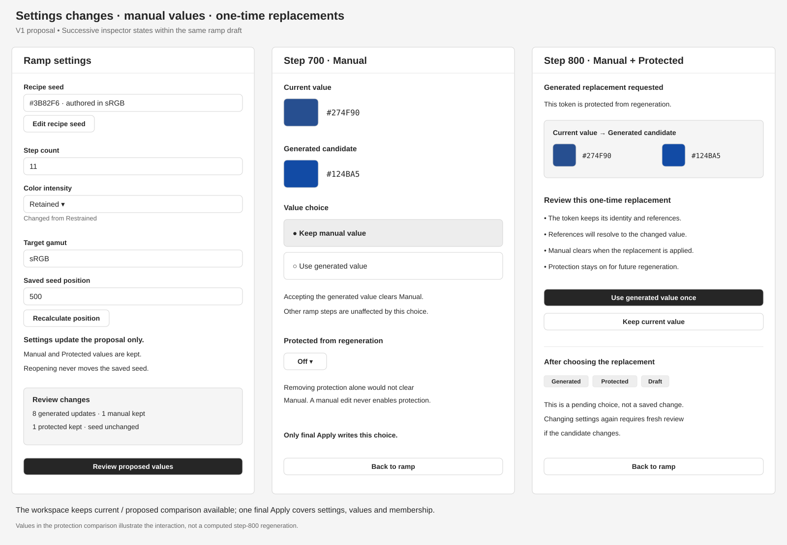
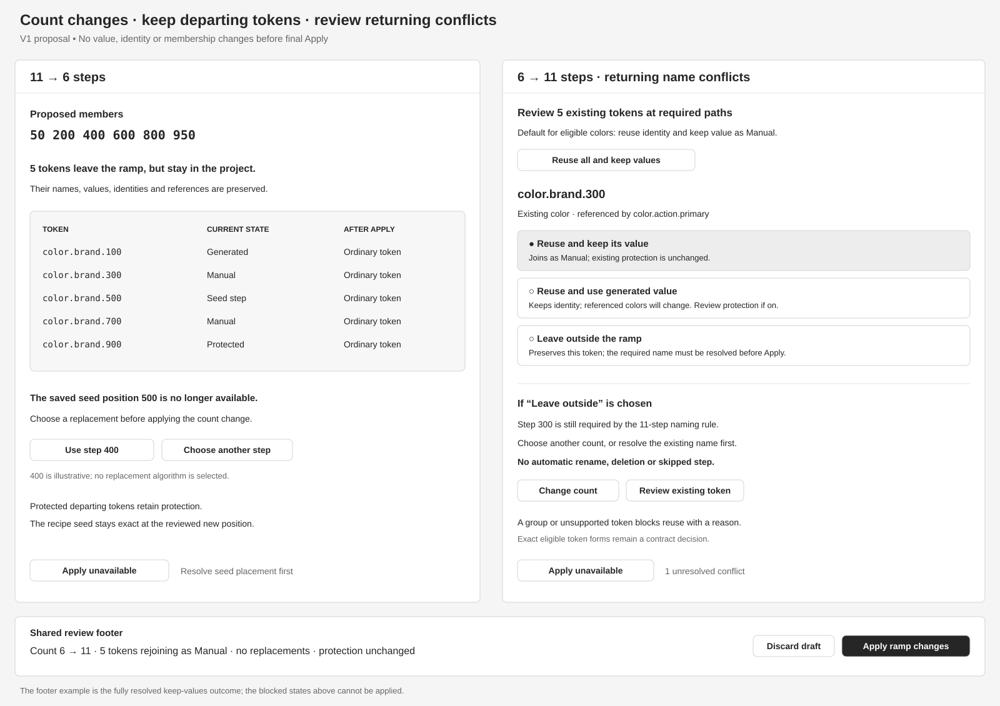

# Color ramp editing V1

**Historical static proposal — 22 November 2026.**

[Editing V2](./color-ramp-editing-v2.md) supersedes the inspector, protection controls
and Apply/navigation presentation below following user feedback.

The user resumed the previously deferred editing design and requested named
swatches and three aligned component-slider rows in the central workspace.
These sheets propose the workspace/inspector split and review interactions. They
are not an approved interaction contract, analyst review, prototype or application
implementation. The [owning ramp direction](../guided-color-palette-generation.md)
supplies agreed behavior; the historical [024 draft](../../increments/024-color-ramp-authoring.md)
still requires reconciliation. Creation remains the accepted
[V3 dialog flow](./color-ramp-creation-v3.md).

## Central workspace and selected step

[PNG preview](../../../output/color-ramp-editing-v1/color-ramp-editing-v1-workspace.svg.png).

Keep the ramp as the central editing surface. Eleven aligned columns contain the
step name, rounded swatch, read-only HEX preview, status and three component
sliders. A selected-column background connects the swatch to all three controls.
The inspector supplies precise numeric entry, alpha, description, applied value,
recipe-seed difference and protection. Selecting another step or Ramp settings
changes inspector content without losing the shared ramp draft.

The workspace shows the proposed values when a draft exists; the inspector's
Applied comparison remains the saved value. Its example intentionally edits step
500 to OKLCH `0.64 / 0.18 / 259.8°`, preview `#4488F7`, while the exact recipe seed
remains `#3B82F6`. The seed-step column's compact **Seed · M** means Seed + Manual;
the inspector spells both out. Production should expose full status labels to
assistive technology and on demand. Manual overrides do not reshape neighbours.

Recommended additions are limited to selected-step status, target gamut,
checkerboard/light/dark preview context, current-versus-proposed comparison and
a persistent pending-change summary. An extra curve chart would duplicate the
three rows and compete with direct editing; omit it initially. Generated is the
unmarked default state in the row, while Manual and Protected remain separate.

## Component space and editing

**New UI proposal:** on entering a ramp, initialize **Component space** to the
project's effective default (including the existing historical-project fallback).
Keep the selection for the current editing session. Do not add a saved ramp-wide
space preference in this proposal. Creation's explicit Advanced space belongs to
the seed; it is not a ramp-wide display preference. Generated steps remain authored
in OKLCH, and the exact seed retains its authored space.

Changing the selector changes labels, slider scales and displayed numbers only.
It never converts all tokens or marks them Manual. For an actual component edit,
carry forward the existing [color editing policy](../../increments/003-color-policy-proposal.md):
only that edited step becomes a literal draft in the selected representation.
The inspector exposes its resulting authored draft space and Manual state.
Untouched steps retain their exact source. Conversions remain approximate; no
silent gamut clamping is introduced. This extends the existing policy to the new
surface, rather than inventing bulk conversion.

Show Lightness/Chroma/Hue for OKLCH, Lightness/a/b for OKLab,
Hue/Saturation/Lightness for HSL and Red/Green/Blue for sRGB or Display P3.
Alpha remains a separate selected-token field: there are exactly three component
rows. The shared alpha summary changes to **Mixed alpha** when needed. The
illustrated slider ranges are bounded editing ranges, not a rejection of otherwise
valid authored values. Out-of-range or unavailable components expose the exact
value/reason and precise input without pretending that a clamped thumb is exact.
Powerless hue follows the existing display/editor policy. Full numerical bounds,
steps, precision and supported-member eligibility need the calculation contract.

HEX always denotes the existing sRGB preview policy, including mapping/unavailable
feedback where relevant, not the source or complete Display P3 representation.
Actual swatches should use the authored color preview; these static sheets use
opaque sRGB samples. Preview-background choices change compositing only.

## Settings, Manual and Protected

[PNG preview](../../../output/color-ramp-editing-v1/color-ramp-editing-v1-settings.svg.png).

Ramp settings owns the recipe seed, count, intensity, target gamut and saved seed
position. Opening a saved ramp does not regenerate or move its seed. Settings
changes prepare candidates without saving; **Recalculate position** is explicit
for later editing. Invalid or disappearing positions require reviewed resolution.
Seed/gamut editing reuses the agreed explicit adjustment and restoration choices
from creation, preserving other draft fields. Do not silently adjust the seed.

The settings sheet illustrates changing Restrained to Retained. Manual and
Protected steps keep their current values by default. Selecting a step exposes
current and generated values and **Keep manual value / Use generated value**.
A protected replacement adds the explicit **Use generated value once** review.
Final acceptance clears Manual and retains protection. The result can therefore
be Generated + Protected. Manual editing stays allowed; changing protection alone
does not clear Manual. Until Apply, all these effects are draft choices.

**Recommended reconciliation behavior:** if a settings change changes a candidate
already chosen for one-time replacement, require fresh review of that new candidate
rather than carrying authorization over to an unseen value. Keep the user's manual
value and show that replacement review is pending. Exact draft reconciliation,
including settings changed back, remains a contract decision.

## Count changes and returning names

[PNG preview](../../../output/color-ramp-editing-v1/color-ramp-editing-v1-count.svg.png).

The 11-to-6 example follows the agreed naming rule: 50, 200, 400, 600, 800, 950.
The other five tokens stay ordinary tokens with their names, identities, values,
references and protection preserved. Membership changes only on final Apply.
The removed seed label 500 remains visible as an unresolved position; 400 is an
illustrative proposal, not an agreed replacement algorithm. Existing Manual or
Protected values at a newly selected seed position are still kept by default;
review any generated replacement under the same rules. A recipe seed can therefore
differ from the actual token at its assigned position.

Returning to eleven steps requires review of occupied names. Eligible existing
colors default to **Reuse and keep its value**, joining as Manual without changing
protection. **Reuse and use generated value** preserves identity and references but
explicitly changes the value they resolve to; protection adds the one-time review.
**Leave outside the ramp** preserves the token, but Apply stays blocked until the
name is resolved or count changes. A required step is never silently skipped.
Groups and unsupported tokens cannot be automatically converted into ramp colors;
exact eligible forms remain unresolved. Batch keep-values is explicit and still
reviewable per token. The resolved footer illustrates five reused Manual values;
it is distinct from the blocked states above.

**Review existing token** must not bypass draft guards or save a rename implicitly.
The precise name-resolution workflow remains to be designed: the proposal does not
promise a second independently saving editor while the ramp draft is open.

## One draft, actions and access

**Proposal:** one shared draft owns settings, step values, membership and protection
choices while ramp editing is open. The inspector has no independently saving
Apply. The persistent workspace footer offers **Discard draft** and **Apply ramp
changes**, with counts of updates, preserved values, additions/departures and
unresolved choices. A settings-only change can still be meaningful. The full
atomic operation/history contract remains to be reconciled in 024.

Leaving the ramp uses the existing discard/keep-editing guard. Ordinary failure
retains the draft with actionable feedback; stale revision, lost ownership and
unknown writes use existing recovery and block blind reapplication. Loading
candidates exposes a pending status and disables Apply. Missing members and
unsupported values show a specific blocking reason, not silent recreation.

Use labeled vertical sliders with a thin visible track but a generous interactive
area (at least 24 CSS pixels wide), visible focus, arrow-key changes and appropriate
minimum/maximum/value text. The name must include full token path and component.
Numbers below the sliders remain directly editable alternatives; the inspector
provides the same precise fields. Changing focus/selection does not write data.
Use logical row order and labelled groups; do not invent a custom grid keyboard
model without testing it. Validation is attached to the affected field and the
footer links to the first unresolved item. Announce summarized settled changes,
not every pointer-move event. Returning from a review restores its triggering
control; Apply and recovery need explicit focus behavior in the final contract.

At 20 steps, preserve readable column widths with a horizontal scrolling component
matrix and sticky row headings; never squeeze controls into unreadable columns.
At a narrow width, hide navigation and open the inspector as the existing separate
full-width edit surface with Back to ramp, retaining the draft and scroll position.
The central matrix can scroll horizontally; a future stacked alternative is not
selected here. Narrow layout, zoom, keyboard and screen-reader behavior are written
proposals only; no narrow-screen artifact or runtime evidence is claimed.

## Review decisions and checks

Recommended next user review: judge the workspace/inspector split, the component
space default, and the single Apply boundary. The known agreed Manual/protection
and token-preservation rules are represented rather than reopened. After feedback,
identify a revision for explicit user approval to analyst review; no analyst review
has happened. Numerical policy, exact eligibility/schema, count/name recovery and
complete draft reconciliation remain unresolved before contract agreement.

Blue values reuse the [recipe exploration](./color-ramp-recipes-v1.md). The edited
500 HEX preview was computed with installed Culori from the shown OKLCH values.
Protection comparisons are illustrative interaction samples, not computed step-800
candidates. Samples do not qualify production generation or conversion policy.

The designer inspected all three rendered sheets and checked SVG XML and local
links. Quick Look required a temporary square canvas to avoid clipping; final PNGs
retain lower whitespace, while SVGs retain the intended landscape proportions.
Static checks used approximately 10 aggregate minutes (designer 8, coordinator 2)
and one rendering repair cycle, now stopped. The coordinator also visually inspected
all three corrected PNGs. No application tests, browser interaction,
independent review or broader qualification occurred. No production source,
dependencies or staged files were changed.
