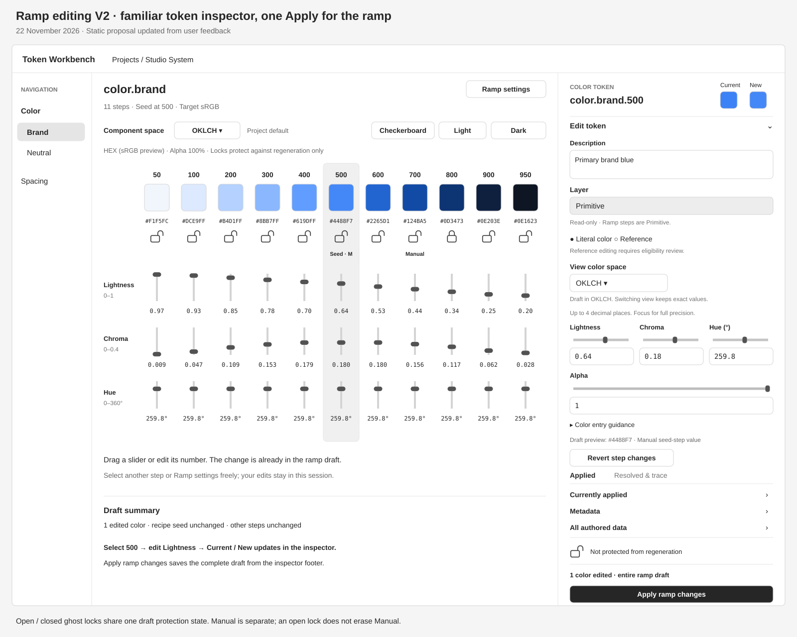
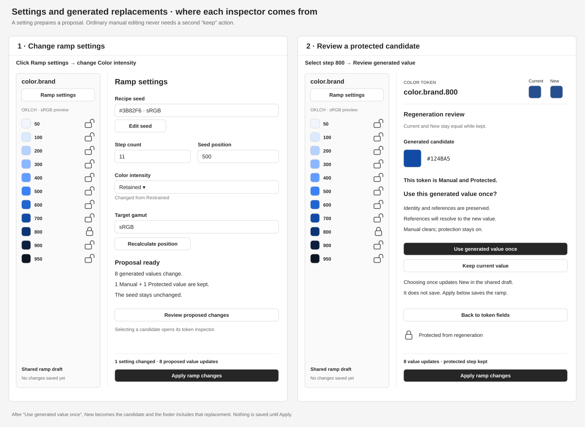
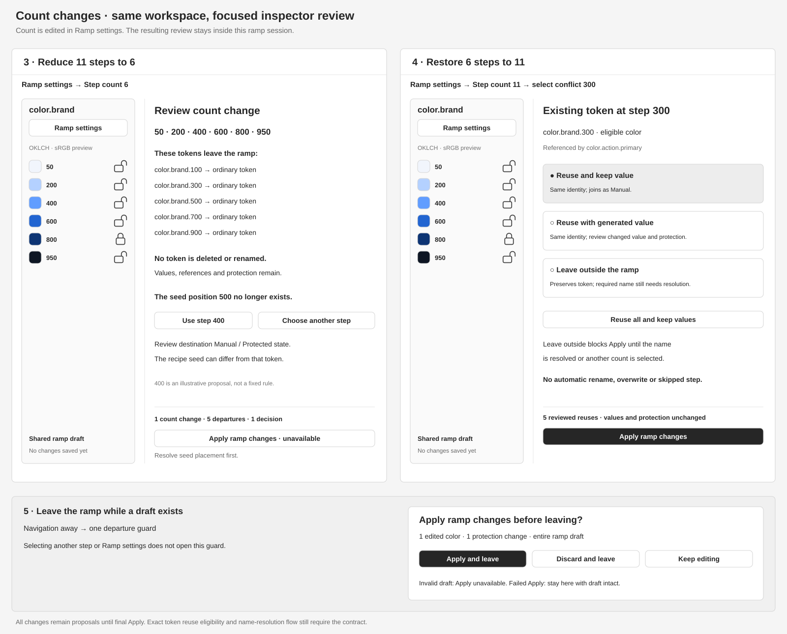

# Color ramp editing V2

**User-directed refinement — 22 November 2026. Static wireframes for review.**

V2 keeps the central component matrix from [V1](./color-ramp-editing-v1.md), replaces
text protection switches with ghost lock buttons and brings the step inspector
closer to the existing application. The user accepted one final Apply for the
whole ramp draft and requested these changes; on 22 November the user approved V2 for analyst review with the explicit amendment
that Layer is read-only/disabled and fixed to Primitive in the ramp-step inspector.
This is not final contract agreement or implementation authorization. The
[owning agreement](../guided-color-palette-generation.md#single-apply-and-step-inspector--agreed-22-november-2026)
remains authoritative. V1 is historical where V2 differs.

## Workspace and token inspector

[PNG preview](../../../output/color-ramp-editing-v2/color-ramp-editing-v2-workspace.svg.png).

Selecting a swatch opens its step inspector; editing a slider or number immediately
updates the same shared ramp draft. Current shows the applied token, New shows the
pending color, exactly as in the existing token inspector. There is no intermediate
**Keep modified color** action. Moving to another step or Ramp settings preserves
all pending edits. The illustrated seed-step edit changes only its token value;
the recipe seed and neighbours remain unchanged.

The inspector follows the current production hierarchy: color-token header with
Current/New swatches, collapsible Edit token, description textarea, Layer, literal/
reference source, View color space, three horizontal component sliders with exact
inputs, Alpha, Color entry guidance, Applied / Resolved & trace tabs, Currently
applied, Metadata and All authored data. V2 adds the ramp-specific actions and
protection below those existing sections. Long content scrolls; the drawing shows
the expanded structure rather than promising that it fits a short viewport.

Layer is fixed to **Primitive**, read-only/disabled, as explicitly directed by the
user. It cannot change in the ramp-step inspector. Reference remains unavailable
in this proposal pending membership/eligibility decisions. Helper text explains
these boundaries; this does not authorize removing ordinary token-editor
capabilities or silently adding layer/alias edits to the ramp contract. Description
and color edits share the ramp session. Ordinary description changes do not mark
Manual. The exact field-capability policy still belongs in the reconciled contract.

**Revert step changes** returns the selected step to its applied state without
reverting other steps or ramp settings. Recommended detailed scope: restore that
step's edited color, description and protection, and restore its applied Manual
status; never clear an already applied Manual status. Remove an unaccepted
replacement choice for that step. Preserve membership/count choices. If the applied
value must be kept against a changed recipe, represent that deliberate preservation
under the agreed Manual rules. New members without an applied baseline need a
separate explicit treatment before implementation. This detailed scope is a
proposal requiring contract reconciliation, not a claim that every interaction is
already agreed.

At the end of the inspector, **Apply ramp changes** applies the complete ramp draft,
not merely the selected token. A visible scope summary includes values, settings,
membership and protection changes. That footer remains part of the ramp session
when inspector content switches. Invalid/unresolved/pending states disable Apply
and explain why. Save failures retain the draft; unknown outcomes and stale
revisions use the existing recovery rules rather than blind retries.

## Protection controls

Each step has an icon-only ghost button using the actual installed Heroicons
Outline LockOpenIcon / LockClosedIcon paths. Open means not protected; closed means
Protected from regeneration. There is no filled button or extra text badge for
protection in the matrix. The inspector-bottom ghost button reflects the same
draft state, with a readable status beside it. Clicking either updates both;
neither saves or triggers regeneration.

Give each button an accessible action name containing the token path and expose
its current pressed/protected state, for example **Protect color.brand.500 from
regeneration** or **Allow regeneration for color.brand.500**. Tooltips repeat the
action and clarify that manual edits remain possible. Keep a generous hit area,
visible focus and keyboard activation despite the small visual icon. Open locks
do not clear Manual, and a manual edit does not close the lock automatically.

## Settings and regeneration review in context

[PNG preview](../../../output/color-ramp-editing-v2/color-ramp-editing-v2-settings.svg.png).

The sheet labels the triggering click above each state. The slim left columns are
condensed workspace context for the storyboard, not a proposal to replace the
horizontal central matrix with a vertical token list.

1. **Ramp settings → change Color intensity:** the inspector shows remembered
   recipe settings and a pending proposal summary. Seed, count, intensity,
   placement and target changes can affect proposed candidates. Merely reopening
   the ramp does not regenerate. Recalculate position is explicit in later editing.
2. **Select step 800 → Review generated value:** regeneration review replaces the
   editable fields temporarily while retaining the same token header, workspace
   context, protection and whole-ramp Apply. The protected current value is kept
   by default, so Current/New remain equal before the one-time choice. **Use
   generated value once** changes New to that candidate within the draft. It is a
   regeneration choice, not a save or a manual-edit confirmation. Final acceptance
   clears Manual and preserves protection. **Back to token fields** restores the
   ordinary inspector without discarding choices.

A changed recipe can prepare generated candidates; an individual manual edit,
view-space change or lock toggle does not recalculate neighbouring colors. Unlocking
alone does not immediately substitute a generated value. Settings and review always
stay draft-only until the shared Apply. If a newly changed setting changes a
previously authorized one-time candidate, recommend renewed review of that candidate
rather than silently extending the earlier choice. Complete reconciliation remains
unresolved. The user has asked about regeneration triggers; this sheet retains the
current multi-setting proposal pending any resulting direction change.

The protected replacement color pair is illustrative, not a computed step-800
candidate. Scope counts illustrate mutually exclusive kept/generated cases. This
sheet does not validate generation math.

## Count conflicts and departure

**Superseded after analyst review:** the user subsequently selected confirmed count
replacement and explicit per-referencing-token remapping. See the [latest direction](../guided-color-palette-generation.md#count-replacement-and-reference-remapping--22-november-2026).
The count sheet below is historical for departure/reuse behavior; revised wireframes
await the remaining decisions. The shared Apply/departure guard remains applicable.

[PNG preview](../../../output/color-ramp-editing-v2/color-ramp-editing-v2-count.svg.png).

3. **Ramp settings → count 6:** the inspector lists the five departing tokens and
   explicitly preserves them as ordinary tokens. A disappearing seed position
   needs reviewed resolution. The proposed 400 replacement is illustrative;
   destination Manual/protection status must still be honored. The recipe seed
   may differ from the token at its assigned position.
4. **Ramp settings → count 11 → conflict 300:** the inspector offers explicit reuse
   with kept value (Manual), reuse with generated value (identity retained, protection
   reviewed), or leave outside (name/count resolution needed before Apply). The
   displayed enabled footer illustrates all five keep-value choices reviewed.
   No group or unsupported token is automatically converted. Eligibility and the
   name-resolution workflow remain unresolved.
5. **Navigate away with pending changes:** show **Apply and leave / Discard and
   leave / Keep editing**. Step and settings selection inside this ramp never opens
   the guard. Apply and leave runs the same whole-ramp Apply and navigates only
   after confirmed success. Invalid drafts disable it; failed Apply keeps the
   session and destination pending so the user can recover or keep editing.

Component-space, preview-background, three-row/alpha distinctions, bounded slider
behavior and narrow/20-step scrolling remain as described in V1. Keep one shared
component-view selection synchronized between the matrix and inspector without
promoting untouched tokens. Keyboard, focus and responsive behavior are proposals,
not runtime evidence. No additional calculation or membership semantics are silently
selected by these drawings.

## Source grounding and checks

The designer read the current production sources (read-only):

- `TokenEditorContent.tsx`: header, Edit token structure, fields, actions, detail tabs.
- `TokenValueComparison.tsx`: Current/New swatches in the header.
- `ColorEditor/ColorEditor.tsx`: View color space, component sliders/exact inputs,
  precision guidance, alpha and Color entry guidance.
- `TokenEditorTabs.tsx`: Applied / Resolved & trace.

These are under
`src/presentation/App/components/TokensWorkbench/components/SelectionInspector/components/TokenEditor/`
(with the named components under `components/`). The designer also inspected the
existing [Increment 023 desktop capture](../../../output/playwright/increment-023-implemented-desktop.png).
The screenshot has collapsed edit fields; current source supplies their expanded
structure. This is source-grounded visual reuse, not pixel-perfect runtime fidelity.

Three SVGs were parsed and rendered; final sheets were visually inspected. Local
links and Markdown whitespace were checked. Square temporary rendering canvases
avoid Quick Look's landscape clipping; PNGs contain lower whitespace, SVGs retain
intended proportions. No production files, dependencies, staged changes or V1
artifacts were edited. No interactive/browser, numerical or independent analyst
review occurred. This bounded follow-up stopped at approximately 8 aggregate verification minutes
(designer 6, coordinator 2), with zero rendering harness repairs. The coordinator
also inspected the rendered sheets. Earlier V1 verification remains stopped.

### Analyst review — 22 November 2026

Following the user's approval with Layer fixed read-only to Primitive, the separate
analyst reviewed V2 and reconciled [Draft 024](../../increments/024-color-ramp-authoring.md#analyst-review--22-november-2026).
Its findings and D1–D5 distinguish agreed directions from unresolved calculation,
draft, eligibility, conflict-recovery and metadata details. No material redesign
was silently applied; final agreement and implementation remain unauthorized.
The coordinator refreshed and visually inspected the workspace PNG after removing
the Layer dropdown affordance and adding the read-only treatment.
