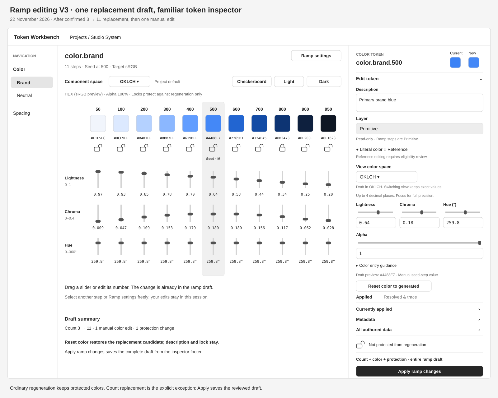
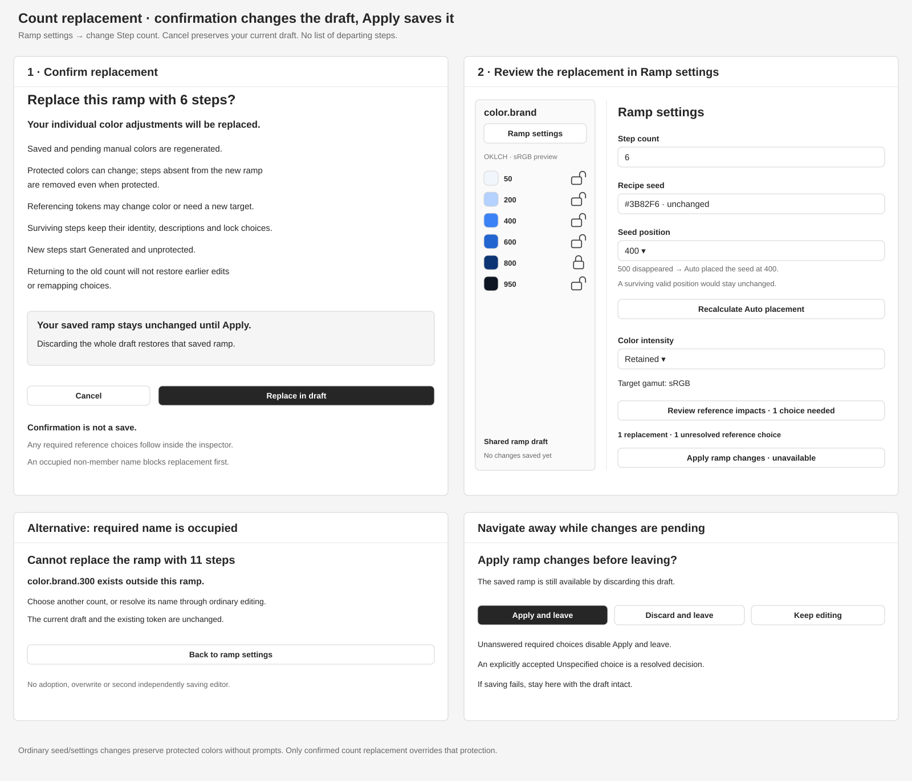
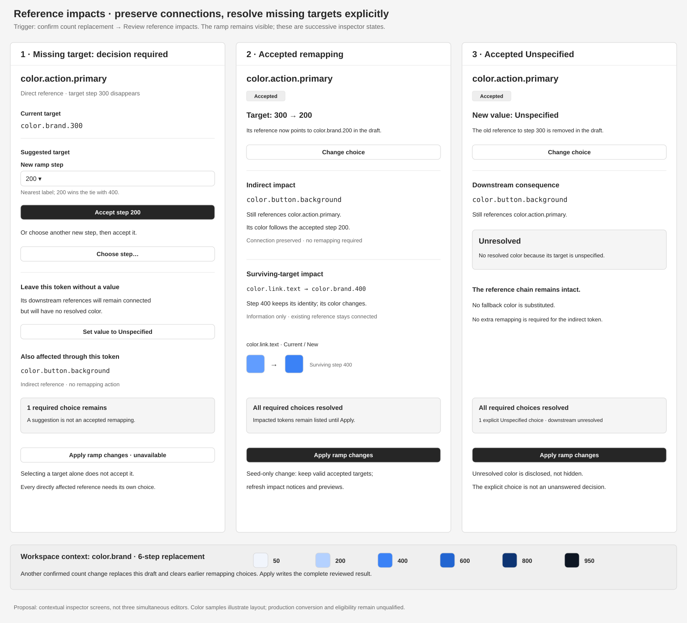

# Color ramp editing V3

**Scenario-coverage reference — 22 November 2026.**

**Review update — 23 November 2026:** the user-authorized renewed analyst review
of accepted V4, the retained V3 workspace and consolidated Draft 024 is complete.
See [findings and remaining decisions](../../increments/024-color-ramp-authoring.md#renewed-v4v3-analyst-review--23-november-2026).
No material design revision was required; final full-contract agreement and
implementation authorization remain pending. Earlier review gates and check claims
below describe this artifact's preparation date, not the current authorization.

The user reviewed this proposal as covering the scenarios and requested a more
compact presentation for repeated use. [Editing V4](./color-ramp-editing-v4.md)
explores progressive disclosure without changing these behaviors. No analyst
review or implementation approval is inferred from that feedback.

V3 replaces the superseded count/reuse and protected-replacement interactions in
[V2](./color-ramp-editing-v2.md). It preserves the accepted central component matrix,
familiar token inspector, ghost locks, fixed Primitive field and one Apply boundary.
The [owning ramp direction](../guided-color-palette-generation.md) supplies the
agreements; [Draft 024](../../increments/024-color-ramp-authoring.md) owns the active
contract and remaining decisions. This pass implements no application behavior and
is not approval for analyst review of V3 or final implementation authorization.

## Workspace and selected-step inspector

[PNG preview](../../../output/color-ramp-editing-v3/color-ramp-editing-v3-workspace.svg.png).

The example starts with a saved three-step ramp, confirms replacement with eleven,
then edits surviving seed step 500 and protects new step 800 in the draft. There is
one Manual color adjustment; new steps initially have no protection. The heading's
Current swatch remains the applied color, while New is the latest draft value.
A genuinely new step has no applied Current color; use a clear **Not yet created**
state, not a fabricated swatch or an old token with a matching name.

Keep the familiar color-token header and Current/New comparison, Edit token fields,
precise component inputs and horizontal sliders, alpha, applied/details sections and
bottom protection state. Layer is **Primitive**, read-only/disabled. Description,
color and lock choices belong to the same draft. Reference remains unavailable in
this ramp proposal pending exact value-form eligibility. **Agreed 23 November:**
only Primitive tokens may participate, and Layer is also read-only in the ordinary
token editor for ramp members. Other ordinary-editor restrictions are not implied. The main matrix has named rounded swatches, HEX previews, one ghost
lock per step and three component rows with editable values. Viewing another color
space changes presentation only; actual edits follow the existing authored/derived
policy. Component space is synchronized with the inspector and initially uses the
project's effective default, as proposed in V2.

**Reset color to generated** is the agreed action after confirmed replacement: clear
the new Manual adjustment and use the generated candidate from the latest valid
draft recipe/settings, including subsequent seed changes (agreed 23 November),
while leaving description and protection unchanged. It does not recover the discarded old
color. **Ordinary Revert scope agreed 23 November:** without count replacement,
restore the selected step's saved color, Manual status, description and protection.
Preserve other steps' pending edits and ramp settings. This is distinct from the
color-only generated reset after replacement.

**Regeneration amended 23 November:** seed, intensity and seed-position changes
regenerate every unprotected step, including Manual steps, and clear Manual when
replaced. Ordinary regeneration preserves Protected colors without prompts.
There is no one-time protected replacement action. Manual editing remains possible;
unlocking does not itself replace a color or clear Manual. Protection controls are
limited to ramp steps in this increment. A closed lock can therefore coexist with
a generated or manually edited value. Confirmed count replacement is the explicit
exception described below.

## Count confirmation and replacement settings

[PNG preview](../../../output/color-ramp-editing-v3/color-ramp-editing-v3-replacement.svg.png).

**Trigger:** change Step count in Ramp settings. The proposed placement for the
confirmation is a dialog over the persistent workbench; the sheet isolates its
contents for legibility. Cancel preserves the current draft. **Replace in draft**
prepares the replacement and returns to ramp settings; it is not Apply.

The confirmation lists consequences without a list of departing steps:

- Saved and pending manual colors are regenerated, clearing Manual for replacement
  candidates. Protected colors can change; disappearing steps can be removed even
  when Protected, subject to explicit resolution of affected references.
- Surviving names keep identities, latest saved/pending descriptions and latest
  saved/pending protection choices. New steps begin Generated and unprotected and
  inherit no description or protection from removed steps.
- Referencing tokens may receive a changed color or need a new target. Required
  choices are resolved in the same draft before Apply.
- Changing back to an earlier count does not restore earlier individual edits or
  remapping choices. Each confirmed count change prepares a fresh replacement.
- The saved ramp remains unchanged until Apply. Discard the whole draft to restore
  it; do not describe confirmation as an irreversible save.

The proposed sequence checks occupied non-member names before replacing the draft.
A conflict blocks replacement with a specific path and leaves the current draft and
existing token untouched. Offer no adoption or overwrite. Choose another count or
leave via the draft guard to resolve the name in ordinary editing before retrying.
The exact navigation route to that editor can follow the existing workbench rather
than introducing another independent save surface.

After replacement, show the new count, seed, accepted placement, intensity and target
in the inspector. Retain a surviving, valid seed position. When its label disappears,
use the existing lightness-based Auto rule and show the editable result; no second
placement confirmation is required. The illustrated blue seed moves from 500 to 400
in the six-step proposal. Recalculate Auto or choose another valid label before Apply.
This is different from numerical-label proximity for references.

**Non-count seed edits — agreed 23 November:** if editing the recipe seed makes its
retained position invalid, keep that position visible, explain the conflict and
block Apply until explicit correction. For exact white at 500, offer Use step 50
or Edit seed; exact black requires 950. The agreed explanation is: “White needs to
start the ramp. Move the seed to 50 to generate darker steps.” Do not silently move
the seed or imply that a white seed cannot generate a ramp. Exact black is the
mirror case: Use step 950 permits lighter steps before it; an invalid interior
position requires explicit correction or editing the seed.

**Review reference impacts** opens the contextual review below. Its count reports
unanswered required choices, not informational notices. Apply is unavailable while
required choices, invalid fields, stale state or other blocking failures remain.
No token removal, reference rewrite or metadata save occurs at confirmation.

## Reference-impact inspector

[PNG preview](../../../output/color-ramp-editing-v3/color-ramp-editing-v3-impacts.svg.png).

These are successive inspector views of the same draft, not three simultaneous
editors. The narrow workspace specimen at the bottom supplies context; it does not
replace the main three-row matrix. For a larger impact set, the proposed inspector
has a scrollable list of required decisions and notices, with selection opening the
shown detail. Exact list grouping/selection styling remains a presentation detail.

1. **Immediate target disappears:** `color.action.primary` points to step 300. The
   six-step ramp has 200 and 400 equally near, so suggest 200. A selected suggestion
   is not acceptance. **Accept step 200** explicitly records that token's choice.
   Choosing another new step changes the action to accept that target. **Set value
   to Unspecified** is the explicit alternative, with downstream consequences visible
   before choosing. No automatic remapping or bulk acceptance is introduced.
2. **Accepted remapping:** the token now points to the accepted candidate in the
   draft. Show the old/new target and Change choice. An indirect token such as
   `color.button.background` remains connected to `color.action.primary`; update its
   notice/preview without flattening the chain or offering unnecessary remapping.
   A token referencing surviving step 400 receives a changed-color notice, with no
   target change or forced acceptance. Every detected impact is disclosed.
3. **Accepted Unspecified:** remove the direct reference in the draft and leave that
   token without a value. Its downstream token retains the connection but shows
   **Unresolved**, with no fallback. The deliberate choice resolves the required
   decision even though color resolution remains unavailable. Apply may proceed once
   all other required choices are resolved; acceptance is not a numerical success.

Only direct references whose immediate target disappears require a choice. Seed-only
changes keep accepted targets when valid and refresh notices/previews; another
confirmed count replacement clears older remapping choices. Color previews use the
normal truthful preview/availability rules, not a fabricated approximation for an
unresolved value. Exact impacted-reference forms and canonical Unspecified semantics
remain technical contract work; the drawing does not settle unsupported forms.

## Shared Apply, discard and access

Apply at the inspector footer always saves the complete reviewed draft, including
ramp/member changes and accepted reference updates. Its scope summary remains visible
as inspector content changes. The user may select another ramp step or settings
without a departure guard or lost edits. On navigation away, offer Apply and leave,
Discard and leave, Keep editing. Invalid/unanswered choices disable Apply and leave;
confirmed success permits navigation. Failed/unknown/stale writes preserve input and
use the existing recovery contract, never a blind retry or false success.

Use ordinary labeled controls, keyboard focus and generous ghost-lock hit targets.
Expose protection state and a path-specific action label; keep Manual distinct.
Opening confirmation focuses its heading or first action; Cancel returns focus to
Step count. On confirmation, focus the replacement summary, with a route to the
first required reference choice. Return from reference detail preserves list/step
context. This exact focus sequence is proposed, not tested. Unspecified warnings
must be readable before the explicit choice, not just announced afterward.

At twenty steps, keep readable matrix column widths with horizontal scrolling and
sticky component labels. At narrow width, use the existing separate inspector view
with Back to ramp and preserved draft/scroll context. No narrow artifact or runtime
keyboard, screen-reader, focus, scroll or accessibility result is claimed here.

## Remaining decisions and evidence

Known agreed behavior is represented rather than reopened. Remaining work includes:

- Exact numerical generation/mapping/precision and supported member/reference forms;
  canonical Unspecified, versioned metadata and atomic persistence/history contract.
- Remaining identity bookkeeping for draft-only members. The 23 November AC-13
  agreement now preserves returning saved-member identities, original connections
  and latest description/protection choices. Earlier artwork's “earlier edits”
  reset wording means manual colors and remapping choices, not that metadata.
- Consistency check of subsequent ordinary-edit agreements: unchanged input does not
  establish Manual, intentional color edit-return retains it, and ordinary Revert
  restores saved status (AC-9). Invalid seed positions follow the correction gate above. Generated reset baseline and
  ordinary Revert field scope are settled above.
- The exact pre-Apply impact-list organization and final responsive/focus contract.

The main visual structure is carried from source-grounded V2; no production source
was changed. Existing blue samples illustrate layout; the six-step specimen reuses
sample swatches except the unchanged exact seed at step 400, and is not a computed
regeneration fixture. The impact sheet draws one representative Current/New pair
for color.link.text; other impact rows must use the same preview/availability
pattern in the actual UI rather than requiring users to infer their colors. The selected edited color
and source preview reuse V2's recorded sample. No new calculation policy is implied.

All three SVGs were parsed and rendered; the designer visually inspected the PNGs.
Quick Look uses temporary square canvases to avoid landscape clipping, so PNGs have
lower whitespace while SVGs keep intended proportions. Local links and Markdown
whitespace checked. Approximately 8 designer verification minutes; total checks stopped at 14/15
aggregate minutes (designer 8, contract 3, coordinator 3), zero rendering harness
repairs. The coordinator also visually inspected the rendered sheets. Earlier review limits
remain stopped. No runtime/numerical qualification, V3 analyst review, production
implementation, staging or commit occurred.
