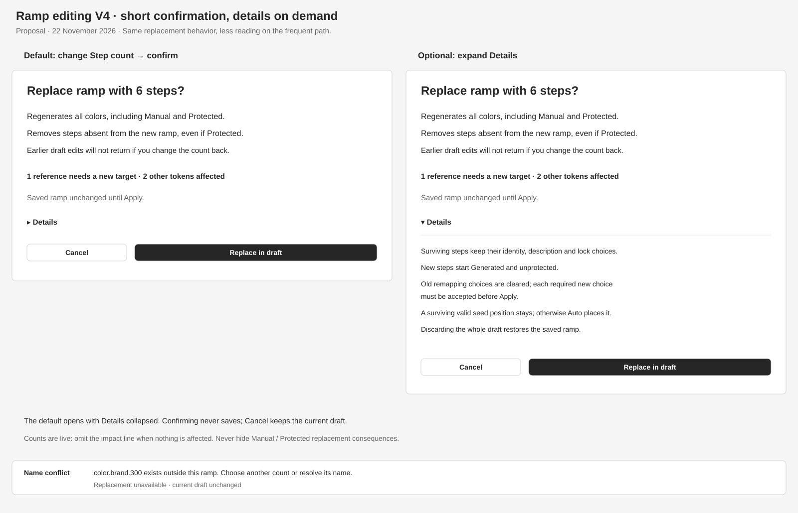
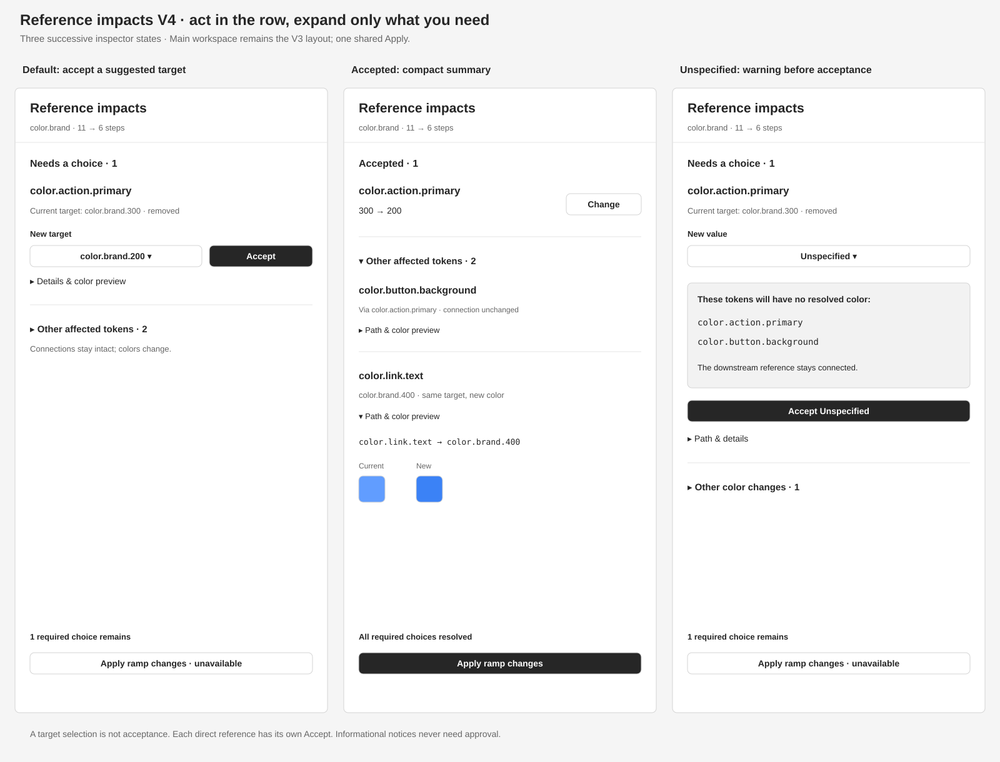

# Color ramp editing V4

**User-accepted UX version — 22 November 2026.**

**Review update — 23 November 2026:** the user-authorized renewed analyst review
of accepted V4, the retained V3 workspace and consolidated Draft 024 is complete.
See [findings and remaining decisions](../../increments/024-color-ramp-authoring.md#renewed-v4v3-analyst-review--23-november-2026).
No material design revision was required; final full-contract agreement and
implementation authorization remain pending. Earlier review gates and check claims
below describe this artifact's preparation date, not the current authorization.

The user accepted V4 as good enough for now. Further UX polish is deferred; do not
keep iterating without a concrete need. This records design acceptance, not completed
analyst review, final agreement to the full increment contract or implementation
authorization.

The user endorsed V3's workflow coverage but found it too verbose for frequent use.
V4 keeps the [agreed behavior](../guided-color-palette-generation.md) and replaces
V3's lengthy confirmation and impact presentation with a shorter path and optional
detail. This is a static design refinement, not implementation or analyst approval.
The [V3 workspace and token inspector](./color-ramp-editing-v3-workspace.svg) remain
the visual reference; fixed Primitive, locks, three component rows, Current/New,
reset behavior and the single Apply boundary are unchanged.

## Short count confirmation

[PNG](../../../output/color-ramp-editing-v4/color-ramp-editing-v4-confirmation.svg.png).

Changing Step count opens the short confirmation with Details collapsed. Essential
consequences remain visible: regenerate Manual/Protected colors, remove missing
steps even when protected, no recovery of manual colors/remapping choices by changing the count
back, live reference-impact counts and no saved change until Apply. No departing-step
list is introduced. Cancel retains the draft; Replace in draft starts the agreed
replacement. The collapsed dialog fits its content rather than reserving the expanded
height. Closing Details never hides the primary actions.

Optional Details explains survivor identity/description/protection, new-step defaults,
cleared remapping choices, individual acceptance, seed placement and whole-draft
discard. It is explanation, not another approval gate. The example's impact count
is illustrative; show actual counts and omit that line when there are no impacts.
Do not claim a complete impact count before calculation is available: pending/error
states must remain truthful and retain the existing action gates.

A conflicting non-member name uses one contextual message beside Step count before
replacement, with its full path and the available route: choose another count or
resolve the name through ordinary editing. Existing draft guards remain. No adoption,
overwrite or extra saving editor is added. Other errors/warnings appear where relevant
rather than permanent instructions in every state.

## Action-first reference review

[PNG](../../../output/color-ramp-editing-v4/color-ramp-editing-v4-impacts.svg.png).

The panels are successive states in the same contextual inspector, not simultaneous
editors. Required choices appear first, then accepted choices and informational impacts.
The normal path is one **Accept** action per affected direct reference:

- Keep the referencing token and current removed target visible. Preselect the
  agreed nearest-label suggestion in the new-target control, with Accept alongside.
  Selection is not acceptance. Other new steps and Unspecified are available in
  that control; there is no preliminary Choose step dialog or bulk accept.
- Expand Details & color preview only when wanted. It shows full paths, the reference
  chain, available Current/New previews and why the numerical suggestion was chosen.
  The compact row never relies on hidden text to identify which token is being edited.
- After acceptance, collapse the row to its token, old/new target and **Change**.
  Accept records a choice in the shared draft; it never saves independently. Opening
  Change edits that choice in place. **Agreed 23 November:** opening Change alone
  keeps the choice accepted. Selecting a different target makes it pending and blocks
  Apply until explicit acceptance or Cancel change. Cancellation restores the previous
  accepted choice. Unspecified retains its disclosure and explicit acceptance below.
- **Other affected tokens · n** remains visibly counted, with the information-only
  summary “Connections stay intact; colors change.” Expand to inspect token paths,
  direct surviving-target versus indirect effects, and per-token previews. These
  notices require no acknowledgement and never manufacture remapping actions.

Selecting **Unspecified** reveals its consequence before the explicit **Accept
Unspecified** button: identify the token and downstream tokens that will have no
resolved color, and say that downstream references remain connected. This warning
is not hidden inside Details or the ordinary informational group. Large lists may
scroll but must remain available before acceptance, without silently omitting impacts.
Other unrelated color-change notices can remain collapsed.

Until that explicit action, the choice remains pending and Apply is unavailable.
After acceptance, show a compact Unspecified summary and unresolved consequence count,
with paths available on demand. A resolved decision may intentionally produce an
unresolved color; Apply can proceed when all other requirements are met. No fallback
or chain flattening is introduced. Seed-only changes retain valid accepted targets
and refresh notices/previews; another confirmed count replacement clears older choices.

## Subsequent regeneration amendment — 23 November 2026

The user agreed that Manual describes authorship; Protected alone preserves a color
during ordinary regeneration. Seed, intensity and seed-position changes regenerate
all unprotected steps, clearing Manual when replaced. Count replacement remains the
explicit protection exception. The V3 workspace note and Draft 024 reflect this
behavioral revision; the earlier analyst review predates it. No artwork redesign
or additional review is claimed here.

## Consolidated review follow-up — 23 November 2026

The [focused analyst review](../../increments/024-color-ramp-authoring.md#focused-consolidated-analyst-review--23-november-2026)
found the later product rules and minimal incomplete-composite model coherent.
The existing artwork still illustrates whole-color aliases, not multiple field
occurrences in a composite. A small identified review example must add token/layer/
field context, field-only Unspecified consequences and accepted/Change/Cancel states;
a focused refill interaction is also needed. [Field review/refill V1](color-ramp-field-review-v1.md)
now supplies that proposed handoff, awaiting user review; it is not accepted or
analyst-reviewed. This is a required handoff, not an
invitation to polish V4 generally. No new design, runtime evidence or implementation
is claimed by recording the findings.

## Access, scope and checks

Use keyboard-operable disclosure controls with expanded state and relationships,
visible focus and descriptive labels. Each repeated Accept action includes its token
context for assistive technology. Do not move focus away on expanding details; after
acceptance, keep focus on the compact row's Change control or another explicit stable
control. These focus details are proposals for the final interaction contract.

The inspector's shared Apply footer remains reachable. Existing narrow-view behavior,
20-step scrolling, draft departure guard, recovery and all protection/identity rules
are unchanged from V3 and the owning direction. V4 adds no “don't ask again”, implicit
acceptance, skip-review mode, automatic remapping or new behavioral policy.

Outstanding numerical, reference eligibility/Unspecified, repeated-replacement representation,
remaining ordinary-edit details and metadata/history contracts remain the [Draft 024](../../increments/024-color-ramp-authoring.md)
questions. UX acceptance does not settle them. A renewed analyst check remains
a separate next step; no implementation is authorized.

Both SVGs were parsed, rendered and visually inspected; local links and Markdown
whitespace checked. Existing color examples were reused without numerical claims.
Temporary square Quick Look canvases prevent clipping; exported PNGs retain lower
whitespace while SVGs keep the intended dimensions. Checks stopped at approximately 8/10 aggregate minutes (designer 6, coordinator 2),
zero harness repairs. The coordinator also inspected both rendered sheets. Older campaigns remain stopped. No
production edits, runtime tests, analyst review, staging or commit occurred.
