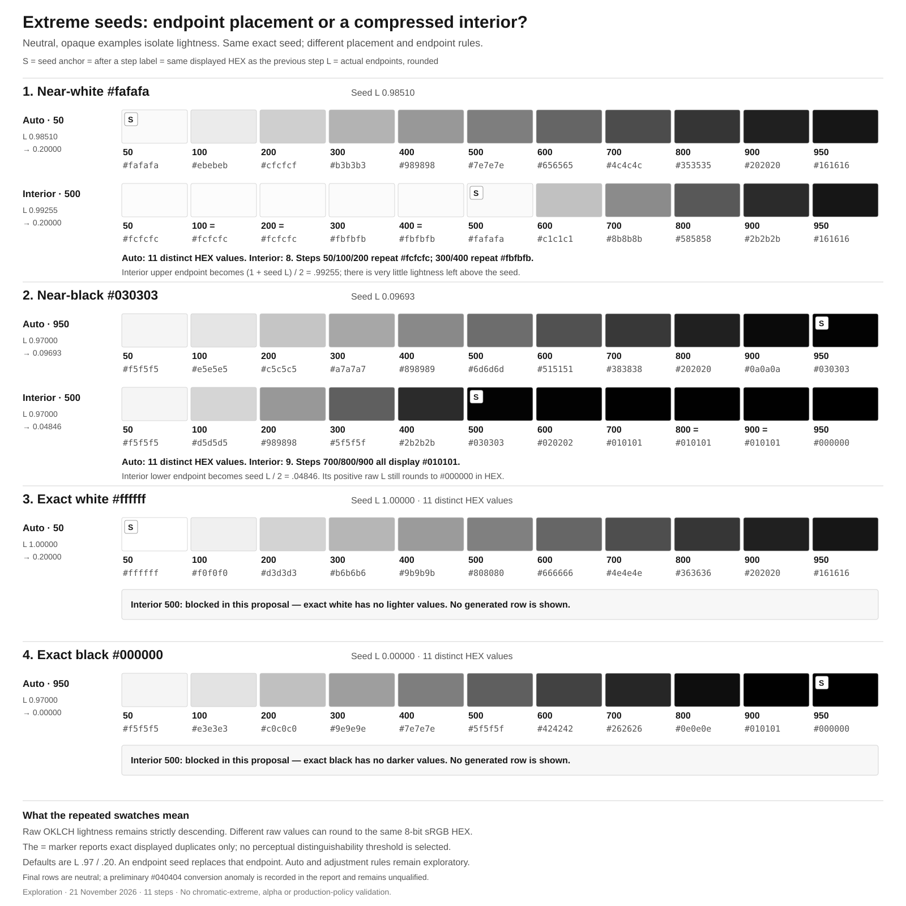

# Extreme-seed endpoint comparison V1

**Numerical and visual exploration — 21 November 2026. Endpoint policy not selected; no implementation authorized.**

This comparison tests an illustrative endpoint policy with near-white, near-black,
exact white and exact black seeds. Neutral opaque inputs deliberately isolate
lightness and placement. It does not qualify chromatic extremes or alpha behavior.
The coordinator computed the samples with Culori 4.0.2; the designer arranged their
exact displayed values.

**S** marks the exact seed. **=** after a step label means its displayed HEX matches
the preceding step. Endpoint lightness values on the sheet are rounded to five
decimal places; the [sample data](../../../output/color-ramp-endpoints-v1/data.json)
retains the underlying coordinates. No fabricated swatch row is drawn for a blocked
placement.

## Policy being explored

- Start with lightness endpoints 0.97 and 0.20 and 11 named steps.
- Auto selects the nearest reference lightness
  `0.97 − 0.77 × (step − 50) / 900`, resolving ties toward the lighter step.
- A seed at an endpoint replaces that endpoint exactly.
- For an interior seed at or above 0.97, use upper endpoint `(1 + seed L) / 2`.
  For an interior seed at or below 0.20, use lower endpoint `seed L / 2`.
- Interpolate lightness linearly on each side using numeric step positions.
- Restrict exact white to step 50 and exact black to step 950. Under this proposal,
  an interior placement is blocked because it cannot have strictly lighter steps
  above white or strictly darker steps below black within the lightness bounds.

All seeds have zero chroma, so the retained-chroma setting remains zero throughout.
Hue has no visual effect. The generated coordinates are OKLCH; HEX is an 8-bit sRGB
preview. No gamut mapping was needed for these final samples.

## Observations

| Seed | Auto result | Manual interior position 500 |
| --- | --- | --- |
| Near-white `#fafafa`, L ≈ 0.98510 | Seed at 50; endpoints ≈ 0.98510 / 0.20; 11 distinct displayed HEX values. | Upper endpoint ≈ 0.99255; only 8 distinct displayed HEX values. Steps 50/100/200 share `#fcfcfc`, and 300/400 share `#fbfbfb`. |
| Near-black `#030303`, L ≈ 0.09693 | Seed at 950; endpoints 0.97 / ≈ 0.09693; 11 distinct displayed HEX values. | Lower endpoint ≈ 0.04846; 9 distinct displayed HEX values. Steps 700/800/900 share `#010101`. Step 950 rounds to `#000000` despite positive raw lightness. |
| White `#ffffff`, L = 1 | Seed at 50; endpoints 1 / 0.20; 11 distinct displayed HEX values. | Blocked by the explored policy; no candidate ramp. |
| Black `#000000`, L = 0 | Seed at 950; endpoints 0.97 / 0; 11 distinct displayed HEX values. | Blocked by the explored policy; no candidate ramp. |

All six generated rows have strictly descending raw lightness. The repeated HEX
values therefore represent display quantization, not duplicate authored OKLCH
coordinates. Distinct HEX values also do not establish perceptual distinguishability;
no such threshold has been selected.

The design implication is that preserving an extreme interior seed can produce
several visually repetitive steps on its short side. Auto endpoint placement avoids
those exact HEX repetitions in these samples, while manual placement provides the
requested anchor at the cost of an uneven distribution. A later interface could
explain the repeated preview values before acceptance. This comparison does not
decide whether to warn, restrict placement or accept such ramps without a warning.

## Numerical qualification limit

A preliminary near-black fixture using `#040404` produced `#010001` at its interior
dark endpoint from nominally neutral OKLCH input in the conversion/HEX pipeline.
That observation remains unresolved; no investigation or production fix was
authorized. The displayed comparison uses `#030303` instead, whose final samples
pass the grayscale check. Changing the fixture keeps the endpoint example neutral;
it does not establish that the earlier behavior is correct, fixed or irrelevant.

## Reproducibility and checks

The [generation script](../../../output/color-ramp-endpoints-v1/generate.mjs) and
[data](../../../output/color-ramp-endpoints-v1/data.json) record the exact inputs,
endpoint values, blocked cases and duplicate pairs. The coordinator checked
monotone raw lightness, exact anchors and grayscale output for the final fixtures.
The designer checked all 66 displayed swatches, six seed and five duplicate
markers, two blocked notices, SVG XML, canvas bounds and local links. The
coordinator rendered the full sheet and inspected all six rows, labels and blocked
notices with no clipping observed. A
[PNG preview](../../../output/color-ramp-endpoints-v1/comparison.png) is available.

Other counts, chromatic extreme colors, alpha, precision guarantees and visual
distinguishability remain unqualified. No application code, contract or retained
project data was changed. No analyst review or production-policy agreement is
claimed.
