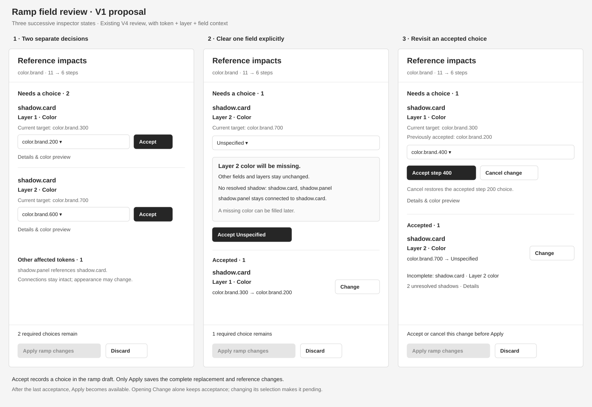
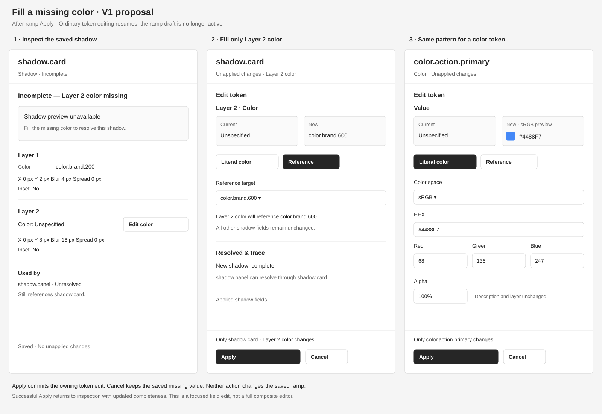

# Ramp field review and missing-color refill V1

**Focused flow accepted and analyst-reviewed — 23 November 2026.** The user accepted
the flow for focused analyst review; that review found no material contradiction or
new interaction gap. Final Draft 024 agreement and implementation authorization remain
outstanding. Prepared against clean base `2bf52db` following the
[consolidated review findings G1/G2](../../increments/024-color-ramp-authoring.md#focused-consolidated-analyst-review--23-november-2026).

Keep [V4](color-ramp-editing-v4.md)'s compact reference review and the retained
[V3 workspace](color-ramp-editing-v3.md). These two sheets extend the existing
inspector only where identifying composite fields and completing missing colors
requires it. The [minimal composite contract](../../design-tokens/incomplete-composites.md)
owns data semantics; this proposal does not add a full composite editor or repair wizard.

## Review the field being changed

[PNG preview](../../../output/color-ramp-field-review-v1/color-ramp-field-review-v1-review.svg.png).

The example confirms `color.brand` from eleven to six steps. In `shadow.card`, Layer 1
color references removed step 300 and Layer 2 color references removed step 700.
`shadow.panel` references the whole `shadow.card`. New nearest-label suggestions are
200 and 600 respectively, with lower-label tie-breaking. There are **two required
choices in one token**, not one token-wide decision.

1. Keep the full token path and **Layer n · Color** visible in every pending row.
   Show the current removed target, suggested/new target and individual Accept.
   Full preview and explanation remain under Details. Number layers from 1 for users;
   the row identifies the exact occurrence in the reviewed snapshot, not a new token.
2. After accepting Layer 1 → 200, choose Unspecified for Layer 2. Before acceptance,
   explain that only Layer 2 color will be missing, other fields/layers stay unchanged,
   and both `shadow.card` and `shadow.panel` will lack a resolved shadow. The latter
   keeps its connection to the former. This is a shadow consequence, not “no color”
   copied indiscriminately from whole-color examples. The warning stays visible.
3. After accepting Layer 2 Unspecified, reopen Layer 1 with Change and select 400.
   Show the previously accepted 200 choice plus Accept step 400 / Cancel change.
   Opening Change alone preserves acceptance; changing the selection makes the row
   pending and blocks Apply. Cancel change restores accepted 200. The compact accepted
   Layer 2 row retains field identity, Unspecified and the unresolved consequence count.

Counts track required **reference occurrences**, while informational impact counts
track affected tokens. Do not confuse two references in one shadow with two shadows.
In this example the completion of the last choice enables Apply ramp changes; only
that shared action saves removal and reference edits together. No field save or
independent token editor opens during ramp review. All latest protection, identity,
draft replacement and Discard decisions remain unchanged.

## Fill a missing color after Apply

[PNG preview](../../../output/color-ramp-field-review-v1/color-ramp-field-review-v1-refill.svg.png).

The first two panels continue the review example after accepting the original Layer 1
suggestion 200 and Layer 2 Unspecified, then applying the ramp. The third panel is a
parallel example of an already-saved Unspecified whole-color token; it is not another
unshown reference decision in the preceding ramp review.

- Ordinary inspection of `shadow.card` shows **Incomplete — Layer 2 color missing**,
  the unavailable preview, existing layer fields and **Edit color** beside that field.
  Other shadow fields are inspectable; this is not permission to author every composite
  field in this increment.
- Edit color opens a focused section in the same owning token inspector. Keep
  **Layer 2 · Color**, Current Unspecified and New candidate visible. Reuse the existing
  **Literal color / Reference** modes. The illustrated Reference choice targets
  `color.brand.600`; Literal color instead exposes the owned space/component/alpha
  controls. There is no intermediate per-field Save or Accept.
- The ordinary token **Apply** commits the owning token change, preserving every
  other field, layer, token identity and metadata. Its scope says only Layer 2 color
  changes. **Cancel** restores the saved missing field. Successful Apply returns to
  inspection and recomputes completeness/resolution; the ramp is unchanged. One normal
  token edit owns the command and history boundary.
- The same missing-to-value pattern works for `color.action.primary` with no assigned
  value: Current Unspecified, New candidate, Literal color / Reference, ordinary
  Apply/Cancel. The sheet illustrates the literal alternative using the existing
  sample `#4488F7`; its description and layer are unchanged.

Only offer this ordinary-edit path once the ramp draft has been applied/discarded or
the existing departure guard has been resolved. Do not mount a second independently
saving editor alongside an active ramp draft. The field-level draft is owned by the
ordinary token session; it is not a separate persistence transaction inside that session.

## Validation, access and retained safeguards

- Blank/incomplete or invalid literal input, an invalid reference target, pending
  validation and stale/unknown writes keep Apply unavailable or use existing recovery.
  Retain input on failure; never claim saved success or navigate away prematurely.
  Unspecified in the *saved* Current pane is not itself a validation error. A still
  missing unchanged value creates no new write. A valid candidate is needed to fill it.
- Candidate completeness is derived. “New shadow: complete” is true in this specific
  example because all other fields/dependencies are valid; do not generalize it into
  a promise that filling one field resolves every diagnostic.
- Repeated Accept, Change and Edit color actions have accessible names including token,
  layer and field. Keep occurrence identity readable, not only in tooltips. On accepting
  a row, focus its Change control; Cancel change returns to that same occurrence.
- Edit color moves focus to the value-mode/first relevant control. Cancel returns to
  that field's Edit color action; successful Apply returns focus to its field summary.
  Whole-color refill follows the normal token-editor focus policy. These sequences
  are proposed, not runtime-verified.
- Use owned keyboard-operable fields/disclosures, visible focus and reachable errors.
  Long paths wrap; required and accepted occurrences scroll inside the inspector with
  the shared footer reachable. Narrow layouts use the existing separate inspector
  view and preserve the selected occurrence/draft. No new narrow-layout artifact.

## Proposal boundaries and evidence

The interaction choices accepted for this focused handoff are the persistent token/layer/
field row identity and counts, the ordinary **Edit color** entry point, and the focused
Current/New refill section using the owning Apply/Cancel boundary. This proposal
implements no application behavior and does not settle schema versions, numerical
policy, invalid-ramp recovery or whole-group deletion. Material revisions return to
the user before renewed analyst review. The separate analyst reviewed committed
snapshot `1ec4abd0de122d0e402ee894f5dfa4db4955ee9d`, including both retained PNGs.
G1 and G2 are covered at design-contract level; production eligibility, authoring
operations and validation integration remain unimplemented. See the
[review record](../../increments/024-color-ramp-authoring.md#field-reviewrefill-v1-analyst-review--23-november-2026)
for scope and verification limits.

The two SVGs reuse V4's neutral structure, typography, spacing and compact action
hierarchy. Color examples are illustrative reused samples, not numerical fixtures.
SVG XML parsed and local links/whitespace checked. The first Quick Look render failed
at sandbox initialization before rendering (`sandbox_extension_issue_file` / invalid
path filter). The coordinator retried the same renderer with the required permission;
both PNGs rendered and were visually inspected. A too-long refill-sheet caption was
shortened, and the coordinator rerendered/rechecked that sheet without observed
caption overlap. No harness was modified.
Temporary square render canvases preserve the full sheet, with lower whitespace in
the PNGs. No runtime/accessibility evidence or production tests are claimed. Designer
source preparation/checks used approximately seven of the eight-minute allowance;
coordinator render/inspection time is recorded separately in Draft 024.
Earlier qualification campaigns remain stopped. Staging/committing/pushing belong
to the user.
