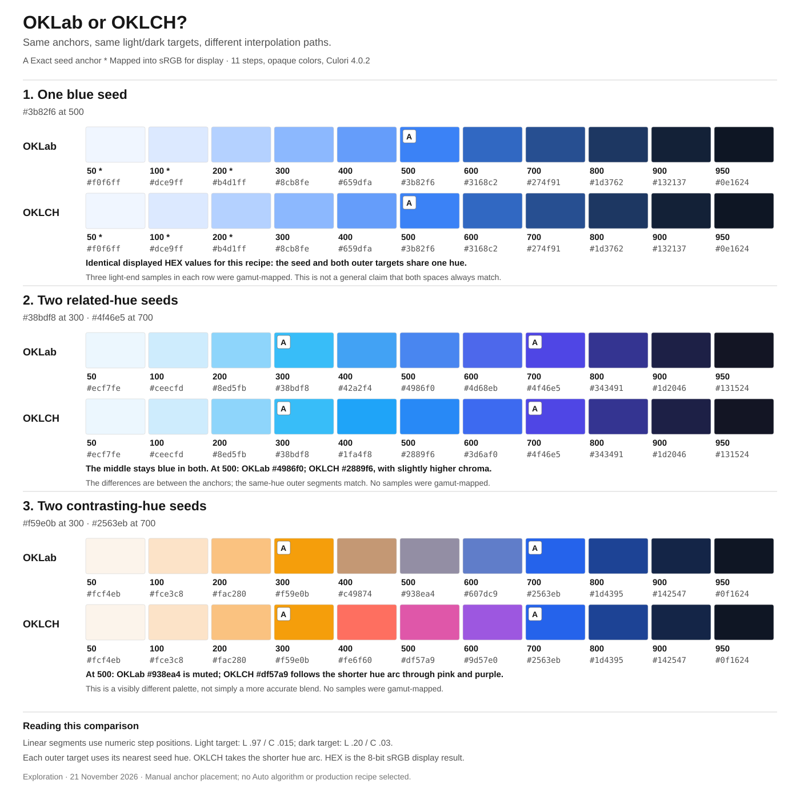

# Color ramp interpolation comparison V1

**Numerical and visual exploration — 21 November 2026. No recipe selected or implementation authorized.**

The user requested an actual OKLab/OKLCH comparison for one blue seed, two related
hues and two contrasting hues. The coordinator computed the samples using the
installed Culori 4.0.2; the designer arranged those exact display values below.
This is not an analyst-reviewed design or an agreed production calculation policy.

## Inputs and reproducibility

The [sample data](../../../output/color-ramp-interpolation-v1/data.json) contains
raw coordinates, displayed values, anchor flags and gamut-mapping flags. The
[generation script](../../../output/color-ramp-interpolation-v1/generate.mjs)
owns reproducibility. The SVG uses each recorded HEX verbatim; **A** marks an exact
seed anchor and **\*** marks a sample mapped into sRGB for display.

These examples use 11 steps and opaque sRGB seeds, manually assigned to positions.
They do not demonstrate Auto placement. Piecewise linear interpolation uses numeric
step-label positions, so the 50–100 interval is shorter than 100–200. Both methods
use the same outer targets: lightness 0.97/chroma 0.015 with the first seed's hue,
and lightness 0.20/chroma 0.03 with the last seed's hue. Those endpoint choices are
illustrative recipe assumptions, not accepted defaults.

OKLab interpolates Cartesian components; OKLCH uses the shorter hue arc in this
comparison. Out-of-sRGB generated samples use Culori's OKLCH chroma-clamping
operation before 8-bit HEX display. Exact seed HEX values are preserved. These
method choices follow the coordinator's checks of the
[Culori API](https://culorijs.org/api/) and
[CSS Color 4 interpolation guidance](https://www.w3.org/TR/css-color-4/#interpolation).

## What the computed samples show

| Scenario | Observed result | Design implication |
| --- | --- | --- |
| Blue `#3b82f6` at 500 | Every displayed HEX matches between rows. Each row maps three light-end samples into sRGB. | With these same-hue endpoints, this example gives no visual reason to prefer one method. Endpoint and gamut policies still matter. |
| Cyan-blue `#38bdf8` at 300, indigo `#4f46e5` at 700 | At 500, OKLab gives `#4986f0`; OKLCH gives `#2889f6`. Raw midpoint chroma is approximately 0.172 versus 0.185. No mapping occurs. | The difference is modest and concentrated between anchors: OKLCH keeps somewhat more chroma in this example. |
| Amber `#f59e0b` at 300, blue `#2563eb` at 700 | At 500, OKLab gives muted `#938ea4`; OKLCH gives pink `#df57a9`. Raw midpoint chroma is approximately 0.033 versus 0.190. No mapping occurs. | The shorter hue route creates a pink/purple intermediate family. It is a substantive palette choice, not a universally better blend. |

The single-seed match depends on the same-hue endpoint construction; it does not
establish equivalence for arbitrary ramps. The two-seed examples also share their
outer segments because each outer target keeps the adjacent seed's hue.

My design conclusion is to choose the intended behavior for widely separated
seeds before declaring a default. If preserving chromatic intensity along an
explicit hue journey is desired, the OKLCH result demonstrates that direction.
If a quieter transition is desired, the contrasting OKLab example better expresses
it. These three examples do not establish a universal quality ranking. In
particular, introducing multiple seeds makes the visible intermediate hues a user
decision worth previewing, not merely an internal precision choice.

## Relation to the latest scope discussion

The user has subsequently agreed multiple seeds, 2–20 steps with 11 by default,
and labels with first `50`, last `950`, and interior
`round(1000 × i / (n − 1))` for zero-based interior index `i`. They also selected
dialog creation followed by central-workbench editing. This exploration uses the
default 11-step case only; it does not test other counts or settle how anchors move
when count changes. The coordinator owns reconciliation of that newer scope with
the increment contract and earlier interface artifacts.

Still unresolved here: the production interpolation choice, hue-route controls,
endpoint recipe, Auto placement, alpha, stored output space, precision and gamut
policy, and manual override behavior when topology changes. No application code,
retained project data or implementation contract was changed by this artifact.

## Checks and limitations

The designer checked SVG XML, canvas bounds and all 66 swatch values plus
anchor/mapping marker counts against the supplied data. The coordinator rendered
and visually inspected the full sheet with no clipping observed, and checked
11 distinct valid-sRGB HEX values per row, exact seed values, equal pre-mapping
lightness at each sample and the single-seed row match. A
[PNG preview](../../../output/color-ramp-interpolation-v1/comparison.png) is available.
The swatches are sRGB display results; this is not wide-gamut display
qualification, accessibility contrast analysis or production numerical validation.
