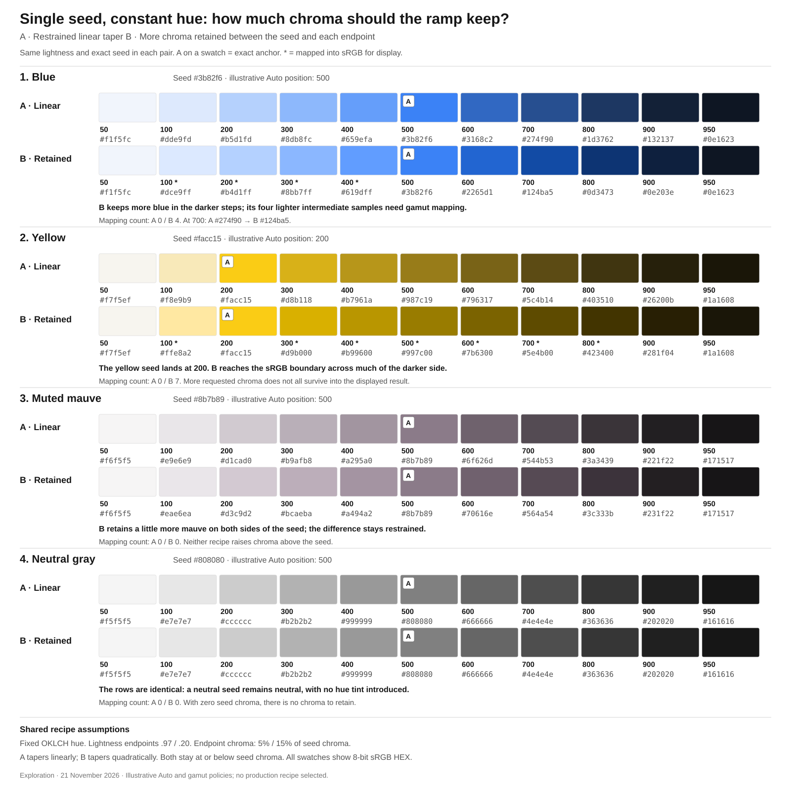

# Single-seed ramp recipe comparison V1

**Numerical and visual exploration — 21 November 2026.**

**Subsequent user decision:** B is the default chroma behavior, with A available as
an alternative; the step-count maximum is confirmed at 20 (2–20, default 11).
See the [owning decisions](../guided-color-palette-generation.md#first-increment-decisions--21-november-2026).
The observations below preserve the comparison evidence. Full production numerical
policy is not agreed and no implementation is authorized.

The user requested a comparison between a restrained chroma taper and a recipe
that retains more chroma between the seed and the endpoints, then confirmed the
preference to keep hue constant. The coordinator computed four examples using
installed Culori 4.0.2. The designer laid out those exact display values below.

## What is being compared

Both rows use the same seed, anchor position, piecewise-linear lightness and
constant OKLCH hue. Lightness reaches 0.97 at step 50 and 0.20 at 950. Exact gray
uses zero chroma; neither recipe adds a tint. Exact input HEX is retained at the
anchor, marked **A** on each row. **\*** marks generated samples mapped into sRGB
before display. All shown values are rounded 8-bit sRGB HEX.

Let `Cs` be seed chroma, `t` the normalized distance from the seed to the relevant
endpoint, and `e` the endpoint chroma ratio: 0.05 on the light side and 0.15 on the
dark side. Distance uses numeric step positions, not equal array-index spacing.

- **A — Linear:** `C = Cs × (e + (1 − e) × (1 − t))`.
- **B — Retained:** `C = Cs × (e + (1 − e) × (1 − t²))`.

Both have identical endpoints and never exceed seed chroma. B stays closer to seed
chroma between the anchor and each endpoint. It does not increase chroma beyond
the input seed or change the lightness curve.

For this exploration only, Auto chooses the nearest reference lightness
`0.97 − 0.77 × (step − 50) / 900`; ties choose the lighter step. The selected
positions are blue 500, yellow 200, mauve 500 and gray 500. These four seeds fall
within the chosen lightness endpoints; extreme seeds are not covered.

Out-of-sRGB generated colors use Culori's OKLCH `clampChroma`. Constant hue describes
the calculated OKLCH path, not a guarantee that converting every rounded HEX back
to OKLCH reconstructs exactly the same hue angle. The endpoint, Auto, taper and
gamut policies remain illustrative choices.

## Observations and design judgment

| Seed | Observed difference | sRGB-mapped samples, A / B |
| --- | --- | --- |
| Blue `#3b82f6` | B keeps more color in the darker blue steps. At 700, A is `#274f90` and B is `#124ba5`; four lighter B samples hit the gamut limit. | 0 / 4 |
| Yellow `#facc15` | B reaches the sRGB boundary across much of the darker side. Several HEX results have a zero blue channel; the requested extra chroma does not all survive mapping. | 0 / 7 |
| Muted mauve `#8b7b89` | B has a slightly stronger mauve tint on either side of the seed, while remaining restrained. | 0 / 0 |
| Neutral gray `#808080` | Every displayed HEX is identical. Both remain grayscale because seed chroma is zero. | 0 / 0 |

B is not uniformly better. Its stronger darker blues may be useful, but the yellow
example shows how often the requested curve can exceed the display gamut. For the
muted and neutral examples, the difference is subtle or absent. A is the more
restrained candidate in this sample set; B is a deliberate alternative when more
color between the seed and endpoints is desired. These observations alone do not establish behavior for every hue and chroma;
the subsequent user selection of the default is recorded above.

## Scope and reproducibility

The first increment is now single-seed, with 2–20 steps and 11 by default;
multiple anchors are deferred. The earlier
[OKLab/OKLCH multi-seed comparison](./color-ramp-interpolation-v1.md) remains a
historical exploration, not current first-increment scope. This sheet uses only
the default 11-step case and does not settle count-change, override or anchor
relocation behavior.

The [generation script](../../../output/color-ramp-recipes-v1/generate.mjs) and
[sample data](../../../output/color-ramp-recipes-v1/data.json) retain the calculations,
raw coordinates and mapping flags. No production code or retained project data
was changed. Alpha handling, extreme seeds, final Auto behavior, endpoint policy,
precision and gamut policy remain unresolved.

## Checks and limitations

The coordinator's calculation checks cover equal pre-mapping lightness and fixed
hue per pair, monotone raw lightness, exact input HEX, generated chroma no greater
than seed chroma, and grayscale output for the neutral seed. The designer checked
SVG XML, canvas bounds, all 88 swatch values and anchor/mapping markers against
the data. The coordinator rendered and inspected the complete sheet; no clipping
or overlapping labels were observed. A [PNG preview](../../../output/color-ramp-recipes-v1/comparison.png)
is available.
This is not production numerical qualification, contrast analysis or a validated
Auto algorithm. No analyst design review or implementation approval is claimed.
