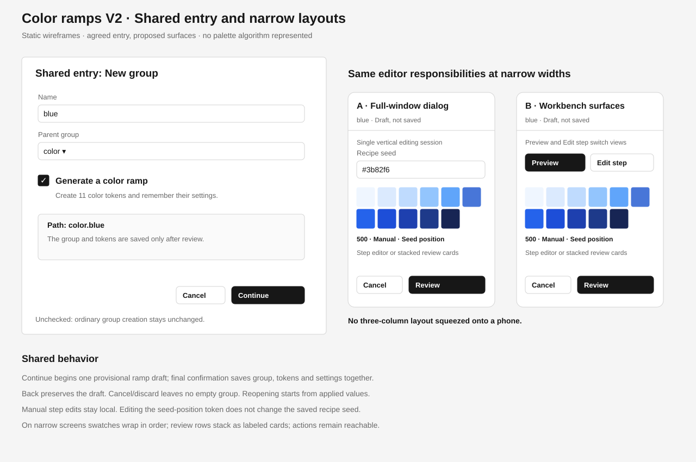
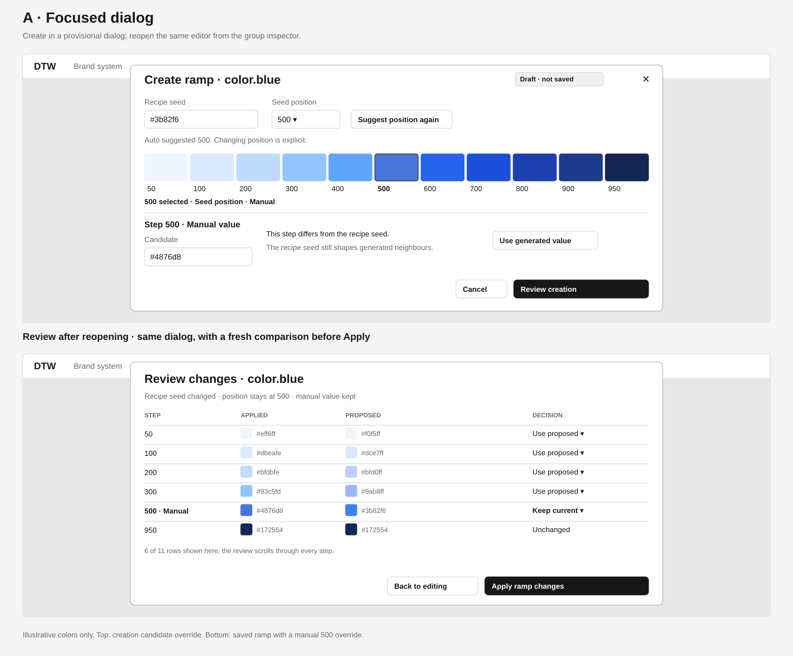
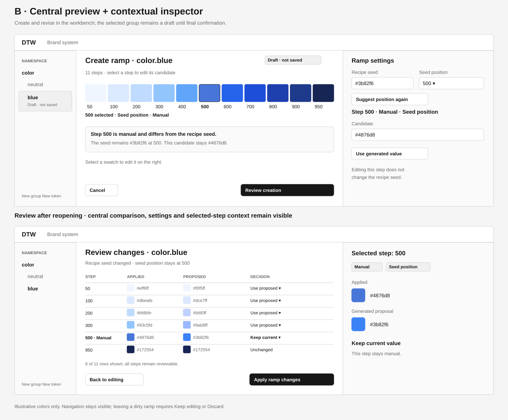

# Color ramp authoring — wireframe comparison V2

**Historical comparison:** the user subsequently selected dialog creation and
central-workbench editing. [Creation V3](color-ramp-creation-v3.md) supersedes the
creation portions, including removal of individual-step editing before creation.
V2 is not the current creation proposal.

**Designer exploration — 20 November 2026. Surface choice and design approval pending.**

The user authorized static wireframes comparing a focused dialog with a central
preview and contextual inspector. They agreed to enter through **New group** with
a **Generate a color ramp** checkbox and keep the group provisional until final
confirmation. This supersedes V1's dedicated New ramp entry proposal; it does not
approve either editing surface, the full contract or implementation.

The [Increment 024 draft](../../increments/024-color-ramp-authoring.md) owns scope
and unresolved decisions. The [ramp concept](../guided-color-palette-generation.md),
[visual direction](../visual-direction.md) and [presentation conventions](../presentation-conventions.md)
remain authoritative. These are static comparison artifacts, not an interactive
prototype or evidence that generation, keyboard behavior or persistence works.

## Shared entry and narrow layouts

Keep the existing **New group** and **New token** actions. The group form retains
name, parent and path preview. With **Generate a color ramp** checked, **Continue**
opens a ramp draft; unchecked, ordinary group creation remains unchanged. Continue
does not save an empty group. Final confirmation saves group, tokens and metadata
together. Back preserves the draft; discarding leaves no group behind.

Both alternatives use the same fixed 11 steps, explicit recipe seed, Auto placement
suggestion, manual candidates and reviewed application. The illustrations use
synthetic blue colors and HEX labels solely to compare layouts. They do not select
a numerical algorithm, authored color space, gamut or alpha policy. The samples
are not assertions about generated color quality.

## A — Focused dialog

After Continue, the group form becomes the larger ramp editor within the same
editing session. The background workbench is unavailable for editing. The top
frame shows creation, including a manually adjusted candidate at the seed position.
Selecting a swatch updates the one selected-step editor below the strip. Recipe
settings remain separate from that local value editor.

The second frame shows reviewing changes after reopening a saved ramp. Review is
another stage in the same dialog; **Back to editing** retains settings, manual
candidates and decisions. Reopening later uses a contextual **Edit ramp** action
in the group inspector and the same editor. Ordinary group inspection can show a
concise saved-ramp summary without housing the whole generator.

**Benefit:** a clearly bounded draft with ample comparison width and one obvious
confirmation point. **Tradeoff:** normal browsing is interrupted while editing.

## B — Central preview and contextual inspector

After Continue, the group form closes into a ramp authoring mode within the
workbench. The namespace shows **blue — Draft · not saved** as a provisional
navigation item, distinct from applied groups. It disappears on discard and becomes
the ordinary saved group only after confirmation. Selecting this draft returns to
its session; it is not an already-created empty group.

The centre shows all 11 candidates; selecting one updates its editor in the
inspector. The inspector also keeps recipe settings visible, clearly separated
from the selected token's value. A single central action region owns Cancel/Review
and final application; there is no second independent Apply in the inspector.

Review replaces the central preview with Applied/Proposed comparisons. The inspector
shows the selected step's comparison and status. It does not provide a second
conflicting set of acceptance controls. Reopening a saved ramp uses the same mode
through its group context. Normal browsing of that group's ordinary tokens remains
a separate mode; unsaved ramp proposals never become its applied token list.

**Benefit:** the ramp uses the workbench's visual context and the inspector's
existing focused-editing role. **Tradeoff:** navigation and view switching need
explicit draft protection. Selecting another group/token while dirty must offer
**Keep editing** or **Discard**, rather than silently abandoning or saving the ramp.

## Equivalent behavior in both alternatives

- Recipe seed and applied seed-position token are separate. A manual 500 value can
  differ from the recipe seed at 500. Show both **Manual** and **Seed position**;
  generated neighbours still use the recipe seed. Editing the selected step never
  silently changes that seed.
- Auto initially suggests a step that can be replaced explicitly. Once accepted,
  the saved position remains stable. **Suggest position again** requests another
  fit; reopening does not recompute placement or rewrite values.
- Manual candidates remain protected during settings changes. **Use generated
  value** previews a replacement; only accepting it clears the applied override.
  A fresh manual candidate edit must remain visible rather than be lost to a
  keep-current default.
- Review shows every step, complete paths and relevant settings/status changes.
  The sheets show six rows to demonstrate layout; the actual review must expose
  all 11. Table step labels are compact because the common group path is visible;
  full paths must remain available per row in the final design.
- Creation review has no Applied values and confirms all 11 candidates with
  **Create group and tokens**. Reopened-ramp review compares current and candidate
  values with per-step **Keep current value** / **Use proposed value**, followed by
  one **Apply ramp changes**. Keeping a divergent generated value makes it manual;
  accepting a manually edited proposal keeps its manual status. The draft contract
  still requires agreement on these acceptance and protection details.
- Applied values and settings change together as one operation and Undo step.
  Settings-only or override-status changes remain reviewable even if colors look
  unchanged. No-op handling follows the existing contract.

## Narrow, keyboard and failure behavior to validate

The common sheet includes narrow sketches. A becomes a full-window dialog with
vertically ordered settings, wrapping swatches and step controls. B uses the
existing browse/edit separation: **Preview** contains recipe settings and the
ramp; **Edit step** opens the selected-step surface. Switching views retains one
shared draft. Review rows become labeled cards in either option, with all choices
and actions reachable without squeezing a desktop table onto a phone.

Use labeled keyboard-operable swatch buttons with visible selection and text
status. Move focus to the ramp heading on entry and review heading on review; return
to the prior selected-step control on Back where possible. A traps focus within
its dialog; B preserves workbench navigation with the dirty-departure guard. After
creation, select the saved group and announce completion. Exact focus targets,
scroll behavior, breakpoint geometry and assistive-technology delivery require
validation after the user chooses a surface.

Invalid fields retain input and block progression with a local explanation. Name
collisions return to the group fields without losing candidate edits. Failed writes
retain the draft. Changed revisions, unavailable members and unknown outcomes need
the existing explicit review/recovery behavior rather than blind retry or silent
replacement. Neither wireframe adds concurrent normal-token editing while a ramp
proposal is active or promises persistent drafts after browser reload.

## Recommendation and next decision

Both options now honor the scalable New group entry. A remains the smaller focused
editing experience; B makes the ramp a more continuous part of ordinary workbench
use. Prefer **A for the first bounded slice** if minimizing navigation/session
complexity matters most. Prefer **B** if comparing and adjusting ramps in the
workbench is a central everyday task worth that additional interaction scope.

The user should choose which surface to develop, or identify elements to combine.
No surface is approved and no analyst design review has occurred. Numerical policy,
token protection, membership eligibility and metadata compatibility remain open
regardless of the surface choice. The next design revision should refine the chosen
option, not treat these wireframes as an implementation-ready specification.

## Artifact checks

SVG XML and basic bounds are checked by the designer. All interface geometry is
illustrative. The coordinator rendered and visually inspected all three sheets. Quick Look
initially cropped wide thumbnails; temporary square-canvas copies allowed full-width
inspection without changing source artifacts. Browser interaction, narrow runtime
behavior and accessibility are not tested.
No production files or interactive prototype were changed.
