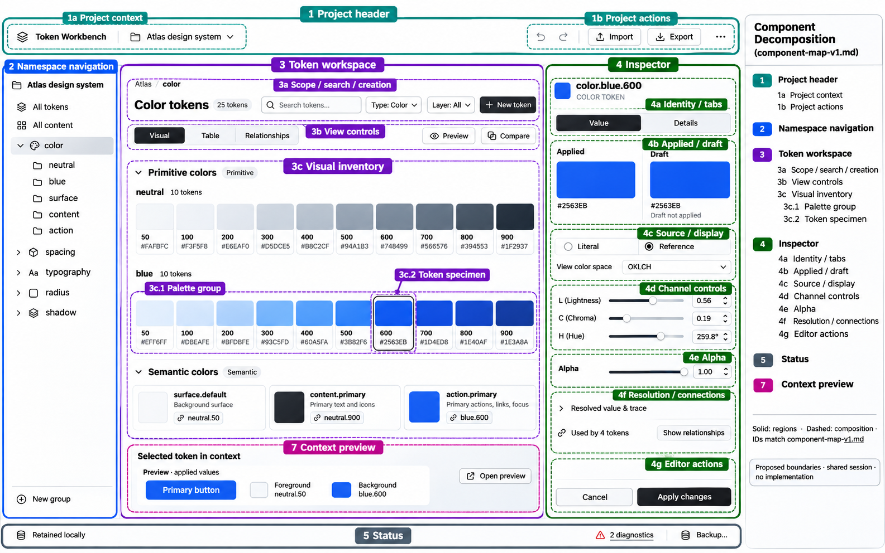
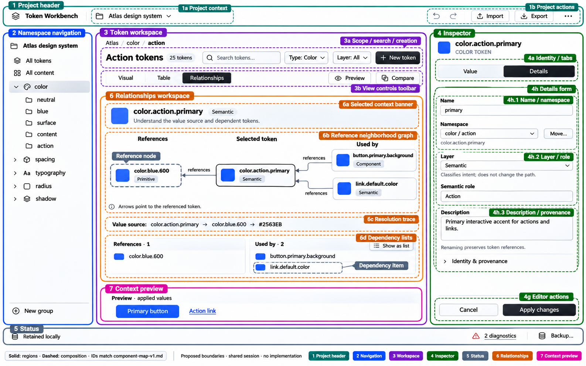
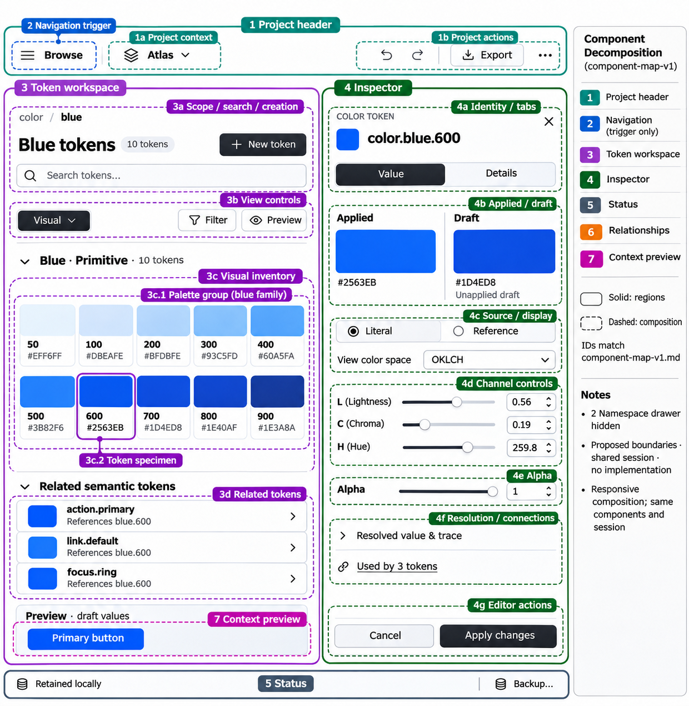
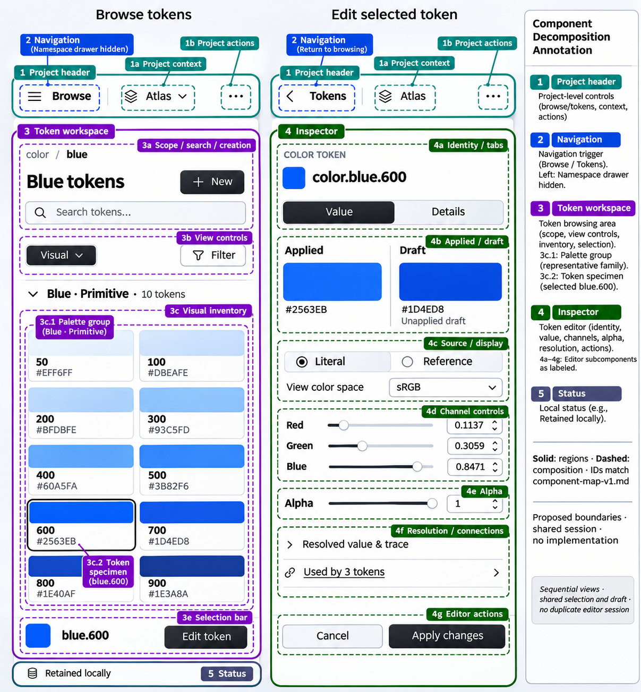

# Workbench layout component map V1

**Proposal — 15 November 2026.** This maps the four saved visual references to
possible React responsibilities. It supplements the [layout direction](./README.md)
and the [current organisation](../workbench-component-organisation.md); it does
not replace current ownership or establish a finalized architecture.

**Organisation follow-up — 15 November 2026:** the user endorsed the
[component-oriented presentation organisation proposal V1](./presentation-organisation-proposal-v1.md).
That proposal replaces this document's conservative target folder paths with a
structure without `features/workbench`, while retaining the annotation IDs and
responsibility guidance below. The paths here remain the original decomposition
proposal, not the preferred future tree or a record of a completed migration.

The annotated images describe visual regions and nested rendering sections.
They do not prescribe one file per rectangle or prove delivered behavior.
No implementation, analyst review, new feature contract or qualification restart
is authorized by this map.

## Annotated references

### Wide desktop: visual library



### Wide desktop: relationships



### Half-screen desktop



### Mobile: successive browse and edit screens



### Reading the annotations

Large outlines identify shell regions 1–5. Dashed outlines identify nested
responsibilities. Region 6 is alternate central content within region 3, not an
additional permanent pane. Region 7 is a contextual preview within region 3.
The same numbers have the same meaning across images; not every section is
visible in every state. Generated inconsistencies remain subject to the layout
reference's [interpretation notes](./README.md#interpretation-notes).

Teal identifies project context/actions, blue navigation, violet the token
workspace, green the inspector, slate status, orange relationships and magenta
context preview. These colors are annotation ink, not proposed application theme
colors. Repeated leaves are outlined once as examples rather than labeling every
swatch or list row. An outlined section may remain local JSX; boundaries do not
require a separate file, hook, state store or DOM wrapper.

The annotated derivatives were made with the built-in image generation tool;
the [exact prompts](./annotation-prompts-v1.md) are saved. They may rescale or
re-render source details and are not pixel-preserving overlays. Original mockups
remain unchanged in `mockups/`. Use the numbered responsibility map below for
ownership, the originals for visual direction and the application for current
behavior. In the relationship annotation, 4a's outline emphasizes the tabs;
the selected-token heading immediately above belongs to that same responsibility.

## Mapping to React responsibilities

Paths below are relative to `src/presentation/features/workbench/`, except those
beginning `app/`, which are relative to `src/presentation/`.
**Adapt** means an existing component or owner can evolve; **New** names a
candidate component/file, not an instruction to create it immediately. Names in
parentheses can remain local sections until reuse or complexity justifies a file.

| Label / visible responsibility | Component and path | Reuse or proposed change |
| --- | --- | --- |
| 1 Project header | `WorkbenchHeader` · `components/WorkbenchHeader.tsx` | Adapt existing shell header. |
| 1a Project context | `ProjectContext` section in `WorkbenchHeader` | Adapt existing project name and Projects entry; switching is a project workflow. |
| 1b Project actions | `ProjectActions` section in `WorkbenchHeader` | Adapt backup entry points; Import, Export and Undo/Redo remain future actions with separately defined workflows. |
| 2 Navigation | `ProjectNavigation` · `browser/ProjectNavigation.tsx`; `NavigationPane` / `NavigationDrawer` · `app/WorkbenchNavigation.tsx`; proposed local `ReturnToBrowser` action in `WorkbenchHeader` | Adapt namespace content and responsive containers. The compact Browse trigger opens the hidden drawer; mobile editor Back returns to the workspace, not to the namespace drawer. Neither owns the token draft. |
| 3 Token workspace | `TokenBrowser` · `browser/TokenBrowser.tsx` | Adapt current central composition; keep its All content and unavailable-selection behavior. |
| 3a Scope/search/actions | `WorkspaceToolbar` · proposed `browser/WorkspaceToolbar.tsx` | Extract/adapt current heading, search and creation entry; add filters only with agreed semantics. |
| 3b View controls | `WorkspaceViewControls` · proposed `browser/WorkspaceViewControls.tsx` | New view choices over the same scope/selection, distinct from namespace membership. |
| 3c Visual inventory | `VisualTokenInventory` · proposed `browser/VisualTokenInventory.tsx` | New alternative to the retained `ProjectedTokenList`; keep Table and `AllContent` available. |
| 3c.1 Palette group | `PaletteGroup` · proposed `browser/PaletteGroup.tsx` | New presentation grouping; does not establish a canonical scale or infer mathematical order. |
| 3c.2 Token specimen | `TokenSpecimen` · proposed `browser/TokenSpecimen.tsx` | New selectable specimen using `components/swatch.tsx` and `AuthoredValue.tsx` where appropriate; future types need their own specimen rendering. |
| 3d Related tokens | `RelatedTokens` · proposed `relationships/RelatedTokens.tsx` | New compact relationship summary inside the Visual workspace; uses the same dependency projection as region 6. |
| 3e Selection bar, mobile | `SelectionBar` · proposed `browser/SelectionBar.tsx` | New selected-token summary and Edit entry; not a second editor or draft owner. |
| 4 Inspector | `WorkbenchInspector` / `EditableTokenInspector` · `inspector/WorkbenchInspector.tsx` | Adapt existing selection composition and single editor owner. |
| 4a Token identity/tabs | `InspectorHeader`, `EditorFields` · `inspector/WorkbenchInspector.tsx`, `inspector/Editor.tsx`; `InspectionTabs` · `inspector/inspection-tabs.tsx` | Adapt existing header/tabs to proposed Value and Details arrangement; preserve resolution access rather than silently dropping it. |
| 4b Applied/draft preview | `TokenValueComparison` · proposed `inspector/TokenValueComparison.tsx` | Extract/adapt current `InspectorHeader` feedback into a larger comparison, driven by the existing editor's derived preview. |
| 4c Source/display controls | `EditorFields`, `ReferenceFields`, `ColorFields` · existing inspector files | Adapt literal/reference and display controls; source mode and derived display representation remain separate decisions. |
| 4d Channel controls | `ColorFields` · `inspector/ColorFields.tsx` | Adapt layout within current component; do not require separate channel-state owners. |
| 4e Alpha | `AlphaField` section in `ColorFields` | Reuse current separate Alpha control; extract a file only if justified. |
| 4f Resolution/connections | `ResolvedTokenPanel` · `inspector/ResolvedTokenPanel.tsx`; proposed `InspectorConnections` · `inspector/InspectorConnections.tsx` | Adapt resolution explanation; new connection summary links to region 6 using stable identities. |
| 4g Editor actions | `EditorActions` · `inspector/EditorActions.tsx` | Adapt current Apply/Cancel and feedback for sticky narrow layout; keep completion authority with the session/command owners. |
| 4h Details form | `TokenDetailsForm` · proposed `inspector/TokenDetailsForm.tsx` | New editable section alongside current read-only `TokenMetadata`; future command/draft support is required. |
| 4h.1 Name/namespace | `TokenIdentityFields` section in `TokenDetailsForm` | New rename/move inputs with derived path, naming/collision feedback and identity-safe legacy access. |
| 4h.2 Layer/role | `TokenClassificationFields` section in `TokenDetailsForm` | New explicit metadata editing; Component requires an owning component definition and deliberate association handling. |
| 4h.3 Description/provenance | Description field plus `TokenMetadata` · `inspector/TokenMetadata.tsx`, `components/ExactSource.tsx` | Adapt description editing separately from read-only identity, provenance and exact-source inspection; no invented provenance editor. |
| 5 Status | `WorkbenchStatus` · proposed `components/WorkbenchStatus.tsx` | Extract current inline `app/Workbench.tsx` footer; consolidate routine retention information while preserving actionable warnings/recovery. |
| 6 Relationships workspace | `RelationshipsWorkspace` · proposed `relationships/RelationshipsWorkspace.tsx` | New alternate content of `TokenBrowser`, not another global selection owner. |
| 6a Selected context | `RelationshipContext` section in `RelationshipsWorkspace` | New selected-token/context heading with route back to the prior selection. |
| 6b Reference neighborhood | `ReferenceNeighborhood` · proposed `relationships/ReferenceNeighborhood.tsx` | New focused graph; references point from referring token to referenced token and have textual equivalents. The representative Reference node label denotes a local `ReferenceNode` renderer, not another state owner. |
| 6c Resolution trace | `ResolutionTrace` section using `ResolvedTokenPanel` | Adapt/extract explanatory rendering only where useful; resolution remains supplied by application/domain results. |
| 6d Dependency lists | `DependencyLists` · proposed `relationships/DependencyLists.tsx` | New References / Used by lists; authoritative accessible navigation alongside the optional graph. The representative Dependency item is a local `DependencyItem` renderer until extraction is useful. |
| 7 Context preview | `ContextPreview` · proposed `preview/ContextPreview.tsx` | New explicit bindings/context and applied/draft labeling; not an application builder or external-usage claim. |

## Incremental folder/file sketch

This shows candidate additions alongside selected existing owners. It is not a
full source listing, migration instruction or requirement for empty scaffolding.
Retain the existing browser, inspector, creation, backup, recovery, coordination,
color and cross-block component boundaries until an agreed slice needs a change.

```text
src/presentation/
├── app/
│   ├── Workbench.tsx                 existing shell and owner composition
│   └── WorkbenchNavigation.tsx       existing pane/drawer containers
└── features/workbench/
    ├── browser/
    │   ├── TokenBrowser.tsx          existing central composition
    │   ├── ProjectNavigation.tsx     existing navigation content
    │   ├── ProjectedTokenList.tsx    existing retained list/table starting point
    │   ├── AllContent.tsx            existing complete inventory
    │   ├── WorkspaceToolbar.tsx      proposed extraction
    │   ├── WorkspaceViewControls.tsx proposed
    │   ├── VisualTokenInventory.tsx  proposed
    │   ├── PaletteGroup.tsx          proposed
    │   ├── TokenSpecimen.tsx         proposed
    │   └── SelectionBar.tsx          proposed narrow browse entry
    ├── inspector/
    │   ├── WorkbenchInspector.tsx    existing composition/editor owner
    │   ├── useTokenEditor.ts         existing draft owner hook
    │   ├── Editor.tsx                existing EditorFields composition
    │   ├── ColorFields.tsx           existing controls
    │   ├── EditorActions.tsx         existing actions
    │   ├── TokenMetadata.tsx         existing read-only metadata
    │   ├── TokenValueComparison.tsx  proposed extraction
    │   ├── TokenDetailsForm.tsx      proposed future editable details
    │   └── InspectorConnections.tsx  proposed summary
    ├── relationships/               proposed only as its slice is needed
    │   ├── RelationshipsWorkspace.tsx
    │   ├── ReferenceNeighborhood.tsx
    │   ├── DependencyLists.tsx
    │   └── RelatedTokens.tsx
    ├── preview/
    │   └── ContextPreview.tsx        proposed
    ├── components/
    │   ├── WorkbenchHeader.tsx       existing
    │   ├── WorkbenchStatus.tsx       proposed extraction
    │   ├── AuthoredValue.tsx         existing cross-block leaf
    │   ├── ExactSource.tsx           existing cross-block leaf
    │   └── swatch.tsx                existing cross-block leaf
    ├── coordination/                existing readback/command/lifecycle/layout owners
    ├── creation/                    existing form workflow
    ├── backup/                      existing protected restore/download workflow
    └── recovery/                    existing feedback/departure/diagnostics renderers
```

Keep shared button, field, input, select, badge, dialog and Icon primitives under
`src/presentation/components/ui/`. Reuse those before introducing new primitives.
Use the shared Icon with Heroicons Outline and the existing semantic theme/Tailwind
conventions; generated mockup icons and arbitrary measurements are not specifications.

## Ownership and responsive composition

`app/Workbench.tsx` currently owns selection, browser scope/query, dirty/departure
coordination and the connections to readback/commands. `EditableTokenInspector`
currently calls `useTokenEditor` once and supplies the result to `EditorFields` and
header feedback. `useTokenEditor` owns the value session, raw input, dirty state,
recovery and Apply/Cancel behavior. `session.ts` supplies pure draft operations.
These are the starting owners, not new parallel state stores.

Wide desktop, compact desktop and mobile must present the same selected-token
session. Layout/container changes must not remount a keyed editor in a way that
loses a draft, including invalid raw text. A future slice may lift the session
owner to a stable common ancestor or preserve its mounted position while changing
layout; choose the smallest demonstrated solution then. Do not mount separate
desktop/mobile `useTokenEditor` instances or synchronize duplicate drafts.

Proposed Details editing extends that single session boundary; its atomicity,
validation and revision-conflict behavior still need an agreed operation contract.
The current hook's Apply callback accepts a color value, not a general token edit.
Renaming, moving and changing layer/role therefore require real application/domain
operations rather than a form calling arbitrary renderer-side token mutations.
Stable identity survives rename/move/classification; group, type, layer and role
remain independent. Component ownership must stay valid when entering/leaving its
layer. Existing command completion and retention protection remain authoritative.

Visual/Table/Relationships navigation preserves namespace scope, query, selection
and session. View state is presentation state, not canonical token data. Dependency
and resolution projections come from application/domain operations; components
must not reimplement resolution, infer missing semantics or validate imports.
The focused graph and lists consume the same facts. “Used by” means known token
dependents, not verified use inside an external design file or application.

On compact desktop, region 2 moves into the existing drawer pattern and regions
3/4 remain side by side only while controls remain usable. At narrower widths,
region 3 browse and region 4 edit are successive full-width surfaces. Region 3e
opens editing; Back preserves scope, selection and scroll position and does not
mean Cancel. Draft/departure protection must distinguish these actions. No exact
breakpoint is prescribed by the image widths. Region 6 becomes linear lists;
region 7 reflows without creating a second preview authority.

## Workflow entry points and missing states

Creation remains an entry to `creation/CreationDialog` / `useCreationForm`.
Backup remains owned by `useWorkbenchBackup`, `useBackupRestore` and
`RestoreDialog`; it is not token interchange. `RetentionRecovery`,
`DepartureGuard` and `ProjectDiagnostics` remain reachable even when their feedback
is not pictured. Their placement does not make recovery the semantic owner of all
validation. Keep read-only/unavailable data and supported legacy conflicts visible.

Import, Export, Undo/Redo, preview bindings and comparison are future workflows;
no implementation is inferred from a header button or card. Import stages reviewed
normalization; Export uses a named target profile and compatibility report. The
canonical model remains upstream of Figma, Penpot, CSS, Tailwind and documentation
artifacts. See [interoperability](../../design-tokens/interoperability.md).

Concrete slices must cover empty/mixed inventories, incomplete tokens, unavailable
previews, missing references/cycles, validation errors, retained-command outcomes
and session conflict/recovery. Image sample data is not an acceptance fixture.

## Accessibility and review limits

- Use labeled landmarks and headings; keep one central `main` and a named inspector.
- Specimens require readable token names and explicit selection state; color alone
  cannot communicate selection, layer, reference status or validity.
- Provide keyboard-accessible token navigation, view controls and graph equivalents;
  do not apply ARIA grid semantics without implementing the associated keyboard model.
- Drawers/tabs retain existing focus, Escape and restoration contracts. Focus goes
  to the edit heading on mobile entry and returns to the invoking token/action.
- Sticky actions respect safe areas, zoom, keyboard opening and validation text;
  fields and errors remain reachable without overlay obstruction.
- Reuse labeled fields, error associations, status announcements and shared controls;
  do not silently change class composition or Base UI callback contracts.

This proposal uses source/design inspection only. It adds no runtime evidence,
tests, builds, browser sessions or resumed qualification. Existing stopped budgets
and acceptance gaps remain unchanged. Its component names, responsive behavior,
operation boundaries and feature ordering require scoped agreement and validation
before implementation.
