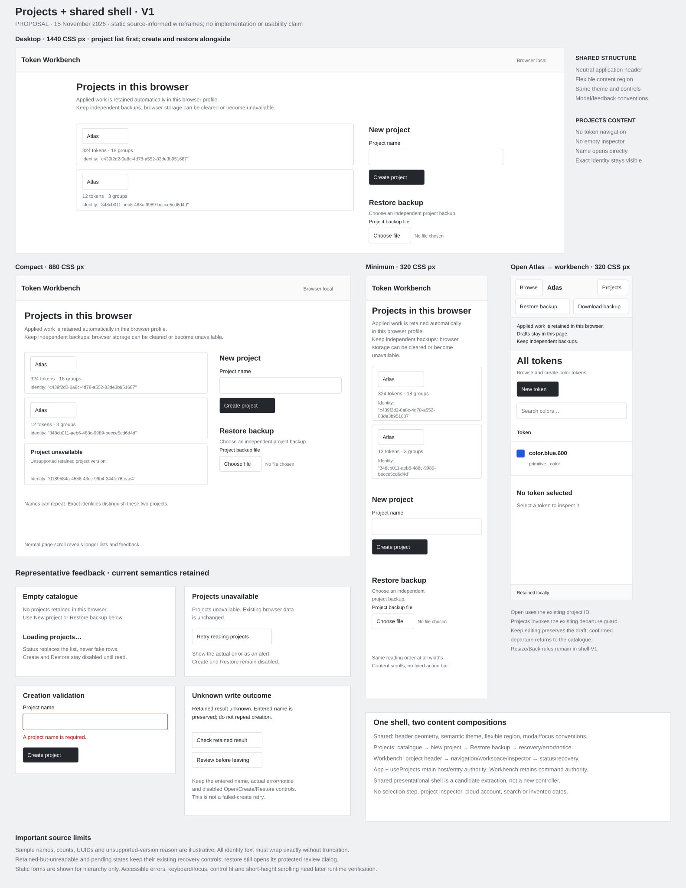

# Projects and shared shell — proposal V1

**Proposed for user discussion — 15 November 2026.** Static design exploration for
[draft Increment 011](../../increments/011-responsive-shell.md). No analyst design
review, final contract/design agreement or implementation authorization is recorded.
This supplements [workbench shell V1](responsive-shell-v1.md); it does not approve
that proposal's unresolved interaction policies.

[Open the SVG at full size](projects-shell-v1.svg). The sheet shows actual content
at 1440, 880 and 320 CSS px, a 320px workbench destination and representative state
treatments. These are synthetic wireframes, not application screenshots. The long
320px Projects frame shows a scrolling document, not a promise that all its content
fits one phone viewport. At 320×720 the lower form/restore content is below the fold.

## Subsequent user direction — 15 November 2026

**V1’s direct-open behavior is superseded for the next design revision.** The user
agreed the [project-capability inventory](../project-operations.md), then specified
list selection with project details in a right-side inspector and explicitly
confirmed a separate control to enter the project’s token workbench. Selecting a
project must no longer open it directly. The coordinator recommends **Open project**
in the inspector; label/placement and narrow inspection/Back behavior await the
revised design. V1’s SVG/PNG below remain the original proposal, not the updated
agreed direction or an approved implementation artifact. Projects V2 is needed
before analyst review; this note does not authorize application implementation.

The user also directed that all project-management controls belong on Projects;
the token workbench should expose only Projects navigation for project management.
V2 must include selected-project backup/restore placement and remove duplicate
workbench backup/restore controls. See the
[placement decision](../project-operations.md#placement-of-project-actions).
The workbench destination in V1’s original SVG/PNG is superseded on that point.

## Recommendation

Use a dedicated Projects composition inside the same structural application shell.
The catalogue is the primary task; project creation and restoration are secondary
entry routes. A modest two-column content area on desktop makes those routes
available without turning project selection into a dashboard or a token-shaped
three-pane screen. The workbench can then fill the same shell with its own regions.

The recommendation changes presentation, not project operations: activating a
project name still opens that exact project directly. There is no preliminary
selection, project inspector, row menu or new project management capability.

## Concrete layout and content

- Header: **Token Workbench**, with **Browser local** where space permits. At
  320px the repeated badge drops away; the page's explicit browser-profile copy
  remains. No Projects button is needed while already on Projects.
- Main heading: **Projects in this browser**. Supporting copy: **Applied work is
  retained automatically in this browser profile. Keep independent backups:
  browser storage can be cleared or become unavailable.** This is useful ownership
  guidance once at entry, rather than a permanent banner above every section.
- Catalogue: each supported entry shows its current name as the Open button,
  existing token/group counts and full **Identity: …** string. The sheet deliberately
  repeats **Atlas** with different identities. Preserve `JSON.stringify(entry.id)`
  exactly, including quotes, escapes and unusual identities; wrap anywhere rather
  than elide, shorten or infer a path. Keep `(unnamed project)` fallback and current
  unsupported-row reason/identity. No fabricated dates, thumbnails or “recent” order.
- **New project**: existing **Project name** field and **Create project** submit.
  The primary filled button belongs to creation; existing projects remain readable
  name buttons, avoiding a page of equally heavy primary actions. Preserve the
  current pending label **Retaining project…** and entered name.
- **Restore backup**: **Choose an independent project backup.**, then existing
  **Project backup file** native file input. Selection stages protected review;
  it is not an immediate overwrite and is not token import. Native file-control
  appearance will vary; the drawing illustrates its space, not a custom uploader.
- Recovery and actual error/notice feedback follow the content. In exceptional
  states use clear grouped feedback, retaining its exact current actions. Do not
  replace details with a generic “Something went wrong” toast.

Desktop proposes a readable maximum content width of 1120px: a 728px catalogue,
40px gap and 352px entry column at 1440px. At 880px use 24px outer spacing,
480px catalogue, 32px gap and 320px entry column. **768 CSS px** is an initial
Projects stacking candidate, independent of the workbench's proposed 880px split
boundary. Below it, catalogue → New project → Restore backup uses one column,
16px side spacing at 320px. Keep this DOM/reading order even while visually placing
forms alongside the catalogue. Long names wrap on their own control; identity
strings and errors wrap without shrinking typography or forcing page overflow.
These measurements are design candidates, not established usability thresholds.

The two-column composition gives returning users fast entry and keeps creation
visible. Its trade-off is a longer mobile page and a less prominent restore route
than the current Restore-before-New ordering. The small existing catalogue makes
this proportionate; no new search/pagination or competing shortcut is proposed.
The chosen order and breakpoint need user feedback before becoming criteria.

## Existing states and protections

| Existing state | Proposed placement and content treatment |
| --- | --- |
| Loading | Replace catalogue rows with **Loading projects…** status; preserve inputs and existing disabled conditions. Do not draw an empty catalogue or fake project rows. |
| Empty | **No projects retained in this browser.** beside/above the same create and restore sections. No extra duplicate call-to-action buttons. |
| Catalogue unavailable | **Projects unavailable. Existing browser data is unchanged.**, actual error alert and **Retry reading projects**. Keep create/restore disabled; this is distinct from empty. |
| Unsupported entry | **Project unavailable: [actual reason]**, exact identity, no Open action. Supported entries keep their current availability. |
| Opening/read error | Preserve actual error alert and catalogue; no fabricated successful-open state. Do not relabel a read problem as creation failure. |
| Empty-name validation | Existing **A project name is required.**, existing focus to name field and association with `project-error`. The sheet places the alert near the form; it remains the actual shared error, not an invented separate validation channel. |
| Pending issued mutation | Preserve **Retention or preparation pending. Inputs are preserved.** and **Check retained result** when current predicates expose it. Do not manufacture retry creation. |
| Known retained, read unavailable | Preserve name, **The project is retained. Entered input is preserved while reading is unavailable; creation will not be repeated.**, and **Retry reading project**. |
| Unknown result | Preserve **Retained result unknown. Entered name is preserved; do not repeat creation.**, actual reason, **Check retained result**, **Review before leaving**. Keep Open/Create/Restore blocked per current conditions. |
| Restore and departure dialogs | Same existing owners, staged preview/protection and callbacks; reflow within 320px with scrollable content and reachable actions. No parallel sheet or replacement confirmation flow. |

The static state sheet shows representative content, not every possible simultaneous
predicate. `ProjectsScreen` currently disables Open for `pending || retained || unknown`;
Create/Restore additionally require a readable catalogue. Preserve these rules and
existing pending/retained/unknown distinctions. Source currently shares `error`
between the form association and alert, even for non-create errors; this proposal
preserves those semantics rather than silently introducing error classification.
Detailed safety messages remain visible when relevant, while routine guidance
appears once. Keep role=status, role=alert and accessible labels/associations.

## Shared shell and transition into the workbench

Share application header geometry, semantic theme, flexible content-region sizing,
spacing/reflow conventions and modal/feedback styling. Share structure rather than
forcing identical content columns or every status message into one global banner.
Projects uses one normal scrolling main region; workbench uses its existing bounded
navigation/workspace/inspector scrolling surfaces and status/recovery composition.

**Projects → activate Atlas → existing open operation → workbench.** Supply the
same exact ID, wait for current read success, then show the keyed Workbench. On
narrow entry show workbench browse, as proposed in shell V1; project opening creates
no token draft and no project-selection stage. No router or browser-history entry
is introduced. Successful create/current restored-project entry retains its current
operation/completion behavior.

**Workbench → Projects** remains its existing guarded action: `request` blocks
busy/reading actions and consults dirty/form/unknown state before leaving; accepted
continuation calls `leaveProject` and returns only when safe. Keep editing retains
the same editor. Explicit discard/departure retains its existing meaning; do not
make returning to Projects equivalent to narrow inspector Back. App's `useProjects`
stays unconditional and retains its name state unless an existing operation clears
it. No new guard is silently added for an unfinished Projects name when opening an
existing project: source currently opens directly, while browser unload remains
best-effort protected. Any desired policy change is separate from this layout.

Proposed focus after a successful screen change goes to its main heading; initial
creation validation still focuses the name input. This needs agreement/runtime
checking and does not alter operation authority. Keep one main landmark per active
screen, descriptive project controls and normal tab order. Do not use ARIA grid or
interactive row semantics for a plain list. Current dialogs retain initial focus,
containment and return behavior; resizing never dismisses a protected review.

## React decomposition candidates

Retain the agreed [component direction](presentation-organisation-proposal-v1.md)
and [actual ownership](../workbench-component-organisation.md). Refine only the
boundaries required by an agreed slice; the following are candidates, not a new
folder migration or architecture commitment.

| Responsibility | Source-informed candidate |
| --- | --- |
| Shared outer presentation | A small `app/ApplicationShell/ApplicationShell` could receive header/content/status slots and own only outer geometry. Existing screen wrappers can also share styling first if extraction would disturb lifetime. Do not prescribe a state provider or generic shell registry. |
| Header geometry/identity | A small colocated `ApplicationHeader` could receive context/action nodes. `WorkbenchHeader` keeps Browse, project actions and their callbacks; Projects supplies brand/browser context. Shared header rendering receives no host/database authority. |
| Projects content | Keep `projects/ProjectsScreen`, `ProjectList/ProjectList`, `ProjectListItem`, `CreateProjectForm/CreateProjectForm` and `ProjectRecovery/ProjectRecovery`. A local Restore section need only become a named component if reuse or complexity warrants it. |
| Workbench composition | Keep `Workbench`, `WorkbenchHeader`, `WorkbenchNavigation`, `TokenWorkspace`, `WorkbenchInspector`, `WorkbenchStatus` and existing recovery owners. Projects shell sharing never imports or instantiates TokenEditor. |
| State, keys and commands | App retains branch selection, project-ID Workbench key, dialog configuration, refs and `useWorkbenchHost` / `useProjects` calls. Workbench keeps selection, commands, editor key and session lifetime. Shared chrome does not lift or remount those owners. |
| Restore and controls | Keep cross-screen `project-backup/RestoreDialog` / `useBackupRestore`, current workbench backup coordination and generic `ui/` controls. No new upload library, icon family or dependency. |

Slot composition is illustrative: choose the smallest mechanism after agreement.
A shared `ApplicationShell` does not require hoisting both screens into simultaneous
mounting, and visual reuse does not justify relocating lifecycle/command hooks.

## Review limits and next decisions

Inspected current ProjectsScreen, ProjectList/Item, CreateProjectForm,
ProjectRecovery, App/useProjects, WorkbenchHeader and Workbench departure path;
read the project/workflow/layout/ownership constraints and inspected the existing
rendered workbench shell V1. Sample names/counts/UUIDs/unsupported reason are
illustrative; they do not establish fixtures, catalogue order or data guarantees.
No application changes, dependencies, browser runs, tests, interactive prototype,
qualification restart or analyst design review occurred. Static layout cannot prove
keyboard/focus, long-content reflow, native file-control fit or short-height scroll.

Decisions for user feedback: the dedicated Projects content within shared chrome;
two columns then stacked order; prominence of Open/Create/Restore; always-visible
exact identity; candidate stacking threshold; and whether this Projects redesign
joins Increment 011 delivery. Workbench shell V1's unresolved entry/Back/resize
policies remain unresolved. Present these identified artifacts before any analyst
review. Approval for analyst review is separate from final agreement/implementation.

Designer self-check allowance: at most approximately **1 minute**, manual source/
prose/SVG consistency only, zero harness repairs; prior aggregate consumption is
approximately 8/10 minutes. Coordinator owns any one-shot rendering, final links,
status/contract reconciliation and aggregate accounting.

Suggested commit: `docs: propose Projects content within shared responsive shell`

Coordinator viewing check: the static SVG was rendered with Quick Look and the
visible layout inspected. A square preview canvas was needed to retain the lower
state sheet; the [PNG preview](../../../output/increment-011-responsive-shell/projects-shell-v1.png)
therefore includes unused space to the right. The editable SVG is authoritative.
This is static design evidence, not application/320px runtime acceptance.
