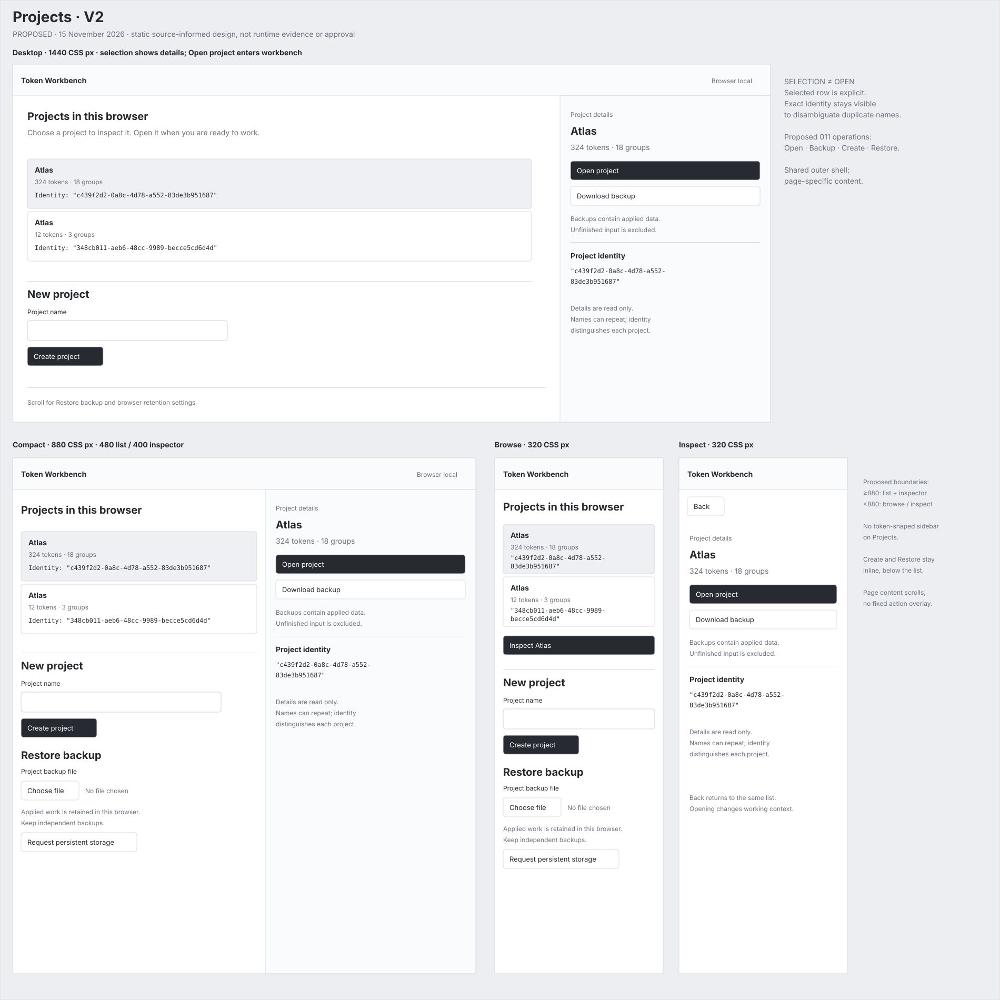

# Projects shell V2

**Proposed for user review — 15 November 2026.** Design-only revision for
[draft 011](../../increments/011-responsive-shell.md), incorporating the
[agreed project direction](../project-operations.md). No analyst design review,
final agreement or implementation authorization is implied. This supersedes the
Projects V1 direct-open design, without editing that historical artifact.

[Full-size editable sheet](projects-shell-v2.svg) ·
[Representative state sheet](v2-state-sheet.svg) ·
[Workbench V2](workbench-shell-v2.md) · [React map V2](component-map-v2.md)

## Recommendation and hierarchy

Share the neutral outer header, semantic theme, region spacing and feedback/modal
conventions with the workbench. Projects has a catalogue and project inspector,
without token navigation. Selection displays details; **Open project** explicitly
enters the selected project. This distinction is agreed. Placement of Open at the
start of the inspector, and the arrangements below, are proposals.

At 1440 and 880 CSS px, use a 400px inspector beside the list. At 880 the list has
480px. Below 880, use full-width browse and project inspection, down to 320 CSS px.
Recommend selecting a row then **Inspect Atlas** below the list; inspection has
**Back**, Open project and Download backup. This extra step makes selection and
entry consistent with the proposed token flow. Direct row-to-inspection is a
reasonable alternative saving one tap; neither entry policy has user agreement.

Keep **New project** and **Restore backup** inline below the catalogue, in the
same scrolling surface. This preserves the current name/file input workflow and
avoids a new modal dismissal policy. Their lower placement costs scrolling in a
long catalogue; an action opening a form is an alternative if that cost proves
material. Do not introduce it implicitly during implementation. Create project
retains existing create-and-open completion and required nonblank name validation;
it does not merely add a selected row. Restore retains its current staged review,
explicit replacement protection and subsequent Open behavior.

Only Open, Download backup, Create and Restore appear. Rename, description editing,
Delete, Import and Export are in the product inventory, not automatically 011
features; there are no inactive future buttons. The inspector is **read only** in
this proposal, using existing catalogue name, identity, token/group counts and
supported/unavailable status. Do not add dates, description editors, inferred
location, account state or fictitious storage guarantees. Full exact identities
remain visible and wrap anywhere in both rows and inspector; duplicate names
remain distinguishable without hover or clipping.

## Selection, detail reads and backup implications

Catalogue fields do not establish a current project header/revision. Project
selection alone does not call the existing Open behavior or mount Workbench.
Available catalogue fields can appear immediately; any additional detail read
shows **Reading project details…**, and read failure shows its real reason with a
retry action. Keep the selected identity and catalogue facts visibly distinct
from unavailable details. An unsupported entry shows its reason and exact
identity; Open and Download are unavailable. No guessed token/group counts.

**Download backup requires scoped coordination work**, not moving a button:
`useWorkbenchBackup` currently calls `downloadProjectBackup` with the already-open
header's identity/revision. From Projects, acquire the supported selected
project's coherent applied snapshot/revision through the existing application/
host boundary, without entering the workbench or treating catalogue counts as a
revision. Analyst scoping must establish the exact read/backup sequence, stale
revision handling and supported/unavailable/ownership cases. No new native file
API or protocol is selected by this design. Open and Backup remain separate
commands; backup does not implicitly navigate. While preparing/downloading,
show actual progress, block conflicting operations using the command owner's
rules and report failure against that selected identity. Download initiation
never proves the file was saved; retain the existing truthful notice.

Move the existing **Request persistent storage** action to a retention section on
Projects, beside independent-backup guidance. This is a proposed relocation of a
browser preference action, not a privacy or API-policy change. Show its actual
response; persistent permission is not permanent retention. The workbench still
shows applied-state/draft context and urgent recovery. The coordinator must
reconcile this relocation and selected backup delivery in 011 before agreement.

## States and protections

| Existing state | V2 placement and preserved meaning |
| --- | --- |
| Catalogue loading | Replace list with Loading projects…; do not render an empty list or fake project rows. Existing create/restore gates remain. |
| Empty catalogue | No projects retained in this browser. Inline New project and Restore remain visible when allowed; no selected inspector claim. |
| No selection | Inspector says Select a project to inspect it. At narrow size no empty second surface is opened. |
| Unavailable catalogue | Existing browser data is unchanged; show actual alert and Retry reading projects. Preserve the existing disabled conditions. |
| Unsupported selected entry | Reason and exact identity are inspectable; no Open/Backup promise. |
| Validation | Preserve entered name, associated A project name is required error and focus behavior. Do not trim accepted authored text. |
| Pending / unknown creation | Keep entered name and recovery above the catalogue/form region; Check retained result / Review before leaving remain reachable. Never repeat creation because a read failed. |
| Retained / read unavailable | State explicitly that creation is retained; Retry reading project, preserving input until current completion. |
| Restore review | Existing exact identity, actual backup date, coverage, diagnostics, same-ID choice, replacement backup + acknowledgement, stage-lost and unknown-result recovery remain in RestoreDialog. |
| Departure | Keep App's existing Review before leaving, Stay here / Leave and unknown-write warning. No automatic discard from responsive Back. |

The [state sheet](v2-state-sheet.svg) illustrates unavailable, unknown, validation
and replacement forms. These panels are representative, not a new simultaneous
dashboard. Existing command enablement/protections are authoritative; the design
does not convert uncertain writes into ordinary failure/retry.

## Proposed focus and scrolling

Selection remains in Projects presentation state, separate from `useProjects`'
opened-project state. Refresh preserves selected identity if still present; if it
vanishes show unavailable selection rather than silently selecting another project.
Returning from workbench should restore its project selection and prior catalogue
position where still available; precise persistence of that page context requires
App coordination without changing Workbench's project-ID key semantics.

Narrow Inspect focuses its heading; Back returns to Inspect selected-project
action, falling back to the selected row then Projects heading. Back preserves
name input, selected identity and browse scroll; it is neither Open nor Cancel.
Resize uses the focus-based visible-surface policy in Workbench V2. All exact
identity/error text wraps; normal page/region scrolling exposes lower forms.
No fixed action bar covers controls. Native file input must fit its available
width; no custom uploader is prescribed. Modal bodies scroll and their actions
stack at 320; current focus containment/safe departure rules remain.

## Review status and limits

The primary sheet shows concrete 1440, 880 and 320 CSS px compositions. Names,
counts and IDs are illustrative; they create no fixtures. Source inspection
covered ProjectsScreen, ProjectListItem, useProjects, App, ProjectRecovery,
backup coordination and RestoreDialog, alongside current ownership and accepted
visual/project constraints. There was no runtime, browser, test, build or storage
qualification. Static art cannot prove actual reflow, native file input, focus or
session behavior. Exact candidate thresholds, two-step narrow entry, read-only
metadata and inline forms remain for user feedback before analyst review.

Suggested commit: `docs: propose coordinated Projects and workbench V2 design`

## Subsequent analyst handoff — 15 November 2026

The user approved this V2 set at `ae75f29` for analyst review. The completed
[review](../../increments/011-v2-analyst-review.md),
[refined Draft contract](../../increments/011-responsive-shell.md) and
[concrete presentation tree/ownership matrix](presentation-organisation-v2.md)
record the refinements. Supported catalogue entries already carry a revision for
the existing selected-project backup path; no extra header read or editing
ownership is needed for the proposed fields. App-lifetime Projects context
replaces the earlier screen-local lifetime suggestion where cross-screen
preservation is required. All file kinds follow purpose, owner and consumers;
meaningful hooks/helpers or other shared folders are allowed.

These are contract/ownership clarifications, not a material visual revision.
Original V2 artwork is unchanged; final agreement and implementation remain pending.
Read the refined tree with this earlier component map.
