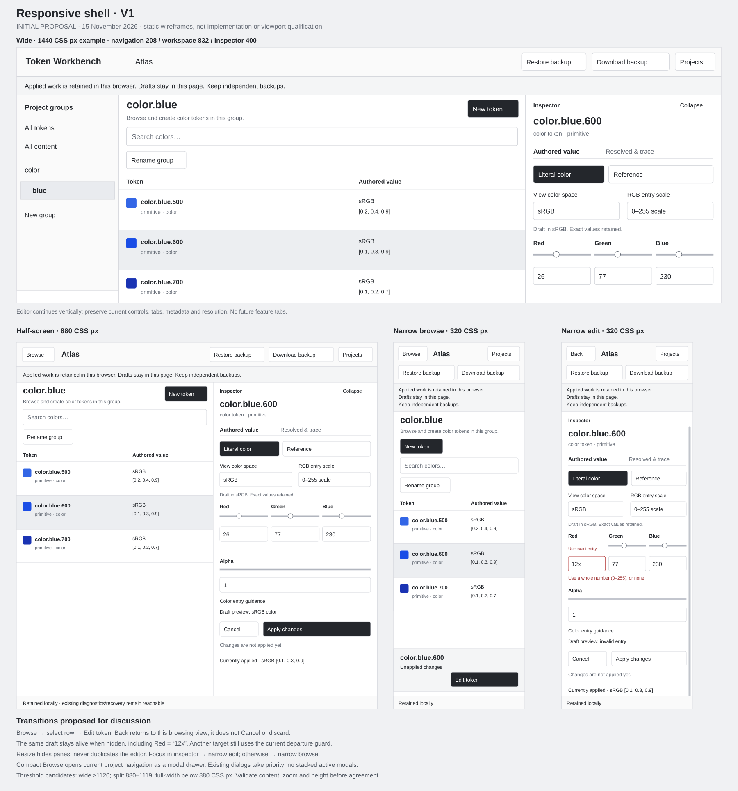

# Responsive shell — initial proposal V1

**Proposed for user discussion — 15 November 2026.** This is the designer's initial
recommendation for [draft Increment 011](../../increments/011-responsive-shell.md),
not an agreed interaction contract, analyst-reviewed design, or implementation
authorization. The existing [responsive visual direction](README.md#responsive-behavior)
is retained; exact policies below remain proposals.

[Open the full-size SVG](responsive-shell-v1.svg) and zoom to read each state.
The wide sketch deliberately shows a vertically clipped inspector: its content
continues by scrolling. Compact and narrow sketches expose more of the same
editor. These are synthetic source-informed wireframes, not browser screenshots.

## Subsequent user direction — 15 November 2026

**Workbench project-action placement is superseded for the next revision.** The
user directed that project-management controls belong on Projects, leaving only
Projects navigation in the token workbench. Remove Restore backup and Download
backup from the next workbench header proposal. Current V1 SVG/PNG retain the
original controls and are not the updated agreed direction. See
[project operations](../project-operations.md#placement-of-project-actions).
Project context, retention/recovery feedback and protected departure remain;
exact revised layouts and implementation scope await designer/user/analyst review.

**Further user request — Undo/Redo:** replace the removed backup/restore header
controls with Undo and Redo, following the accepted visual references. This is the
requested next design direction; V1 does not depict it. The user agreed initial history for applied token/group changes within the open
project session, retaining native typing undo; persistent history is outside this
first scope. Exact operation coverage, draft interaction and delivery scope remain
unresolved in
[Increment 011](../../increments/011-responsive-shell.md#requested-undoredo-controls--15-november-2026).
Do not treat button placement as agreement to a history implementation.

## Independent recommendation

Keep the current list/table and the current Authored value / Resolved & trace
editor inside three responsive compositions. Navigation should yield space first;
then browsing and inspection should become successive full-width surfaces.
Preserve current channel controls and semantic theme rather than redesigning
color authoring as part of a shell change. No visual inventory, editable Details,
relationships, comparisons, preview features, or interchange controls are added.

Recommend a selected-token strip in narrow browsing with an explicit **Edit token**
action (or **Inspect token/group** for inspection-only selection). Row activation
still selects the inspected target and invokes the current departure guard before
replacing a dirty session. The strip is also the reopen route when a query/scope
hides the selected row. It shows **Unapplied changes** only when dirty, with no
implication of persistence beyond the current page.

This two-step entry follows the illustrative mobile reference and makes the
browse/edit transition deliberate. It costs one tap. A meaningful alternative is
opening full-width inspection directly on row activation; that saves the tap but
makes each selected row a screen transition. Both must retain the same guarded
selection and single editor. User feedback should select the entry policy before
interactive prototyping or implementation; neither policy is already agreed.

## Proposed geometry and controls

| Composition | Candidate width in CSS pixels | Arrangement |
| --- | --- | --- |
| Wide | 1120 and above | Navigation (208), workspace (remaining), inspector (400); existing collapse/reopen controls. |
| Compact split | 880–1119 | Browse opens navigation drawer; workspace (at least 480) beside inspector (400). |
| Narrow | Below 880 | Full-width browse or full-width inspection; Back in inspection header. |

These thresholds are candidates from current controls, not usability evidence.
The minimum acceptable viewport is **320 CSS pixels**, per the user. The narrow
wireframes show that minimum; smaller widths are outside this proposal.
The compact example is 880, not a promise that half of every desktop fits a split:
half of 1440 is 720 and uses browse/edit. Proposed representative checks are
1440×900, 880×800, 720×800, 390×844 and 320×720, plus threshold edges and a zoom/short-height
case. Long paths wrap; exact fields and error text remain readable. Keep the
current three channel columns where usable; the static 320 sketch retains them
with short labels/exact entries, but longer labels or validation may need stacking; do not shrink targets to make them
fit. If actual content fails the candidate minima, revise the threshold or reflow
with the user rather than quietly changing color-editor interaction.

At narrow widths down to 320, header row one contains Browse/Back, project name and Projects;
row two wraps Restore backup and Download backup. All are existing actions; no
new project menu is required. Long project names may wrap onto their own line.
Brand text may give way to project context while the application remains named
for assistive technology. Existing notice text wraps beneath; safety messages,
check-access actions, diagnostics and recovery actions remain reachable.

Actions remain in the editor scroll flow with the existing sticky behavior
constrained to its visible scrolling surface. Ensure safe-area padding and that
neither actions nor the virtual keyboard hide focused fields/errors. Do not add
an always fixed screen-bottom bar that covers content. The SVG omits lower
metadata/resolution bodies for legibility; they remain present and scrollable.
Existing group, empty, unavailable, read-only and recovery content is reflowed,
not replaced by the editable-color example.

## Proposed transitions and state

- Initial project entry opens narrow browse with no automatically opened editor.
  Existing created-token completion selects its new token and opens inspection;
  read-only/group selection uses Inspect rather than promising editing.
- Row activation uses the current `choose` policy. A different target must pass
  dirty/form/unknown-state departure protection. Same-token reopening does not
  reset its editor. Scope/query changes continue to browse without replacing
  selection or its draft; there is no second unguarded candidate selection.
- Edit/Inspect opens the already-selected session. In-app Back returns to browse
  without Apply, Cancel, discard, guard prompt or model operation. Preserve
  namespace, view, query, selected identity and browse scroll position.
- Apply and Cancel keep the current inspection surface. Their existing meanings,
  disabled/busy rules, validation and recovery behavior remain authoritative.
- On split → narrow, if focus was in the inspector, show inspection; otherwise
  show browse. An open dialog does not imply inspector focus: remember the
  underlying surface until it closes. Initial selected-but-collapsed inspection
  stays browse. Resize alone never focuses or opens a previously collapsed editor.
- On narrow → split, expose both available panes; preserve the session and last
  narrow surface. If the user returned to browse with a draft, split reveals
  that same editor, not a clean replacement. On a later transition to narrow,
  use current visible-pane focus; if focus is outside both panes, retain the
  last narrow surface, defaulting to browse when none is recorded.
- Keep wide collapse choices for this page session; going compact uses a drawer,
  and returning wide restores the earlier navigation collapse choice. No storage
  preference is introduced. Narrow Back is separate from inspector cancellation.
- Native browser Back retains existing browser/history/unload behavior; do not
  create history entries for these surfaces. Existing beforeunload protection
  remains best-effort browser behavior, not a guarantee of recoverable drafts.

Layout, tabs and visibility must preserve one editor owner/key/session, including
invalid exact strings, entry scale/view space, source mode, errors and unresolved
recovery input. Hide the inactive surface without making it keyboard reachable;
do not mount a second editor to produce a mobile view. Drafts stay session-only.
This is an observable ownership requirement, not a new domain or persistence API.

## Proposed focus and overlay rules

Edit/Inspect focuses the inspector heading, with the current tab/content next in
logical reading order. Back restores focus to its selected-strip action, retaining
browse scroll; if unavailable, use the selected row, then workspace heading.
When a resize hides the currently focused surface, move focus to the resulting
visible heading or equivalent action; otherwise leave focus unchanged. Preserve
editor scroll while hiding/reopening it; do not restore focus to an input that
would unexpectedly open a mobile keyboard.

Browse opens the existing modal navigation drawer. Trap focus there, make the
background inert, and let Escape/backdrop/Close return focus to Browse. Closing
alone preserves drafts. Choosing a scope closes the drawer and focuses the
workspace heading. Existing namespace expansion state survives layout changes.

Existing creation, restore/review, departure and recovery dialogs take priority:
only one modal interaction is active. If an action from navigation requires a
guard/dialog, close the drawer before opening it and preserve an appropriate
visible return target. Keep editing returns to the preserved surface and draft;
Discard runs the already-pending action. Do not suppress a guard to avoid modal
stacking. Resizing while a modal is open keeps that modal active and reflows it;
a drawer becoming persistent navigation closes its modal shell and restores
focus to the equivalent visible navigation control, unless another dialog owns
focus. These exact rules require user/design agreement and later runtime checks.

No matching colors, empty project/group, loading/read failures and unavailable
selection use existing messages/actions within the available full-width surface.
The selected strip remains available when filtering hides the selected row.
An unavailable target opens preserved inspection/recovery, never a replacement
editable token. Validation and safety feedback must not disappear merely because
the editor is offscreen: the strip signals unapplied changes and inspection
retains detailed feedback; existing global errors/recovery stay on the shell.

## Inspection and limits

Inspected current Workbench coordination, layout hook, navigation drawer,
header, toolbar, table, inspector, editor/session composition, color controls,
Apply/Cancel and departure/lifecycle protection. Read the project constraints,
accepted layout/images, presentation conventions, workflow and initial 011 draft.
The source currently retains a single keyed TokenEditor and guards changed
selection through `request`; these owners must remain authoritative.

No application edits, dependencies, browser runs, tests, qualification restart,
interactive prototype or analyst design review occurred. SVG sample decimals and
swatches communicate hierarchy, not numerical conversion fixtures. Text buttons
avoid introducing an icon family; production icons remain shared Icon/Heroicons
Outline. Static inspection cannot establish target sizes, zoom/keyboard behavior,
scroll geometry or focus correctness in a running application.

Designer documentation/artifact self-check: approximately 2 minutes, zero harness
repairs, within the shared 10-minute planning allowance. Manual prose/source
consistency and SVG structure checks only; root may render the SVG once to inspect
its presentation. Open choices are thresholds, entry policy, resize/focus fallback,
Back behavior, collapse restoration and overlay handoff. Present V1 to the user
before any analyst review; material revisions repeat that order.

Suggested commit after agreement: `docs: propose responsive workbench shell`

## Projects page — additional discussion

**Exploration authorized by the user; redesign and delivery scope unsettled.** The
user asked to discuss the Projects page preceding the workbench, including whether
it should share the page layout. This extends the 011 discussion; it does not
approve a replacement screen or add agreed implementation criteria. **The current
SVG shows only workbench states and contains no Projects-page design.**

The current `ProjectsScreen` contains the application identity and Browser local
context; a Projects in this browser heading and independent-backup guidance; the
retained-project list and open action; loading, empty and unavailable-catalogue
states with retry; Restore backup with a file input; Create project with its name
field; mutation/recovery controls; error and notice feedback; and protected
restore/departure dialogs. These meanings remain authoritative while exploring
presentation. In particular, unavailable catalogue data is not an empty catalogue,
an unknown write outcome is not a failed create, and restoring a backup is not
token interchange. Preserve current disabled conditions, pending feedback,
unfinished form input and recovery routes.

| Direction | Benefit | Trade-off |
| --- | --- | --- |
| Dedicated entry page | Focuses on choosing, creating or restoring the working context; current centered composition needs little restructuring. | Entry and workbench can feel disconnected if spacing, header and safety feedback diverge. |
| Shared structural shell | Reuses application identity, responsive header, main scrolling region, theme and message/dialog placement across entry and authoring. | Must avoid empty namespace/inspector panes or implying a project is already open; sharing structure should not force identical content columns. |

**Independent recommendation:** retain a dedicated Projects content surface inside
a shared structural shell. Share the neutral header, spacing rules, responsive
reflow and accessible feedback conventions, while letting the main area use the
full available width with a readable content maximum. Its primary job remains
opening an existing project, with Create and Restore clearly available; at 320px,
stack those sections and keep native inputs/actions in normal scrolling order.
Do not copy the three-pane workbench onto this entry page or introduce speculative
project search, sorting, cards, metadata, cloud state or menus without a concrete
need. Shared appearance does not require merging lifecycle/command owners.

User discussion should settle the desired visual continuity, the relative
prominence of Open/Create/Restore, and whether a Projects redesign belongs in
011 delivery or remains a follow-up. Then prepare a separate static Projects
proposal if useful, return it to the user, and only seek analyst review after
approval of that identified proposal. No Projects mockup or production edit was
made in this addition.

Additional bounded source/prose/SVG check: approximately 1 minute, zero repairs;
designer cumulative estimate now 3 minutes. Root rendered the earlier SVG using
Quick Look successfully; the narrow browse New token action has since moved to
its own row so it no longer overlaps helper text.

Coordinator final static check: updated SVG rendered successfully via Quick Look;
the corrected 320px toolbar was visually inspected. The
[rendered preview](../../../output/increment-011-responsive-shell/responsive-shell-v1.png)
is for viewing convenience; SVG remains the editable source. No browser/application
acceptance is inferred.
