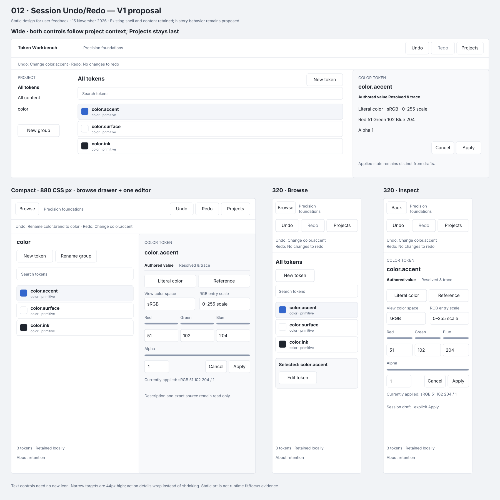

# Session Undo/Redo V1

**Initial designer proposal — 15 November 2026.** For user feedback on
[draft 012](../../increments/012-session-undo-redo.md); now [analyst-reviewed](../../increments/012-v1-analyst-review.md) with the
user amendment below; final agreement remains pending. This static proposal does not authorize implementation or choose a history
mechanism. Existing session-only scope and native typing undo are constraints;
behavior refinements below are proposals.

## User-approved review amendment — 15 November 2026

The user approved V1 **for analyst review**, with this explicit refinement:
Undo/Redo use **Heroicons Outline icons and text on desktop/tablet**, and
**icon-only buttons on mobile**. This supersedes the text-only recommendation
and button depictions below; the existing sheets remain the initial V1 artifact,
not amended visual evidence. Use the shared Icon component and owned Button.
Mobile controls retain accessible Undo/Redo action names, readable nearby next-action
and unavailable-reason descriptions, suitable touch targets and optional tooltips.
Responsive icon-only presentation does not remove action meaning or change history
semantics. The analyst recommends a separate control-label threshold: icon-only below
640 CSS px, icons plus text from 640, independently of pane modes. This threshold
is proposed for final agreement; do not infer device class from user agent. No new design choice beyond this user-requested refinement
is approved. Final contract agreement and implementation authorization are pending.

[Full-size header sheet](undo-redo-v1.svg) ·
[State sheet](undo-redo-states-v1.svg) ·
[Component delta](undo-redo-component-map-v1.md) ·
[Rendered header sheet](mockups/undo-redo-v1.png) ·
[Rendered state sheet](mockups/undo-redo-states-v1.png)

## Independent recommendation

Keep two ordinary text buttons, **Undo** and **Redo**, after project context and
before **Projects**. Both stay in the header on browse and inspection. At 320 the
context/navigation row precedes a second row containing all three actions, each
at least 44 CSS px high. Long names wrap; no action becomes an unlabeled icon or
moves behind Browse. This adds header height but keeps the actions discoverable
beside a design tool, including without a physical keyboard. Project management
stays on Projects. Use current theme, Button, header and feedback owners; no new
icon is necessary.

A quiet wrapping line immediately below the action row names the next Undo and
Redo. Wide examples keep it on one line when it fits; 320 stacks both descriptions.
Examples: **Undo: Change color.accent**, **Redo: Create color.accent**.
An empty branch says **No changes to undo** or **No changes to redo**. A persistent
line costs some vertical space but exposes consequence and disabled reasons on
touch as well as hover. Alternative: show details only on hover/focus to save
space; this is weaker for touch and disabled controls, so it is not recommended.
No full history list or new History navigation is proposed.

## Commands and feedback

Every changing acknowledged existing command makes one step: Create group,
Rename group, Create color token and explicit Apply of an authored color value.
The next-action vocabulary is **Create group color**, **Rename color.brand to
color**, **Create color.accent**, **Change color.accent**. Show human paths/names
captured for the step; identities determine targets, never a matching path string.
After rename, refresh visible surviving paths coherently. The exact authored
representation and complete creation metadata remain preserved even though the
label summarizes the action. No token-name editing or public Delete is added.

Typing, sliders, display conversions, navigation, Cancel, failures and no-ops
create no steps. A successful new changing command after Undo replaces Redo;
failed/pending/no-op actions do not. Undo/Redo never Apply a draft and never mean
Cancel. The history label describes the command, not an inferred color conversion.

| State | Proposed visible feedback and action |
| --- | --- |
| Empty | Both buttons unavailable; next-action lines explain empty branches. Avoid a separate warning. |
| Available | Enable each available branch. Button name includes its action, for example `Undo: Change color.accent`; visible text stays Undo. |
| Pending | Both unavailable. `Undoing Change color.accent…` in shared feedback. Do not imply completion before acknowledgment. |
| Unknown | Both unavailable. `Undo result is unknown. Do not repeat the change.` Existing **Check retained result** recovery remains visible. |
| Retained but unreadable | Both unavailable. `Undo was retained. Current project could not be read.` **Retry reading project** repeats only the read. |
| Rejected reversal | Current data and history remain intact. `Could not undo Change color.accent. No change was retained.` Include the real rejection reason; **Retry Undo** uses the same guarded command path and same step. Do not show retry for unknown results. |
| Read only | Both unavailable. `Undo/Redo paused. Another tab has write access.` Existing **Check access** remains. Preserve history conditionally while the retained baseline is unchanged. |
| Lifecycle paused | Both unavailable. `Undo/Redo paused until access and retained state are checked.` Existing **Check access and retained state** remains. |
| External revision / replacement restore | Clear both branches and explain `Project changed outside this session. Undo/Redo history cleared.` Preserve retained project data and existing read/recovery needs. |
| Worker replaced | `Session restarted. Undo/Redo history cleared; applied project data remains retained.` Unknown original results still require existing reconciliation; this message does not claim a result was retained. |
| Oldest entries evicted | `Earlier changes are no longer available to undo.` Keep next-action labels accurate at the oldest remaining step. |
| Oversized accepted edit | `Change applied. This change cannot be undone in this session. Earlier Undo/Redo history was cleared.` This copy applies only if the proposed clearing policy is agreed. |

Recovery/error/expiration feedback uses the existing shared Workbench feedback
region outside browse/inspector visibility, not the editor alone or retention
help disclosure. Prefer one coherent reason over multiple duplicate alerts. Keep
blocking messages until resolved; announce outcomes once through a polite status
region, with current error semantics preserved for failures. Routine success is
`Undid Change color.accent` / `Redid Change color.accent`; do not announce every
render or keystroke. Eviction notices need not repeat on every later action.

Known admitted diagnostic baselines are a separate unresolved contract policy.
Recommendation: permit exact restoration of a previously admitted baseline with
its existing diagnostics, under narrow application validation; preserve the normal
visible diagnostics and inspect-only restrictions. This better matches Undo's
promise of restoring authored state. Alternative: reject such Undo and explain
why while keeping data/history intact. Neither policy may silently weaken new-edit
validation or treat Undo as backup restore. The artwork does not settle it.

## Draft, form and shortcut ownership

With dirty input, including invalid raw text, header Undo/Redo opens the existing
protected-dialog pattern with history-specific copy. Example title:
**Discard unapplied changes and undo?** Body: **Your draft for color.accent will
be discarded. Then Undo: Rename color.brand to color. No draft value will be
applied.** Actions: **Keep editing**, **Discard and undo** (Redo equivalent:
**Discard and redo**). Give initial focus to Keep editing; Escape behaves likewise.
Keep editing restores exact input and the pre-dialog focus. Discard abandons only
the input after explicit consent, revalidates the captured direction/step and
current revision, then attempts it once. If it became unavailable, show the reason
and perform no substitute history action. Never silently retarget a newer step.
If the attempted reversal then fails, show the failure with retained data/history
intact; the explicitly discarded draft is not represented as restored.

Creation/rename dialogs own their keyboard and inert background. Shortcuts never
reach the header while any dialog is open. Use the existing protected close path
before header traversal; do not add Undo to form footers or automatically close a
form on Cmd/Ctrl+Z. A dirty form therefore receives its existing discard protection
on close; there is no second hidden form editor. The general captured-intent guard
still covers any unfinished form state reachable without modal ownership.

Recommend **Cmd/Ctrl+Z** and **Cmd/Ctrl+Shift+Z** for Workbench Undo/Redo only when
focus is on eligible non-editable Workbench content. Inputs, textareas,
contenteditable, composition, dialogs, already-handled events and key-repeat stay
local/native; do not intercept unavailable commands or events outside Workbench.
**Ctrl+Y is excluded from V1** as a proposal: Shift+Z supplies one consistent pair
without another interception rule. An explicit Ctrl+Y alias is a reasonable later
choice if the user prefers Windows convention. Shortcut hints use the host's
appropriate modifier label and are descriptions, not the sole accessible name.

## Selection, focus and lifecycle

Preserve surviving selection and browse scope by stable ID. A clean selected
editor refreshes to the accepted authored value without mounting a second editor.
If Undo removes its created target, clear the missing selection and editable
session; choose the nearest surviving ancestor of the affected browse scope,
otherwise All tokens (or retain All content if already active and valid). On
narrow inspection, return to browse because there is no surviving inspection
target. Explain **Undid Create color.accent. Selected token was removed.** No
unrelated token is automatically selected.

Redo restores the original identity and data but does not select it, reopen an
inspector, change current scope/query or steal focus. Surviving context remains.
This can leave the restored token outside the current query; next-action/outcome
copy still identifies it. Alternative: reselect restored creations, which makes
Redo more visible but unexpectedly changes the user's current inspection; do not
recommend that as the default.

Keep focus on the invoked history button where available. If that button becomes
unavailable using native disabled semantics, move focus to the still-available
opposite history button; otherwise focus the visible Workbench heading. After a
shortcut, keep current focus if it survives; if its target is removed use the
visible browse heading. Do not move focus solely for success feedback. Tooltips
supplement visible next-action/reason text; they never carry essential information
alone. Associate unavailable reasons with controls and provide a readable nearby
explanation even where disabled buttons cannot receive focus. Focus behavior and
touch geometry require later runtime checks; the SVG cannot prove them.

Project departure/switch/reload ends session history without an extra prompt
solely for history expiry. Existing dirty/unknown protections remain. Retained
applied project data survives. Suspension alone preserves history only if access
recovery proves the exact project incarnation and expected revision; otherwise
clear it with the visible explanation above. Recovery does not reconstruct a
history from storage or silently replay a write.

## Decisions needed and review boundary

The user should first assess identified **Undo/Redo V1**, including these policies:

1. Labeled wrapped-header controls and always-readable next-action details.
2. Explicit discard-and-traverse guard, local modal/native shortcuts, and Shift+Z
   with no Ctrl+Y alias in V1.
3. Surviving-ID selection, valid browse fallback after removal, and passive Redo.
4. Exact diagnostic-baseline restoration versus a rejected Undo.
5. Conservative history invalidation and proposed bound/oversize user experience.

The draft's snapshot-versus-inverse mechanism and **50 steps / 32 MiB** limit are
unagreed application proposals. The visible truncation/oversize design is
conditional on that agreement; these numbers do not appear as technical machinery
in ordinary product controls. User approval of this V1 for analyst review comes
before analyst review, final contract/design agreement and separate implementation
authorization. No interactive prototype has been changed.

Source/static review: draft contract, project direction/architecture/conventions,
current ownership map, V2 shell, actual Workbench header/commands/guard/layout,
single TokenEditor caller and final 011 narrow screenshot. Approximately **4.5
minutes** designer source/static checks, zero harness repairs; ordinary artifact
writing is separate. Stop at this bounded planning review. No application tests,
build, browser, accessibility qualification or renewed 007/011 campaign. Static
copy/geometry illustrates intent; running fit, guards, acknowledgment, focus and
native keyboard behavior remain unverified. Coordinator renders sheets once.

Suggested commit: `docs: propose session undo redo V1 design`

## Analyst review outcome

The [review](../../increments/012-v1-analyst-review.md) confirms core state and
ownership consistency. AC-11 now incorporates the user-requested icons; the 640px
control-label mapping and project-targeted/versioned receipt policy remain final
agreement decisions alongside the existing policy bundle. Original SVG depictions
remain superseded for button presentation. No interactive prototype or application
was changed, and no implementation was authorized.

## Final agreement — 15 November 2026

The user agreed the refined V1 and contract, including the independent 640px
control-label threshold and receipt compatibility policy, and authorized
implementation followed by independent review. This supersedes pending labels
above; the initial text-only SVG depictions remain superseded by the icon/text
amendment. The [012 agreement](../../increments/012-session-undo-redo.md#final-agreement-and-implementation-authorization--15-november-2026)
owns the accepted policy bundle and verification ceiling.
