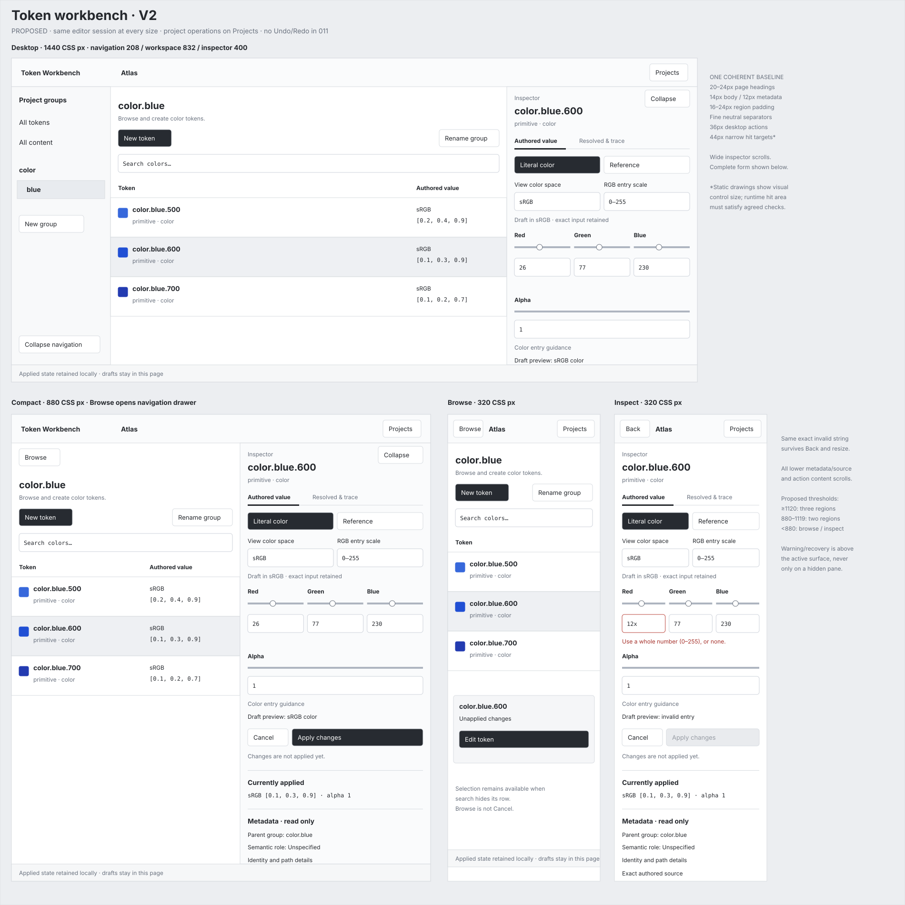

# Workbench shell V2

**Proposed for user review — 15 November 2026.** Coordinated design-only revision
for [draft 011](../../increments/011-responsive-shell.md), incorporating the
agreed full existing-workbench UI refinement and component-decomposition direction.
This is not an analyst-reviewed contract or implementation authorization.
Historical V1 art is preserved.

[Full-size editable sheet](workbench-shell-v2.svg) ·
[Existing states](v2-state-sheet.svg) · [Projects V2](projects-shell-v2.md) ·
[React map V2](component-map-v2.md)

## Independent recommendation

Refine the current list-based workbench as one coherent interface: restrained
white/cool-gray surfaces, fine borders, compact anthracite primary actions,
clear type hierarchy and local scrolling. Color is authored content; semantic
warnings use the existing theme. No visual grid, Relationships, comparison,
editable Details, interchange or new token capability is implied. Undo/Redo is
absent, including disabled placeholders: it belongs to 012.

The header identifies the application and current project with **Projects** as
its only project-management control. Compact/narrow adds Browse, or Back inside
inspection. Long project names wrap without pushing Projects beyond reach.
Existing backup/restore moves to Projects. Request persistent storage moves there
as proposed in Projects V2. Workbench safety feedback remains workbench content.

Remove the oversized permanent retention strip in ordinary writable state.
Use a compact wrapped status region with applied-state context and a native
disclosure for the complete draft/independent-backup guidance; at short height it
joins the normal scroll flow instead of disappearing. The primary sheet abbreviates
this region for scale. Inspection-only, lifecycle-paused, read-failure, pending,
unknown and actionable recovery messages are always above the active browse or
inspect surface, not buried inside a hidden pane or behind that disclosure.
Retain Check access, Check access and retained state, Retry reading project,
Check retained result and Review before leaving as applicable. Do not suppress
actual errors to make the shell smaller.

## Proposed geometry and visual baseline

| Width | Composition |
| --- | --- |
| ≥1120 CSS px | Navigation 208px, workspace flexible, inspector 400px. Both side regions retain accessible collapse/reopen controls. A collapsed inspector leaves a labeled Inspect selected token button at the workspace edge; reopening restores its same session. |
| 880–1119 | Browse drawer; workspace at least 480px beside 400px inspector. |
| 320–879 | Full-width browse or inspection. Back is distinct from editor Cancel. |

Thresholds remain proposals; 320 minimum is user-supplied. 880 allows the current
exact controls more room than the existing 768 split but means half a 1440 display
uses successive surfaces. Recommend 1440×900, 880×800, 720×800, 390×844, 320×720,
threshold edges and one short-height/zoom sample when implementation is authorized.
Static sheets are content illustrations, not viewport acceptance.

Use existing semantic tokens and standard Tailwind scale. Target region padding
16–24px; page/selected headings 20–24px; body 14px; supporting text 12px; line height
comfortable for wrapped paths/errors. These are proposed visual roles, not a new
independent token palette. Desktop controls use existing compact sizes; narrow
interactive hit areas should reach 44px without squeezing columns or text.
The art depicts visual controls and is not evidence of those hit areas.

Navigation groups All tokens, All content and current namespace tree; New group
remains available. Scope title leads the workspace, followed by New token, search
and Rename group when applicable. Do not add search to All content or invent
filters. On narrow sizes New token and Rename group wrap as separate actions when
needed. TokenTable keeps its current button/list semantics: no ARIA grid without
a corresponding keyboard model. At 320, token path, swatch and type/layer lead
rows; the full authored value remains in inspection rather than forcing a tiny
value column. This responsive suppression of repeated row detail is a presentation
proposal for user agreement. All content keeps existing group/token membership,
incomplete/unavailable entries and Find/reveal behavior; do not reduce it to the
three ordinary color rows shown in the sheet.

## Inspector and editor closure

Keep **Authored value** and **Resolved & trace**. Inspector heading shows selected
path, value type, layer and existing description. No editable token-name, role or
layer fields are introduced. Authored value contains current Literal color /
Reference switch; View color space and applicable RGB entry scale; horizontal
channel sliders above their exact inputs; independent Alpha slider/input; current
entry guidance and normalized draft display; draft feedback; Cancel/Apply; current
applied value and read-only metadata/source disclosures. The compact/full-width
examples show actual field density rather than an empty inspector rectangle.

Preserve color precision, raw input, channel ranges/steps, unavailable-slider
messages, `none`, display/view conversions, byte-entry policy and derived-state
truthfulness. Values shown in art are illustrative, not conversion fixtures.
Three channel columns fit the proposed 320 example with short labels; stack
labels/fields if actual validation or localization requires it rather than
shrinking hit targets. Alpha remains separate from layer opacity. Reference uses
the current labeled native target selector, missing-target option and cycle-on-
Apply explanation; no expression or cross-project referencing is added.

Apply remains the editor's primary action, Cancel secondary; actions are in the
editor scroll flow near validation, with any existing sticky treatment constrained
to its scrolling surface and safe areas. No fixed viewport-bottom overlay.
Invalid byte text shows its error and unavailable Apply; do not generalize that
to new validation timing for every input. Currently applied stays distinct from
unapplied preview. Metadata remains read only: regeneration, semantic role,
parent, exact identity/path and Exact authored source. Preserve source lazy
request/revision invalidation, no-wrap bounded source viewport and exceptional
source notices. The existing inspector's applied/draft feedback and swatches
retain their meaning; no new variation comparison is added.

Resolved & trace shows existing applied resolution and structured trace, including
real unresolved reasons. It does not resolve raw invalid drafts or invent CSS
for unsupported values. Group inspection retains its existing read-only fields,
identity and source. Empty/no selection, preparing inspection, unsupported token,
read-only, target unavailable, baseline recovery and diagnostics remain as
specified by their owners; representative panels are on the state sheet.

## Proposed responsive policy, requiring agreement

1. Narrow project entry starts on browse. Row activation selects with the existing
   guarded `choose` path; a selected-token strip offers **Edit token**, or
   **Inspect token/group** for inspection-only/group selection. This two-step
   entry costs a tap but gives a stable reopen route even when scope/query hides
   the row. Direct row-to-inspection saves a tap; it remains an alternative, not
   an agreed behavior. Created-token completion continues to select/open its
   inspector as current command completion intends.
2. In-app Back hides inspection and preserves namespace, active view, query,
   selected identity, browse/editor scroll and exact draft. It does not call
   Apply, Cancel, discard, model mutation or a new departure guard. The selected
   strip signals Unapplied changes only when dirty. Existing global safety
   feedback stays visible even with the draft hidden.
3. Apply/Cancel retain their current semantics and remain on inspection. Choosing
   another token or leaving via Projects uses current dirty/form/unknown/busy/
   read-failure/departure protections. Reopening the same token does not replace
   the session. Search/scope changes do not substitute another editor target.
4. Split→narrow shows inspection if focus was in it, otherwise browse; with an
   open modal, remember the underlying surface. Resize alone does not open an
   explicitly collapsed inspector. Narrow→split reveals the same mounted editor.
   A later return to narrow uses current pane focus; when focus is outside both,
   retain last narrow surface, default browse. Preserve wide collapse preferences
   only within the page session; no saved layout preference is added.
5. Edit/Inspect focuses the inspection heading. Back restores the selected-strip
   action, then selected row, then workspace heading if unavailable. Restore
   browse scroll before focusing without scroll jump. Keep editor scroll while
   hidden/reopened; do not automatically refocus an input/open a soft keyboard.
   Resize moves focus only if its surface becomes hidden, to the visible heading
   or equivalent control. Otherwise preserve focus.
6. Drawer is modal with current focus containment, inert background and Escape/
   Close return to Browse. Scope choice closes it and focuses workspace heading.
   Close drawer before opening a required creation/departure dialog; retain an
   equivalent visible return target. No bypass of a guard to avoid modal stacking.
   On becoming persistent navigation, remove drawer modality and use equivalent
   navigation focus unless another dialog owns it.
7. Creation/rename, departure, baseline review and recovery dialogs take priority.
   Reflow/scroll their bodies at 320 with wrapping/stacking action rows. Existing
   safe dismissal and pending/unknown restrictions stay authoritative; resize
   never dismisses them or mutates input. Browser Back retains existing browser/
   unload behavior; no native-history routing is introduced.

**One session is a constraint.** `Workbench` owns selection, command completion and
`[selection.id, editorVersion]` key; `TokenEditor` calls `useTokenEditor` once.
Layout, Back, query, drawer and resize add no reset reason. Preserve literal and
reference draft state, invalid strings, tab/mode, display space/entry scale,
validation and recovery review. Hidden surfaces are inert/non-focusable, but do
not unmount the session or mount a second mobile editor. Concrete React/CSS
mechanics remain implementation planning after agreement.

## State coverage and acceptance mapping

| Criteria | Design evidence / limitation |
| --- | --- |
| AC-1–2 | Wide/compact sheets, navigation collapse and drawer notes; actual geometry still unverified. |
| AC-3–5 | Selected strip, 320 browse/edit, Back/reopen/guard and single-session rules above. Policy proposals await user agreement. |
| AC-6–7 | Focus/overlay rules, wrapped identities/errors, local scrolling, modal/narrow notes; runtime keyboard/zoom/short-height acceptance is not established. |
| AC-8 | State sheet plus Projects state inventory and workbench recovery placement; existing blocking remains authoritative. |
| AC-9 | Current-owner React map; no domain/host semantics selected. Projects backup/read coordination needs analyst scope. |
| AC-10 | Existing control hierarchy, authored/resolved/metadata/source, action and status baseline across both pages and current dialogs. |

Inspected Workbench/layout/commands/readback composition, TokenEditor/content and
session ownership, current color/reference controls, workspace toolbar/navigation,
metadata, departure, restore/recovery/status and Projects owners. This is source
and static design evidence only. No application edits, dependencies, tests, builds,
browser sessions, qualification restart or analyst design review occurred.
The artifacts cannot prove native focus, exact CSS control fit or preservation in
running React. Present V2 to the user before analyst review. Thresholds, narrow
entry, focus/resize/scroll policy, routine-status consolidation, inspector metadata
scope and Projects backup/permission placement remain explicit proposals.

Suggested commit: `docs: propose coordinated Projects and workbench V2 design`

## Subsequent analyst handoff — 15 November 2026

The user approved this V2 set at `ae75f29` for analyst review. The completed
[review](../../increments/011-v2-analyst-review.md),
[refined Draft contract](../../increments/011-responsive-shell.md) and
[concrete presentation tree/ownership matrix](presentation-organisation-v2.md)
record the refinements. Supported catalogue entries already carry a revision for
the existing selected-project backup path; no extra header read or editing
ownership is needed for the proposed fields. App-lifetime Projects context
replaces the earlier screen-local lifetime suggestion where cross-screen
preservation is required. All file kinds follow purpose, owner and consumers;
meaningful hooks/helpers or other shared folders are allowed.

These are contract/ownership clarifications, not a material visual revision.
Original V2 artwork is unchanged; final agreement and implementation remain pending.
Read the refined tree with this earlier component map.
