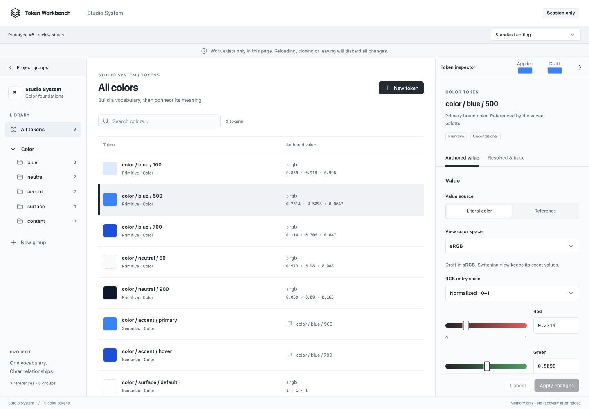
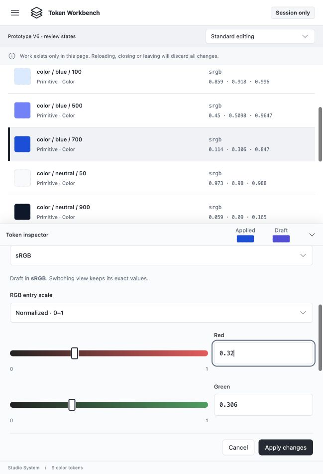

# Increment 003 — Designer proposal V6

**7 November 2026 · Focused F1–F7 bundle and option A approved for isolated prototyping; actual artifact awaits user review before analyst review.**

This revision follows the [approved focused improvement proposal](../../docs/increments/003-design-improvement-proposal.md) and [V5.2.4 design review](../../docs/increments/003-prototype-design-review.md). It preserves the accepted visual direction and earlier interactions. No application implementation, final contract/design agreement, dependency selection or analyst review is authorized.

## Review V6

From this directory, use `npm run build` then `npm run preview`; open **http://127.0.0.1:4173/**. Check for an existing preview server first. Reloading discards the temporary session. **Explore sample project** opens the editor; the Prototype V6 review-state selector continues to reset explicit fixtures under existing departure protection.

1. In **Standard editing**, scroll to component controls. A compact, noninteractive **Applied / Draft** color pair remains in the 44px inspector header. The collapse/reopen control is a separate 44px button. The large scrolling comparison card has been removed; exact applied values and preview explanations remain in the content.
2. Edit a literal, explore another color space without editing and return: exact draft values remain anchored as before. Switch Literal/Reference to inspect the active form's preview, then return to the retained independent draft. Apply, rejection and Cancel keep their existing semantics.
3. In sRGB byte mode, enter incomplete `-`: Draft becomes **Unavailable**, with the reason in the form. Try `none`, extended RGB or an unresolved reference. No stale color or fallback substitutes for unavailable preview. **Resolved & trace** shows applied-only header context.
4. Collapse/reopen at mobile width: compact feedback remains in the same full-width header row. At desktop/tablet, the existing narrow 52px collapsed rail remains icon-only; it cannot hold both labeled previews without changing its width. Expanding restores the context and retained reading position.
5. Choose **Unresolved / blocked repair**: the list shows **Missing target** and `missing-primary`, not the broken token's own path. Choose **Read failure**: creation actions are unavailable and Retry explains how to resume. **Inspect-only token** gives an inspection-only header status, without inventing a color specimen.
6. Open create or departure confirmation: its real backdrop should visibly dim the workspace. Test dismissal, focus containment and focus return. Desktop/sidebar and compact/drawer current navigation share one semantic current state.

## Changes and acceptance mapping

| Item | V6 treatment | Relevant draft criteria |
| --- | --- | --- |
| **F1 · Meaningful values** | Authored-coordinate summaries, token metadata/IDs and navigation counts use the existing stronger neutral `#5c6675`. Primary names/headings and decorative/disabled states retain their roles. | AC-1, AC-3, AC-7 |
| **F2 · Feedback in context** | Noninteractive labeled preview chips reuse the 44px header; separate collapse button. Editor owns exact drafts and publishes only derived preview/status and active-tab context to that header. No second authored color or global state library is introduced. | AC-2, AC-3, AC-5, AC-7 |
| **F3 · Missing target** | Missing references display a truthful label plus retained target ID; successful references still display their target's path. | AC-2, AC-4 |
| **F4 · Current navigation** | Active All tokens/group context uses `aria-current="true"`; inactive choices omit it. Existing native button keyboard/focus behavior remains. | AC-1, AC-7 |
| **F5 · Read failure** | New token/group/rename and form submission are unavailable during failed project read, with a visible explanation and Retry. Create/Apply handlers also refuse mutation. Editor state can remain mounted but hidden while a read is unavailable, retaining its drafts rather than replacing project data. | AC-4, AC-5 |
| **F6 · Modal distinction** | Existing Base UI create/departure backdrops are explicitly rendered even under the surrounding navigation-dialog context, using the existing neutral dimming role and higher popup layer. | AC-5, AC-7 |
| **F7 · Inspector surface** | Header, editor, inspector content, footer and sticky actions share navigation's `#fafbfc`; list/fields remain white. Existing boundary and mobile shadow remain. | AC-7 |

The stronger text color calculates approximately 5.81:1 on white, 5.18:1 on selected `#f0f2f5` and 5.61:1 on inspector `#fafbfc`; the approved proposal records the method. These are candidate-color calculations, not a complete accessibility audit. Browser computed styles still need verification.

## State and interaction details

- **Applied** always derives from the latest successfully applied token, including while editing. **Draft** follows the active Literal or Reference form; inactive form data remains retained. Header context is not a live region announcing every slider tick.
- Incomplete byte input withholds the Draft specimen even when an earlier normalized candidate exists. Missing/unsupported/unresolved previews likewise show the visible word **Unavailable**. The full message is accessible in header context and visible beside relevant form controls. No color is invented to make the header look complete.
- The resolved tab publishes applied-only context. Empty selection, unreadable project and inspect-only Number fixtures have explicit header statuses rather than previous token colors.
- Mobile collapsed headers retain their preview context. Wide/compact side-inspector rails preserve the accepted icon-only collapsed treatment; this responsive constraint does not change drafts or authorship.
- The compound header's preview context contains no interactive descendants. Only its separate button toggles expansion, with an explicit accessible name, expanded state and controlled-region relationship.
- A read failure does not authorize stale-data editing. Existing project/drafts are retained; Retry restores eligibility. The fixture selector itself intentionally loads a new review fixture, as before; it is not a real adapter failing mid-command. Already-open forms retain their fields with submission guarded if the read-unavailable state occurs.
- Local Base UI `1.9.0` backdrop types/source document `forceRender` for nested dialogs and default suppression when nested. V6 uses that existing API on create/departure backdrops rather than a new modal framework. Actual rendering and focus behavior must be observed; source alone does not prove the fix.

## Preserved behavior and limits

The following remain: 2:1 slider/field proportions with 7rem exact-field minimum; pill tracks with 40px/44px hit areas; 32px/28px compact action sizing and approved structural-control exceptions; 4px selection indicators; the adjacent Applied value badge; 28px trace-heading gap; selected-token list reveal and explicit filtered-selection action; accepted-different-token inspector reset and same-token continuation; native controls, modal drawer and independent draft protection.

The existing string-based group/identity presentation, black creation default, static identity examples, one-hop specimens and controlled failure/cycle cases remain prototype shortcuts. Read eligibility is a design illustration, not durable-storage atomicity evidence. The numerical helper is unchanged: its older binary calculations/fixed fractional formatting and near-neutral behavior do not implement the agreed production numerical bundle. Predictive gradients, new pickers, gamut mapping, persistence and interchange remain outside this pass.

## Verification and next gate

Designer checks: isolated `npm run typecheck`, `npm run build` and all **8 existing helper tests** pass; scoped Markdown links and `git diff --check` are checked. Helper tests are regression evidence for the unchanged helper, not new header-session tests or production numerical acceptance. No root production source, dependency or canonical policy was changed.

The coordinator performs live browser checks and records actual outcomes/screenshots separately. Verify ordinary/unavailable/reference/applied-only header states, read-failure affordances, real modal backdrops and focus, meaningful-value contrast, right/bottom panel surfaces, narrow header fit, selected context and previous draft/scroll semantics. Actual zoom, screen readers and real virtual keyboards remain distinct checks.

Show this identified artifact to the user before analyst review. Material changes return through the designer/user sequence. Final contract/design agreement and explicit application implementation authorization remain pending.

Suggested commit: `design: address focused workbench review findings in v6`.

## Coordinator browser verification — 7 November 2026

The frozen V6 build was checked at desktop, tablet and narrow mobile sizes, including 320×568. [Observations and limits](../../output/playwright/v6-review-2026-11-07/observations.md) record computed surfaces/contrast inputs, active-form and unavailable feedback, retained drafts, Apply/Cancel outcomes, missing-target/current-navigation semantics, read-failure recovery, rendered modal dimming and keyboard focus boundaries. The designer separately inspected saved screenshots01–12; no visual defect was found in those samples. This is scoped prototype verification, not analyst or independent application review.

